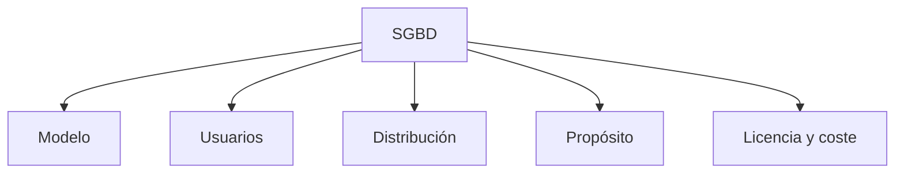

<!-- _class: portada -->
<!-- _paginate: false -->
<!-- _header: "" -->
<!-- _footer: "" -->

# Bases de Datos
## Modelos de bases de datos y arquitectura de los sistemas de bases de datos

1º Desarrollo de Aplicaciones Web (DAW) · Unidad Didáctica 1

---

# Índice de contenidos

<div class="columnas">
<div>

1. Introducción: ¿cómo organizamos los datos?
2. Modelo jerárquico
3. Modelo en red
4. Modelo relacional
5. Comparativa de modelos

</div>
<div>

6. Arquitectura de los sitemas de datos
7. Clasificar SGBD
8. Consolidación y autoevaluación
9. Recursos

</div>
</div>

<!--
Nota para el docente: la presentación tiene dos bloques bien diferenciados.
Bloque A (apartados 2-5): CÓMO SE ORGANIZAN LOS DATOS (modelo lógico).
Bloque B (apartados 6-8): DÓNDE Y CÓMO SE DESPLIEGA el SGBD (arquitectura física/de red).
Conviene explicitar esta separación al alumnado desde el principio para que no mezclen "modelo" con "arquitectura".
-->

---

<!-- _class: seccion -->

# 1. Introducción
## ¿Cómo organizamos los datos?

---

# Cuestión inicial

> Imagina que tienes que organizar:
> - **Una biblioteca** con miles de libros.
> - **Una empresa** con empleados y departamentos.
> - **Una tienda online** con productos y clientes.
>
> **¿Cómo estructurarías esta información?**


<!--
Pista para el docente: tras la actividad, pedir a 2-3 parejas que muestren su dibujo.
Normalmente aparecen árboles (empresa → departamentos → empleados) y tablas (tienda online).
Usar esos dibujos como puente: "acabáis de inventar, sin saberlo, el modelo jerárquico y el relacional".
-->

---

# Concepto clave y evolución histórica

> **Modelo de base de datos:** define la forma en que los datos se **estructuran**, **organizan** y **relacionan** entre sí dentro de un sistema.

| Década | 1960 | 1970 | 1980 | 2000 |
|---|---|---|---|---|
| **Modelo** | Jerárquico | En red | Relacional | Orientado a objetos |

> **Pregunta conectora:** ¿por qué crees que han evolucionado los modelos de datos?

<div class="nota">

**Nota didáctica:** las fechas indican cuándo cada modelo se **popularizó**. El modelo relacional se propuso en 1970, pero su uso comercial se extendió en los 80. A partir de los 2000 también surgen las bases de datos **NoSQL** (documentales, clave-valor, de grafos), que estudiaréis más adelante.

</div>

---

<!-- _class: seccion -->

# 2. Modelo jerárquico

---

# Características principales

> **Organiza los datos en forma de árbol:**
> - Cada nodo **padre** puede tener varios **hijos**.
> - Cada hijo **solo tiene un padre**.
> - Representa relaciones **1:N (uno a muchos)**.

```
                    EMPRESA
                       │
          ┌────────────┴────────────┐
          │                         │
       Ventas                  Informática
          │                         │
     ┌────┴────┐               ┌────┴────┐
     │         │               │         │
    Ana       Luis           Marta      Juan
```

---

# Actividad: construye tu árbol

**Escenario:** el sistema de archivos de tu ordenador.

**Tareas:**
1. Dibuja la estructura desde `C:\` hasta un archivo concreto.
2. Identifica las relaciones padre-hijo.
3. ¿Puede un archivo estar en dos carpetas a la vez?

<div class="nota">

**Nota didáctica:** la pregunta 3 es la clave del tema. En un árbol puro, **no**: cada archivo tiene una única carpeta padre. Los accesos directos (Windows) o enlaces (Linux) son precisamente un "parche" para saltarse esa limitación, igual que el modelo en red lo hizo con el jerárquico.

</div>

---

# Ejemplo real: sistema de nóminas

**Contexto:** empresa con varios departamentos.

```
                          Empresa XYZ
                               │
        ┌──────────────────────┼──────────────────────┐
        │                      │                      │
   Dpto. Ventas            Dpto. IT          Dpto. Contabilidad
        │                      │                      │
   ┌────┴─────┐          ┌─────┴─────┐                │
   │          │          │           │                │
Ana García  Luis Pérez  Marta López  Juan Ruiz   Carmen Torres
 2.500 €     2.800 €     3.200 €     3.000 €       2.700 €
```

<!--
Pregunta para lanzar en clase: "¿Cómo obtendrías el salario de Marta López?"
Respuesta: hay que recorrer el árbol desde la raíz: Empresa → Dpto. IT → Marta López.
Esto ilustra que el acceso en el modelo jerárquico es por CAMINOS PREDEFINIDOS: rápido si la consulta sigue el árbol, costoso si no (p. ej., "todos los empleados que cobran más de 2.800 €").
-->

---

# Ventajas y desventajas del modelo jerárquico

<div class="pequeno">

| Ventaja | Descripción | Ejemplo |
|---|---|---|
| **Simplicidad** | Estructura fácil de entender | Árbol de carpetas |
| **Velocidad** | Accesos predefinidos muy rápidos | Búsqueda por departamento |
| **Eficiencia** | Ideal para relaciones 1:N | Padre → hijos |

| Desventaja | Descripción | Ejemplo |
|---|---|---|
| **Rigidez** | Un hijo solo puede tener un padre | Un empleado no puede estar en 2 departamentos |
| **Limitaciones** | No representa relaciones N:M | Proyectos con varios empleados |
| **Mantenimiento** | Cambios estructurales complicados | Reorganizar departamentos |

</div>

---

<!-- _class: seccion -->

# 3. Modelo en red

---

# Características principales

> **Evolución del modelo jerárquico:**
> - Un nodo **puede tener varios padres**.
> - Permite relaciones **N:M (muchos a muchos)**.
> - La información se guarda en **registros (nodos)** conectados mediante **enlaces**.

```
   Ana ─────────► Pedido 101 ◄───────── Luis
    │               │     │              │
    ▼               ▼     ▼              ▼
Pedido 102    Auriculares Móvil      Pedido 103
    │               ▲       ▲          │     │
    └───────────────┘       └──────────┘     ▼
                                         Portátil
```

<div class="nota">

**Nota didáctica:** fíjate en que *Pedido 101* recibe flechas de **dos clientes** y *Auriculares* de **dos pedidos**: eso es tener varios padres, algo imposible en el modelo jerárquico.

</div>

---

# Relaciones del ejemplo anterior

Para leer el diagrama con más claridad, estas son las conexiones que representa:

<div class="columnas">
<div>

**Clientes → Pedidos**

| Cliente | Pedidos |
|---|---|
| Ana | 101, 102 |
| Luis | 101, 103 |

</div>
<div>

**Pedidos → Productos**

| Pedido | Productos |
|---|---|
| 101 | Auriculares, Móvil |
| 102 | Auriculares |
| 103 | Móvil, Portátil |

</div>
</div>

<div class="nota">

**Nota didáctica:** en el original un mismo pedido (101) pertenece a dos clientes; sirve para ilustrar los "varios padres", aunque en una tienda real cada pedido tendría un único cliente.

</div>

---

# Actividad: red de relaciones

**Escenario:** una universidad con estudiantes y asignaturas.

| Estudiante | Asignaturas |
|---|---|
| **Ana** | Matemáticas, Programación, Inglés |
| **Luis** | Matemáticas, Historia, Inglés |
| **Marta** | Programación, Historia, Arte |

**Tareas:**
1. Dibuja la red de relaciones.
2. Identifica qué estudiantes comparten asignaturas.
3. ¿Cuántos "padres" tiene cada estudiante?

<!--
Soluciones:
2) Ana-Luis: Matemáticas e Inglés · Ana-Marta: Programación · Luis-Marta: Historia.
3) Depende de la dirección de las flechas. Si la asignatura es el "padre", cada estudiante tiene 3 padres. Y cada asignatura puede tener varios estudiantes: relación N:M.
Aprovechar para subrayar que la pregunta 3 no tiene sentido en el modelo jerárquico (solo habría 1 padre).
-->

---

# Ejemplo real: sistema de pedidos

**Contexto:** plataforma de comercio electrónico.

| Entidad | Relaciones |
|---|---|
| **Clientes** | Pueden realizar múltiples pedidos |
| **Pedidos** | Pertenecen a un cliente y contienen múltiples productos |
| **Productos** | Pueden aparecer en múltiples pedidos |

**Ventaja clave:** un producto puede aparecer en muchos pedidos simultáneamente.

---

# Ventajas y desventajas del modelo en red

<div class="pequeno">

| Ventaja | Descripción | Ejemplo |
|---|---|---|
| **Flexibilidad** | Permite relaciones complejas | Estudiante-Asignatura |
| **Realismo** | Refleja mejor el mundo real | Productos en múltiples pedidos |
| **Conectividad** | Enlaces múltiples entre registros | Red social de amistades |

| Desventaja | Descripción | Impacto |
|---|---|---|
| **Complejidad** | Diseño y mantenimiento difíciles | Programadores especializados |
| **Enlaces manuales** | Hay que gestionar punteros | Propenso a errores |
| **Sobrecarga** (*overhead*) | Gestión de múltiples relaciones | Mayor uso de recursos |

</div>

<div class="nota">

**Nota didáctica:** un **puntero** es una referencia a la posición física de otro registro. Si el registro se mueve, el puntero queda "roto". Este es el principal motivo por el que el modelo en red se abandonó en favor del relacional.

</div>

---

# Pregunta de reflexión

> En una red social como Instagram, ¿cómo representarías que…
> - un usuario puede **seguir** a muchos otros,
> - un usuario puede **ser seguido** por muchos otros,
> - una publicación puede recibir **likes** de múltiples usuarios?

<!--
Respuesta orientativa:
- Seguir/ser seguido es una relación N:M de USUARIO consigo mismo (relación reflexiva).
- Like es una relación N:M entre USUARIO y PUBLICACIÓN.
En el modelo en red se resolvería con enlaces entre registros. En el relacional (siguiente apartado) se resuelve con tablas intermedias: SEGUIDORES(id_seguidor, id_seguido) y LIKES(id_usuario, id_publicacion).
Dejarlo planteado como "cliffhanger" y retomarlo tras ver la tabla VALORACIONES.
-->

---

<!-- _class: seccion -->

# 4. Modelo relacional

---

# Características principales

> **El modelo más utilizado en la actualidad:**
> - Propuesto por **E. F. Codd en 1970**.
> - La información se organiza en **tablas**.
> - Filas = **tuplas / registros** · Columnas = **atributos / campos**.
> - Las relaciones se establecen mediante **claves externas** (ajenas).

<div class="nota">

**Nota didáctica:** la gran diferencia con los modelos anteriores es que **no hay punteros físicos**. Dos tablas se relacionan porque comparten un **valor** (por ejemplo, el mismo `ID_CLIENTE`). Eso hace que la estructura física pueda cambiar sin romper las relaciones.

</div>

---

# Ejemplo: tienda online (I)

**Tabla CLIENTES**

| ID_CLIENTE | NOMBRE | CIUDAD | EMAIL |
|---|---|---|---|
| 1 | Ana García | Sevilla | ana@email.com |
| 2 | Luis Pérez | Cádiz | luis@email.com |
| 3 | Marta López | Madrid | marta@email.com |

**Tabla PEDIDOS**

| ID_PEDIDO | ID_CLIENTE | FECHA | TOTAL |
|---|---|---|---|
| 101 | 1 | 2025-01-12 | 250,50 € |
| 102 | 2 | 2025-02-01 | 89,99 € |
| 103 | 1 | 2025-02-15 | 125,00 € |

---

# Ejemplo: tienda online (II)

**Tabla PRODUCTOS**

| ID_PRODUCTO | NOMBRE | PRECIO | CATEGORÍA |
|---|---|---|---|
| P001 | iPhone 15 | 899,99 € | Móviles |
| P002 | MacBook Air | 1.299,99 € | Portátiles |
| P003 | AirPods Pro | 249,99 € | Accesorios |

<div class="nota">

**Nota didáctica:** con estas tres tablas **no podemos saber qué productos contiene cada pedido**, porque PEDIDOS y PRODUCTOS no están conectadas. Como es una relación N:M, haría falta una cuarta tabla intermedia, por ejemplo `DETALLE_PEDIDO(ID_PEDIDO, ID_PRODUCTO, CANTIDAD)`. Lo veréis en detalle en el modelo Entidad-Relación.

</div>

---

# Actividad: constructor de consultas

Responde utilizando las tablas anteriores:

1. ¿Qué clientes viven en Sevilla?
2. ¿Cuántos pedidos ha realizado Ana García?
3. ¿Cuál es el pedido más caro?
4. ¿Qué productos cuestan menos de 300 €?

<div class="nota">

**Nota didáctica:** para la pregunta 2 tendrás que **cruzar dos tablas**: buscar el `ID_CLIENTE` de Ana en CLIENTES y después contar cuántas veces aparece en PEDIDOS. Esta operación de cruce es lo que en SQL se llama **JOIN**.

</div>

---

# Actividad: soluciones

| Pregunta | Respuesta |
|---|---|
| 1. Clientes de Sevilla | Ana García |
| 2. Pedidos de Ana García | 2 pedidos (101 y 103) |
| 3. Pedido más caro | Pedido 101 (250,50 €) |
| 4. Productos de menos de 300 € | AirPods Pro (249,99 €) |

<!--
Se han separado las soluciones en una diapositiva propia para que el alumnado piense antes de verlas.
Opcional: mostrar cómo sería la pregunta 1 en SQL (anticipo de la UD de SQL):
  SELECT NOMBRE FROM CLIENTES WHERE CIUDAD = 'Sevilla';
-->

---

# Conceptos clave: claves primaria y externa

<div class="columnas">
<div>

### Clave primaria (*Primary Key*)
> **Identifica de forma única** cada registro.

```
ID_CLIENTE   (en CLIENTES)
ID_PEDIDO    (en PEDIDOS)
ID_PRODUCTO  (en PRODUCTOS)
```

</div>
<div>

### Clave externa (*Foreign Key*)
> **Conecta las tablas** entre sí.

```
ID_CLIENTE en la tabla PEDIDOS
        ↓
hace referencia a
ID_CLIENTE en la tabla CLIENTES
```

</div>
</div>

<div class="nota">

**Nota didáctica:** la clave primaria **no puede repetirse ni estar vacía**. La clave externa **sí puede repetirse** (Ana tiene dos pedidos, por eso el valor `1` aparece dos veces en PEDIDOS), pero siempre debe existir en la tabla a la que apunta.

</div>

---

# Ejemplo ampliado: plataforma de streaming

<div class="columnas pequeno">
<div>

**Tabla PELÍCULAS**

| ID_PELICULA | TÍTULO | GÉNERO | AÑO |
|---|---|---|---|
| M001 | Matrix | Ciencia ficción | 1999 |
| M002 | Titanic | Romance | 1997 |

**Tabla USUARIOS**

| ID_USUARIO | NOMBRE | PLAN | FECHA_REGISTRO |
|---|---|---|---|
| U001 | Ana | Premium | 2023-01-15 |
| U002 | Luis | Básico | 2023-03-20 |

</div>
<div>

**Tabla VALORACIONES**

| ID_USUARIO | ID_PELICULA | PUNTUACIÓN | FECHA |
|---|---|---|---|
| U001 | M001 | 5 | 2024-02-10 |
| U001 | M002 | 4 | 2024-02-15 |
| U002 | M001 | 3 | 2024-03-01 |

<div class="nota">

**Nota didáctica:** VALORACIONES es una **tabla intermedia** que resuelve la relación N:M entre usuarios y películas. Su clave primaria es **compuesta**: (`ID_USUARIO`, `ID_PELICULA`). Así un usuario solo puede valorar una vez cada película.

</div>

</div>
</div>

---

# Ventajas y desventajas del modelo relacional

<div class="pequeno">

| Ventaja | Descripción | Ejemplo |
|---|---|---|
| **Independencia** | Niveles lógico y físico separados | Cambiar la estructura sin afectar a las aplicaciones |
| **SQL** | Lenguaje estándar universal | `SELECT`, `INSERT`, `UPDATE`, `DELETE` |
| **Integridad** | Reglas automáticas de consistencia | Claves primarias únicas |
| **Simplicidad** | Fácil de entender y usar | Tablas similares a hojas de cálculo |
| **Flexibilidad** | Permite consultas complejas | `JOIN` entre múltiples tablas |

| Desventaja | Descripción | Cuándo ocurre |
|---|---|---|
| **Complejidad** | Muchas tablas y relaciones | Sistemas muy grandes |
| **Rendimiento** | Los `JOIN` pueden ser costosos | Consultas complejas |
| **Planificación** | Requiere un diseño cuidadoso | Antes de implementar |

</div>

---

# Actividad práctica: diseña tu plataforma de streaming

**Escenario:** crear una plataforma de música similar a Spotify.

<div class="columnas">
<div>

**Entidades necesarias:**
- Usuarios
- Canciones
- Artistas
- Álbumes
- Playlists

</div>
<div>

**Tareas:**
1. Diseña las tablas con sus campos.
2. Identifica claves primarias y externas.
3. Define las relaciones entre tablas.
4. Escribe 3 consultas de ejemplo.

</div>
</div>

<div class="nota">

**Pista:** pregúntate en cada pareja de entidades "¿uno o muchos?". Por ejemplo, una playlist tiene muchas canciones y una canción puede estar en muchas playlists → N:M → necesitarás una tabla intermedia, como en VALORACIONES.

</div>

---

<!-- _class: seccion -->

# 5. Comparativa de modelos

---

# Tabla comparativa

| Característica | Jerárquico | En red | Relacional |
|---|---|---|---|
| **Estructura** | Árbol | Grafo | Tablas |
| **Relaciones** | 1:N | N:M | N:M |
| **Flexibilidad** | Baja | Media | Alta |
| **Facilidad de uso** | Media | Baja | Alta |
| **Lenguaje / acceso** | Punteros | Enlaces | SQL |
| **Velocidad** | Alta | Media | Media |
| **Coste de desarrollo** | Bajo | Alto | Medio |
| **Época de uso** | Años 60 | Años 70 | Años 70 - actualidad |

<div class="nota">

**Nota didáctica:** "grafo" es el término matemático para una red de nodos y enlaces (en el original aparecía como "gráfico"). El relacional representa N:M **de forma indirecta**, mediante tablas intermedias.

</div>

---

# Actividad: elige tu modelo

Para cada escenario, **justifica** qué modelo utilizarías:

<div class="tres pequeno">
<div>

**Escenario 1: sistema de archivos del SO**
- **Estructura:** carpetas y subcarpetas.
- **Relaciones:** una carpeta padre, múltiples hijos.
- **Accesos:** navegación por rutas.

</div>
<div>

**Escenario 2: red social profesional (LinkedIn)**
- **Estructura:** usuarios, empresas, habilidades, contactos.
- **Relaciones:** un usuario puede trabajar en varias empresas y tener múltiples habilidades.
- **Accesos:** búsquedas complejas, recomendaciones.

</div>
<div>

**Escenario 3: reservas de vuelos**
- **Estructura:** vuelos, pasajeros, asientos, rutas.
- **Relaciones:** un vuelo tiene muchos pasajeros y un pasajero puede tener muchos vuelos.
- **Accesos:** consultas en tiempo real, alta concurrencia.

</div>
</div>

---

# Actividad: respuestas esperadas

| Escenario | Modelo | Justificación |
|---|---|---|
| **1. Sistema de archivos** | Jerárquico | Estructura natural de árbol |
| **2. Red social profesional** | Relacional | Flexibilidad para consultas complejas |
| **3. Reservas de vuelos** | Relacional | SQL para consultas complejas |

<div class="nota">

**Nota didáctica:** en los escenarios 2 y 3 hay relaciones N:M, lo que descarta el modelo jerárquico. Entre red y relacional, se elige el relacional por su facilidad de uso, el estándar SQL y la gestión de la concurrencia.

</div>

---

# Casos de uso reales

<div class="columnas">
<div>

### Modelos jerárquicos actuales
- **Sistemas de archivos:** Windows, macOS, Linux.
- **Organigramas empresariales:** estructura de mando.
- **XML / JSON:** estructuras de datos anidadas.
- **Clasificaciones:** taxonomías, categorías.

</div>
<div>

### Modelos relacionales dominantes
- **Sistemas bancarios:** MySQL, PostgreSQL, Oracle.
- **Comercio electrónico:** Amazon, eBay, Shopify.
- **Sistemas educativos:** Moodle, universidades.
- **Gestión hospitalaria:** historiales médicos.

</div>
</div>

<div class="nota">

**Nota didáctica:** XML y JSON no son bases de datos, sino **formatos** con estructura jerárquica. Como futuros desarrolladores web los usaréis constantemente (por ejemplo, en las respuestas de una API).

</div>

---

<!-- _class: seccion -->

# 6. Arquitectura de los sistemas de bases de datos

Capas, máquinas y ubicación de los datos

---

## Un sistema se describe con cuatro preguntas

| # | Pregunta | Qué describe |
|:---:|---|---|
| ① | ¿Quién accede? | Número de usuarios |
| ② | ¿Cómo se organiza el software? | Vista **lógica**: capas |
| ③ | ¿Dónde se ejecuta cada capa? | Vista **física**: máquinas |
| ④ | ¿Dónde están los datos? | Ubicación de los datos |

> Son preguntas **independientes**: cada una se responde por separado y luego se combinan.

**Ejemplo para toda la presentación:** la aplicación de la biblioteca del instituto.

---

## 1 - ¿Quién accede?

| | Monousuario | Multiusuario |
|---|---|---|
| Usuarios a la vez | Uno | Varios |
| Control de concurrencia | No es necesario | Imprescindible |
| Ejemplos | Access en un PC, SQLite en un móvil | PostgreSQL, MySQL, Oracle |
| En la biblioteca | Un único PC con el programa | Varias bibliotecarias a la vez |

---


## 2 - ¿Cómo se organiza el software?

La aplicación se divide en **tres capas lógicas**, según su responsabilidad:

| Capa | Responsabilidad | En la biblioteca |
|---|---|---|
| 🟦 **Presentación** | Lo que ve y usa el usuario | Pantalla para registrar un préstamo |
| 🟪 **Lógica de negocio** | Reglas y procesos | "Máximo 3 libros por alumno" |
| 🟩 **Datos** | Guardar y recuperar la información | SGBD + base de datos |

> Esto habla de **responsabilidades del código**, no de máquinas.
> Estas tres capas existen **siempre**, en cualquier aplicación con base de datos.

---


## 3 - ¿Dónde se ejecuta cada capa?

Ahora tomamos las **mismas tres capas** y las colocamos en máquinas.

🟦 Presentación · 🟪 Lógica de negocio · 🟩 Datos

Las capas **no cambian**. Lo que cambia es **cuántas máquinas hay** y **qué capa va en cada una**.

Tres formas habituales:

1. Mono-equipo
2. Cliente-servidor
3. Con servidor de aplicaciones

---

## Mono-equipo

| 💻 Equipo único |
|:---:|
| 🟦 Presentación |
| 🟪 Lógica de negocio |
| 🟩 Datos |

- Las tres capas en **la misma máquina**
- Normalmente monousuario
- Biblioteca: un único PC con el programa y la base de datos

---

## Cliente-servidor (dos niveles)

| 💻 Cliente | 🖥️ Servidor de BD |
|:---:|:---:|
| 🟦 Presentación | |
| 🟪 Lógica de negocio | |
| | 🟩 Datos |

- Los **datos se separan** en un servidor
- Presentación y lógica en cada cliente → **cliente pesado**
- Biblioteca: cada PC tiene el programa instalado y se conecta a PostgreSQL

---

## Con servidor de aplicaciones (tres niveles)

| 💻 Cliente | ⚙️ Servidor de aplicaciones | 🖥️ Servidor de BD |
|:---:|:---:|:---:|
| 🟦 Presentación | | |
| | 🟪 Lógica de negocio | |
| | | 🟩 Datos |

- **Cada capa en su propia máquina**
- El cliente suele ser solo un navegador → **cliente ligero**
- Biblioteca: la bibliotecaria usa una web; las reglas viven en el servidor intermedio

---

## Clave: capas ≠ niveles

| Arquitectura | 🟦 Presentación | 🟪 Lógica | 🟩 Datos |
|---|---|---|---|
| Mono-equipo | Equipo único | Equipo único | Equipo único |
| Cliente-servidor | Cliente | Cliente | Servidor de BD |
| Servidor de aplicaciones | Cliente | Servidor de apps | Servidor de BD |

- **Capa** (*layer*) → organización **lógica** del software
- **Nivel** (*tier*) → máquina **física** donde se ejecuta

> Con servidor de aplicaciones, capas y niveles coinciden uno a uno.
> Por eso se confunden, pero **no son lo mismo**.

---

## 4 - ¿Dónde están los datos?

| | Centralizada | Distribuida |
|---|---|---|
| Ubicación | Un único sitio | Repartidos en varios nodos en red |
| Para el usuario | Una base de datos | Una base de datos (aunque esté repartida) |
| Ventaja | Sencilla de administrar | Disponibilidad, datos cerca de su uso |
| Inconveniente | Punto único de fallo | Coordinación compleja |

---

## Base de datos distribuida

| 💻 Cliente | ⚙️ Servidor de aplicaciones | 🖥️ Nodo A | 🖥️ Nodo B |
|:---:|:---:|:---:|:---:|
| 🟦 Presentación | | | |
| | 🟪 Lógica de negocio | | |
| | | 🟩 Datos (parte A) | 🟩 Datos (parte B) |

Ahora se reparte **la propia capa de datos**.

- **Homogénea**: todos los nodos usan el mismo SGBD
- **Heterogénea**: los nodos usan SGBD distintos

---

## Una progresión: cada vez se reparte más

| Arquitectura | Qué se reparte | Ubicación de los datos |
|---|---|---|
| Mono-equipo | Nada | Centralizada |
| Cliente-servidor | Los datos se separan del resto | Centralizada |
| Servidor de aplicaciones | Cada capa en su máquina | Centralizada |
| Distribuida | **La capa de datos entre varios nodos** | Distribuida |

> Las tres arquitecturas de la pregunta 3 son **centralizadas**: los datos siguen en un solo sitio.

---

## Ejemplo integrador: la biblioteca

La **misma aplicación**, desplegada de tres formas:

| Pregunta | Un único PC | Programa en cada PC | Aplicación web |
|---|---|---|---|
| 1 - ¿Quién accede? | Monousuario | Multiusuario | Multiusuario |
| 2 - ¿Software? | 3 capas | 3 capas | 3 capas |
| 3 - ¿Ejecución? | Mono-equipo | Cliente-servidor | Servidor de aplicaciones |
| 4 - ¿Datos? | Centralizada | Centralizada | Centralizada |

> La **fila 2** no cambia nunca: el software es el mismo, solo cambia dónde se coloca.

---

## Ejercicio: clasifica cada caso

**A.** Una app de notas en el móvil que guarda todo en SQLite.

**B.** Una gestoría con un programa de facturación instalado en cada PC, conectado a un servidor de la oficina.

**C.** La banca online de un banco, con todos sus datos en un único centro de datos.

**D.** Una cadena de tiendas en la que cada tienda tiene su propio servidor MySQL, y la central consulta todos como si fueran uno.

---

## Soluciones

| Caso | 1 - Quién accede | 3 - Ejecución | 4 - Datos |
|---|---|---|---|
| **A.** App de notas | Monousuario | Mono-equipo | Centralizada |
| **B.** Gestoría | Multiusuario | Cliente-servidor | Centralizada |
| **C.** Banca online | Multiusuario | Servidor de aplicaciones | Centralizada |
| **D.** Cadena de tiendas | Multiusuario | Cliente-servidor en cada tienda | Distribuida homogénea |

---

# Evolución a la nube: microservicios

```
       App móvil ─────┐                 ┌──► Microservicio Auth ───────► BD Usuarios
                      │                 │
                      ├──► API Gateway ─┼──► Microservicio Productos ──► BD Productos
                      │                 │
       Web app ───────┘                 ├──► Microservicio Pagos ──────► BD Transacciones
                                        │
                                        └──► Microservicio Analytics ──► BD Analytics
```

<div class="nota">

**Nota didáctica:** cada **microservicio** es una pequeña aplicación independiente con su propia base de datos. El **API Gateway** es la "puerta de entrada" única que recibe las peticiones de los clientes y las reparte al microservicio adecuado.

</div>

---

# Características *cloud native*

| Característica | Descripción | Ejemplos |
|---|---|---|
| **Contenedores** | Empaquetan una aplicación con todo lo que necesita | Docker, Kubernetes |
| **Serverless** | Se ejecuta código sin gestionar servidores | AWS Lambda, Azure Functions |
| **Base de datos como servicio** | El proveedor gestiona la BD | Amazon RDS, Azure Cosmos DB |
| **Autoescalado** | Los recursos se ajustan automáticamente a la demanda | Más instancias en horas punta |

<!--
La columna "Descripción" se ha añadido para aclarar cada término, ya que en 1º DAW suelen ser conceptos nuevos.
No es necesario profundizar: basta con que les "suenen" y sepan que son la evolución natural de la arquitectura multicapa.
-->
---

<!-- _class: seccion -->

# 7. Clasificar SGBD

## ¿Una clasificación basta para describir un gestor?

Modelo, usuarios, distribución, propósito y licencia son dimensiones combinables.

---

<!-- content: UD01-C06 -->
# Clasificar un SGBD



| Criterio | Categorías y ejemplos |
|---|---|
| Modelo | relacional, jeráquico, en red |
| Usuarios | monousuario, multiusuario |
| Distribución | centralizado, distribuido |
| Propósito | generalista, embebido/específico |
| Licencia | propietario/comercial, Open Source |

Un producto puede ser simultáneamente multiusuario, relacional, distribuido y comercial.

---

# C06 · Ejemplos y licencia

- **SQLite:** relacional, embebido, sin servidor separado; útil en móvil o aplicaciones locales.
- **PostgreSQL, MySQL y MariaDB:** relacionales multiusuario de código abierto, con costes posibles de operación y soporte.
- Un producto propietario puede incluir soporte oficial y funciones empresariales, pero exige revisar licencia, escalabilidad y coste total.

| “Libre” significa… | No significa necesariamente… |
|---|---|
| derechos definidos por una licencia abierta | coste operativo cero |
| posibilidad de estudiar o modificar según licencia | ausencia de soporte profesional |
| comunidad y ecosistema | que todos los productos sean equivalentes |

---

#  Actividad · Ficha de clasificación

Clasifica una solución que usa SQLite en el móvil y PostgreSQL en el servidor:

- ¿Es monousuario o multiusuario cada componente?
- ¿Es embebido o generalista?
- ¿Puede el sistema completo ser híbrido?

**Punto de debate:** las clasificaciones describen dimensiones diferentes. SQLite no deja de ser relacional por ser embebido; PostgreSQL no deja de ser Open Source por admitir soporte comercial.

---


<!-- _class: seccion -->

# 8. Actividades de consolidación

---

# Actividad integradora: elige el modelo y la arquitectura

Para cada escenario, decide: **1)** modelo de datos (jerárquico, red o relacional), **2)** arquitectura y **3)** justifica la combinación.

<div class="tres pequeno">
<div>

**Biblioteca digital**
- **Entidades:** libros, usuarios, préstamos, autores, categorías.
- **Usuarios:** 500 estudiantes concurrentes.
- **Acceso:** local y remoto.

</div>
<div>

**Videojuego multijugador**
- **Entidades:** jugadores, partidas, rankings, objetos, clanes.
- **Usuarios:** 100.000 jugadores en todo el mundo.
- **Requisitos:** tiempo real, alta disponibilidad.

</div>
<div>

**Tienda de barrio**
- **Entidades:** productos, ventas, clientes, proveedores.
- **Usuarios:** 2 empleados.
- **Requisitos:** sencillo, económico y fiable.

</div>
</div>

---

# Autoevaluación (I)

### Nivel básico
1. ¿Cuáles son las principales características del modelo jerárquico?
2. ¿Qué elementos componen una tabla en el modelo relacional?
3. ¿Cuál es la diferencia entre cliente y servidor en una arquitectura cliente-servidor?

### Nivel intermedio
4. Compara las ventajas y desventajas de los tres modelos de datos.
5. ¿Cuándo recomendarías utilizar una arquitectura distribuida?
6. ¿Qué ventajas ofrece la arquitectura multicapa frente a la cliente-servidor tradicional?

---

# Autoevaluación (II)

### Nivel avanzado
7. Diseña un sistema de gestión hospitalaria especificando el modelo de datos y la arquitectura.
8. ¿Cómo evolucionaría tu diseño si el sistema tuviera que dar servicio a 100 hospitales?
9. Analiza por qué el modelo relacional se ha impuesto a los demás modelos.

---

<!-- _class: seccion -->

# 9. Recursos 

---

# Recursos adicionales

<div class="columnas pequeno">
<div>

### Lecturas recomendadas
- *Database System Concepts* – Silberschatz, Korth, Sudarshan
- *Designing Data-Intensive Applications* – Martin Kleppmann
- *Clean Architecture* – Robert C. Martin

### Vídeos educativos
- "Database Design Course" – FreeCodeCamp
- "Microservices Explained" – TechWorld with Nana
- "SQL vs NoSQL" – Hussein Nasser

</div>
<div>

### Herramientas prácticas
- **Diseño:** draw.io, Lucidchart
- **Bases de datos:** MySQL Workbench, pgAdmin
- **Nube:** AWS RDS, Google Cloud SQL
- **Modelado:** ERD Plus, dbdiagram.io

### Sitios web de referencia
- Database Design Principles – Microsoft Docs
- AWS Architecture Center
- High Scalability – casos reales

</div>
</div>

<!--
Corrección: el original atribuye "Database System Concepts" a "Silberschatz, Galvin, Gagne", que son los autores de "Operating System Concepts". Los autores de "Database System Concepts" son Silberschatz, Korth y Sudarshan.
-->

---

# Próximas unidades

| Unidad | Contenido |
|---|---|
| **UD2** | Modelo Entidad-Relación en profundidad |
| **UD3** | Normalización de bases de datos |
| **UD4** | SQL: lenguaje de consulta estructurado |

---

<!-- _class: portada -->
<!-- _paginate: false -->
<!-- _header: "" -->
<!-- _footer: "" -->

# Fin de la presentación

Modelos de bases de datos y arquitectura de los sistemas de bases de datos
Bases de Datos · 1º DAW

