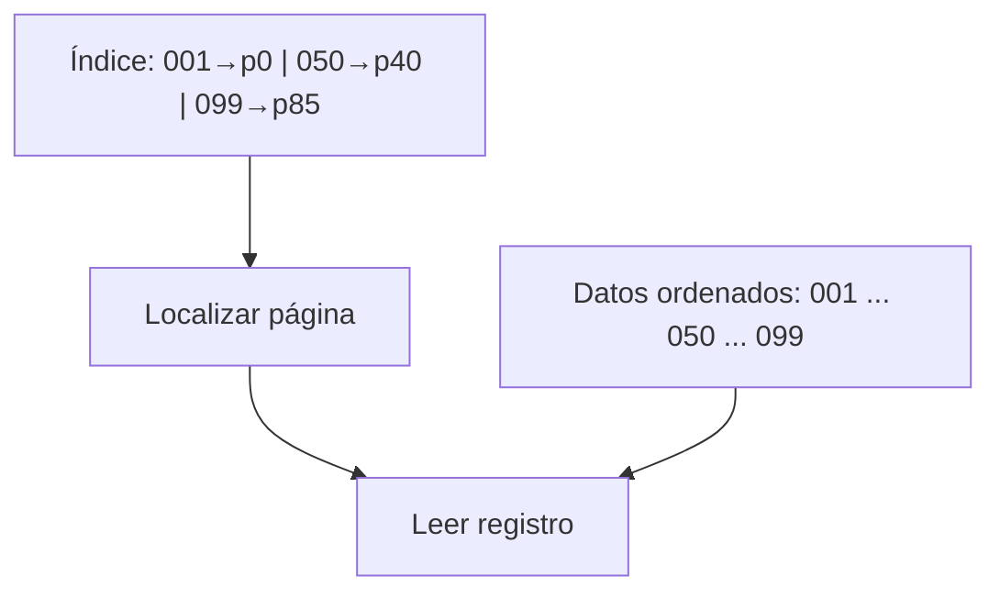
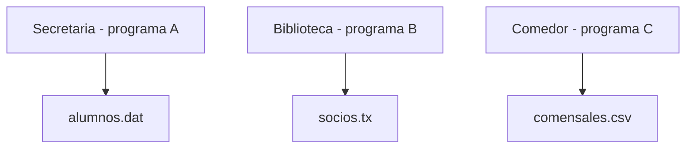

<!-- _class: portada -->
<!-- _paginate: false -->
<!-- _header: "" -->
<!-- _footer: "" -->

# Bases de Datos
## Unidad Didáctica 1: Conceptos básicos

1º Desarrollo de Aplicaciones Web (DAW)


---

# Índice de contenidos

1. Introducción
2. La información y su almacenamiento
3. Sistemas gestores de ficheros
4. Sistemas gestores de bases de datos
5. Arquitectura de una base de datos
6. Componentes de un SGBD
7. Actividades de consolidación y autoevaluación
8. Recursos adicionales y resumen

---

<!-- _class: seccion -->

# 1. Introducción

---

# Cuestiones iniciales

Antes de comenzar, reflexiona sobre las siguientes preguntas:

- ¿Qué entiendes por **base de datos**?
- ¿Conoces algún **Sistema Gestor de Bases de Datos**?
- ¿Has trabajado con bases de datos o has oído hablar de ellas?
- ¿Consideras importante aprender a trabajar con bases de datos?

---

# Actividad: lluvia de ideas

**Organización:** equipos de 3-4 personas · **Duración:** 5 minutos

1. Enumerad ejemplos de **sistemas que utilicen bases de datos** en vuestra vida diaria.
2. Identificad los **problemas** que podrían surgir si no existieran.

**Ejemplos de respuesta:**

| Sistema | Información que gestiona |
|---|---|
| Cajeros automáticos | Datos bancarios |
| Tiendas online | Productos, clientes, pedidos |
| Videojuegos | Puntuaciones, perfiles |
| Redes sociales | Usuarios, publicaciones |

---

<!-- _class: seccion -->

# 2. La información y su almacenamiento

---

# Concepto clave y tipos de información

> **Informática:** ciencia que estudia el **tratamiento automático y racional** de la información.

| Tipo | Descripción | Ejemplo |
|---|---|---|
| **Volátil** | Se procesa y se desecha | Cálculo temporal |
| **Persistente** | Se almacena para un uso futuro | Datos de clientes |

### Evolución del almacenamiento

**Tarjetas de papel** → **Ficheros digitales** → **Bases de datos**

---

# Simulación: el archivo de la empresa

**Escenario:** una empresa de los años 80.

- Miles de tarjetas de cartón con datos de clientes.
- Archivadores organizados alfabéticamente.
- Varios empleados buscando información de forma simultánea.

> **Pregunta de reflexión:** ¿qué **ventajas** e **inconvenientes** tendría este sistema?

<div class="columnas">
<div>

**Ventajas**
- Sencillo
- No requiere tecnología
- Visual

</div>
<div>

**Inconvenientes**
- Lento
- Propenso a errores
- Difícil de compartir

</div>
</div>

---

<!-- _class: seccion -->

# 3. Sistemas gestores de ficheros


---
# Ficheros: estructura básica

> **Fichero:** colección de registros, normalmente de estructura homogénea, almacenada en memoria secundaria y gestionada por una aplicación o sistema de archivos.

- **Registro:** conjunto de campos que describe una entidad concreta. Ejemplo: el cliente `11111111A`.
- **Campo:** unidad de información con nombre, tipo, dominio y, a menudo, longitud.
- **Clave:** campo o conjunto de campos que identifica un registro sin ambigüedad. Puede ser simple (`NIF`) o compuesta (`ID_PEDIDO, Nº_LINEA`).
- Operaciones: **alta**, **baja**, **modificación** y **consulta**.

| Campo | Tipo | Ejemplo | Papel |
|---|---|---|---|
| `NIF` | CHAR(9) | `11111111A` | clave |
| `APELLIDOS` | VARCHAR(40) | `Pérez Soto` | dato |
| `NACIMIENTO` | DATE | `2006-05-18` | dato |

---

# Organización secuencial

Los registros se colocan uno detrás de otro, a menudo ordenados por la clave.


- **Lectura completa:** muy eficiente para nóminas o facturación por lotes.
- **Búsqueda puntual:** puede recorrer `N` registros; coste aproximado **O(N)**.
- Insertar en mitad del fichero puede obligar a desplazar o reescribir registros.

**Ejemplo:** para localizar la clave `004` en 10 000 registros, el peor caso exige examinar los 10 000. La estructura es simple, pero no adecuada para muchas consultas aleatorias.

---
<!-- _footer: "" -->

# Organización indexada

El fichero de datos mantiene un orden y un **índice** asocia claves o rangos con posiciones o páginas.



- **Índice primario:** suele construirse sobre la clave de ordenación.
- **Índice secundario:** acelera búsquedas por otros atributos, por ejemplo `APELLIDOS`.
- Estructuras frecuentes: **árboles B/B+** e **ISAM**.
- Ventaja: combina recorrido ordenado y acceso directo razonable.
- Coste: espacio adicional, mantenimiento y posibles páginas de desbordamiento.

> Un índice no es otra copia completa que sustituya a los datos: es una estructura auxiliar para encontrarlos mejor.
---

# Definición y ejemplo

> **Sistema gestor de ficheros:** sistema de almacenamiento en el que los datos se guardan en archivos con una estructura particular.


---

# Caso práctico 1: centro educativo

Un centro desea informatizar la **emisión mensual de recibos** y las **actas de notas**.

### Solución clásica (problemática)

<div class="columnas">
<div>

**Fichero RECIBOS**
```
Nº Matrícula
Nombre alumno
Nombre asignatura 1, Precio asignatura 1
Nombre asignatura 2, Precio asignatura 2
...
Deducciones
```

</div>
<div>

**Fichero NOTAS**
```
Nº Matrícula
Nombre alumno
Nombre asignatura 1, Nota asignatura 1
Nombre asignatura 2, Nota asignatura 2
...
```

</div>
</div>

---

# Caso práctico 1: análisis

> **Pregunta:** ¿qué defectos observas en esta organización?

1. **Campos repetidos:** se multiplica el espacio ocupado.
2. **Dificultades de actualización:** se invierte más tiempo.
3. **Inconsistencia de datos:** aparecen errores al actualizar.

---

# Caso práctico 1: solución mejorada

<div class="columnas">
<div>

**Fichero ALUMNOS**
```
Nº Matrícula
Nombre alumno
Deducciones
```

**Fichero ASIGNATURAS**
```
Nº Asignatura
Nombre asignatura
Precio asignatura
```

</div>
<div>

**Fichero NOTAS**
```
Nº Matrícula
Nº Asignatura
Nota
```

</div>
</div>

---

# Actividad: detecta los problemas

**Organización:** por parejas

**Caso:** sistema bancario basado en ficheros. El banco gestiona:
- Datos de clientes
- Cuentas de ahorro
- Diversos programas de aplicación

**Preguntas para el debate:**
1. ¿Qué ocurriría si un cliente cambia de dirección?
2. ¿Cómo obtendríamos un listado de clientes de un código postal concreto?
3. ¿Qué sucede si dos cajeros procesan la misma cuenta simultáneamente?

---

# Los siete problemas de los sistemas de ficheros

<div class="pequeno">

| Problema | Descripción | Ejemplo |
|---|---|---|
| **1. Redundancia** | Datos duplicados | Dirección en múltiples archivos |
| **2. Acceso difícil** | Consultas no previstas | Clientes por código postal |
| **3. Aislamiento** | Datos dispersos | Formatos incompatibles |
| **4. Concurrencia** | Accesos simultáneos | Dos retiradas de la misma cuenta |
| **5. Seguridad** | Acceso no controlado | Todos ven toda la información |
| **6. Integridad** | Restricciones difíciles de aplicar | Saldo mínimo de cuenta |
| **7. Dependencia** | Los cambios físicos afectan a los programas | Modificar la estructura de un archivo |

</div>

---

<!-- _class: seccion -->

# 4. Sistemas gestores de bases de datos

---

# Definiciones fundamentales

> **Base de datos:** colección de datos interrelacionados, almacenados sin redundancias perjudiciales, que sirven a múltiples aplicaciones.

> **SGBD (Sistema Gestor de Bases de Datos):** aplicación que permite definir, crear y mantener la base de datos, proporcionando un acceso controlado a la misma.

---

# Componentes de un sistema de BD (I)

### I. Los datos

| Tipo | Descripción | Ejemplo |
|---|---|---|
| **Persistentes** | Permanecen indefinidamente | Datos de empleados |
| **De entrada** | Se introducen por primera vez | Nuevo cliente |
| **De salida** | Se extraen del sistema | Informes, consultas |

<div class="columnas">
<div>

### II. El hardware
- Servidores
- Dispositivos de almacenamiento
- Redes de comunicación

</div>
<div>

### III. El software
- SGBD (sistema gestor)
- Programas de aplicación
- Utilidades del sistema

</div>
</div>

---

# Componentes de un sistema de BD (II)

### IV. Los usuarios

| Tipo de usuario | Función |
|---|---|
| **Programadores** | Desarrollan las aplicaciones |
| **Usuarios finales** | Consultan y modifican los datos |
| **Administrador de Datos (DA)** | Decide **qué** datos se almacenan |
| **Administrador de la BD (DBA)** | Decide **cómo** se almacenan los datos |

---

# Antes y después


| Con ficheros | Con base de datos |
|---|---|
| Cambiar una dirección en 5 archivos | Cambiar la dirección en un único lugar |
| Programar cada nueva consulta | Consulta inmediata |
| Acceso libre a toda la información | Permisos específicos |
| Datos inconsistentes | Integridad garantizada |

---

# Ventajas de las bases de datos

<div class="columnas pequeno">
<div>

**1. Independencia de datos**
Cambiar la estructura sin afectar a los programas.

**2. Menor redundancia**
Se evita registrar el mismo dato en dos lugares.

**3. Mayor integridad**
El saldo de una cuenta nunca baja de cero.

</div>
<div>

**4. Mayor disponibilidad**
Recuperación ante fallos.

**5. Compartición de datos**
Miles de usuarios simultáneos.

**6. Mayor seguridad**
Cada usuario accede solo a lo autorizado.

</div>
</div>

---

# Desventajas de las bases de datos

> **Pregunta:** si las BD tienen tantas ventajas, ¿por qué se siguen usando ficheros?

<div class="columnas">
<div>

**De implantación**
- Instalación costosa
- Instalación larga y compleja
- Sin rentabilidad a corto plazo

</div>
<div>

**Para los usuarios**
- Necesidad de formación especializada

</div>
</div>

> **Regla general:** utilizar ficheros cuando la cantidad de datos es tan reducida que no justifica las ventajas de un SGBD.
> *Ejemplo:* una agenda sencilla con campos de texto por fecha.

---

<!-- _class: seccion -->

# 5. Arquitectura de una base de datos

---

# Objetivos y niveles de la arquitectura

**Objetivos principales:**
1. **Visión abstracta:** ocultar los detalles de almacenamiento.
2. **Independencia:** separar los datos de las aplicaciones.

### Arquitectura de tres niveles

| | Nivel | Perspectiva |
|---|---|---|
| ↓ | **Usuarios** | |
| ↓ | **Nivel externo** (vistas) | Percepción individual de cada usuario |
| ↓ | **Nivel conceptual** (lógico) | Qué datos se almacenan y sus relaciones |
| | **Nivel interno** (físico) | Cómo se almacenan físicamente |

---

# Descripción de cada nivel

<div class="pequeno">

| Nivel interno (físico) | Nivel conceptual (lógico) | Niveles externos (vistas) |
|---|---|---|
| Archivos que contienen la información | Datos elementales (campos) | Cada usuario tiene su propia vista |
| Organización de los archivos | Datos compuestos (registros) | Las vistas pueden compartirse |
| Campos clave | Relaciones entre datos | Permiten omitir o reorganizar campos |
| Tipo y longitud de los registros | Reglas de negocio | |

</div>


---

# Arquitectura de tres niveles: ANSI/SPARC


| Nivel | Pregunta | Ejemplo |
|---|---|---|
| **Externo** | ¿Qué ve cada perfil? | RR. HH. ve DNI y contrato |
| **Conceptual** | ¿Qué datos y relaciones existen? | `ALUMNOS`, `ASIGNATURAS`, `NOTAS` |
| **Interno/físico** | ¿Cómo se almacenan? | páginas, índices B+, buffer |

Una vista puede ocultar salario o combinar columnas. El esquema conceptual sigue siendo común; el interno puede cambiar sin que lo sepa la aplicación.

---

# Ejemplo: los tres niveles (I)

### Esquemas externos

**Vista 1 – Personal administrativo**
```
ALUMNOS CON EDAD: ALDNI, ALEDAD
```

**Vista 2 – Profesorado**
```
ASIGNATURAS APROBADAS: ALDNI, ASIGNUM, NOTA
```

---

# Ejemplo: los tres niveles (II)

### Esquema conceptual

```
ALUMNOS:      ALDNI, ALNOM, ALAPELL, ...
ASIGNATURAS:  ASIGNUM, ASIGNOM, ASIGHORAS
NOTAS:        ALDNI, ASIGNUM, NOTA, FECHA

REGLAS:
1. Un alumno tiene exactamente 8 asignaturas.
2. Máximo de 30 alumnos por asignatura.
```

### Esquema interno

<div class="pequeno">

| Archivo | Organización | Clave | Long. reg. | Campos | Tipo |
|---|---|---|---|---|---|
| Alumnos | Indexada | ALDNI | 70 | ALDNI, ALNOM, ALAPELL | X(9), X(15), X(20) |

</div>

---

# Actividad: ¿qué cambia?

Analiza los siguientes cambios y su impacto:

1. Pasar de un archivo secuencial a uno indexado.
2. Añadir el campo `email` al alumno.
3. Ocultar las notas al personal administrativo.

**Preguntas:**
- ¿Qué niveles se ven afectados en cada caso?
- ¿Qué programas sería necesario modificar?

---

# Independencia de datos

<div class="columnas">
<div>

### Independencia lógica
> Los cambios en el esquema conceptual **no afectan** a las vistas externas que no utilizan los datos modificados.

**Ejemplo:**
- Suprimir la fecha de nacimiento del alumno.
- Añadir la entidad «aula».
- Los programas existentes siguen funcionando.

</div>
<div>

### Independencia física
> Los cambios en el esquema interno **no afectan** al esquema conceptual.

**Ejemplo:**
- Reorganizar archivos para mejorar el rendimiento.
- Cambiar los índices.
- Los usuarios no perciben diferencias.

</div>
</div>

---

<!-- _class: seccion -->

# 6. Componentes de un SGBD

---

# Estructura general del SGBD

<div class="pequeno">

| Núcleo | Lenguajes | Utilidades | Diccionario de datos |
|---|---|---|---|
| Control de integridad | DDL – Definición | Asistentes | Metadatos |
| Gestión de seguridad | DML – Manipulación | Generadores de formularios | Catálogo del sistema |
| Comunicación entre niveles | DCL – Control | Herramientas de importación | |

</div>

---

# 1. Núcleo

> **Función:** conjunto de programas transparentes al usuario que coordinan el funcionamiento del SGBD.

**Responsabilidades:**
- Control de integridad y seguridad.
- Comunicación entre niveles.
- Garantía de la independencia de datos.
- Gestión del diccionario de datos.
- Soporte para utilidades y lenguajes.

---

# 2. Lenguajes: DDL

**DDL** (*Data Definition Language*) · **Propósito:** definir la estructura de la base de datos.

**Funciones:**
- Crear los esquemas conceptual y externos.
- Establecer la seguridad.
- Asignar derechos de acceso.

**Ejemplo:**
```sql
CREATE TABLE Alumnos (
    DNI VARCHAR(10) PRIMARY KEY,
    Nombre VARCHAR(50),
    Edad INT
);
```

---

# 2. Lenguajes: DML

**DML** (*Data Manipulation Language*) · **Propósito:** gestionar la información.

| Operación | Sentencia |
|---|---|
| Añadir registros | `INSERT` |
| Eliminar registros | `DELETE` |
| Modificar registros | `UPDATE` |
| Consultar información | `SELECT` |

**Ejemplo:**
```sql
SELECT Nombre, Edad
FROM Alumnos
WHERE Edad > 18;
```

---

# 2. Lenguajes: DCL

**DCL** (*Data Control Language*) · **Propósito:** controlar permisos y accesos.

| Operación | Sentencia |
|---|---|
| Conceder permisos | `GRANT` |
| Revocar permisos | `REVOKE` |

**Ejemplo:**
```sql
GRANT SELECT ON Alumnos TO profesor_matematicas;
```

---

# 3. Utilidades y 4. Diccionario de datos

<div class="columnas pequeno">
<div>

### 3. Utilidades
> Facilitan el trabajo a usuarios y programadores.

**Características:** interfaces amigables, menús guiados y asistentes interactivos.

**Ejemplos:**
- Generadores de informes
- Creadores de formularios
- Herramientas de importación/exportación
- Asistentes de migración

</div>
<div>

### 4. Diccionario de datos
> Almacena toda la información sobre la BD. También denominado **catálogo del sistema**.

**Contiene información sobre:**
- Estructura de las tablas
- Relaciones entre tablas
- Usuarios y permisos
- Índices y claves
- Estadísticas de uso

</div>
</div>

---

<!-- _class: seccion -->

# 7. Actividades de consolidación

---

# Actividad final 1: mapa conceptual

**Organización:** por equipos

Elaborad un mapa conceptual que relacione:

- Sistemas de ficheros y bases de datos.
- Los tres niveles de la arquitectura.
- Los componentes del SGBD.
- Las ventajas y desventajas de cada enfoque.

---

# Actividad final 2: role playing

**Roles:** Administrador de Datos (DA) · Administrador de la BD (DBA) · Programador de aplicaciones · Usuario final

**Escenario:** la empresa necesita añadir un nuevo campo `email` a la tabla de clientes.

**Preguntas para cada rol:**
- ¿Cuál es tu responsabilidad en este cambio?
- ¿Qué impacto tiene en tu trabajo?
- ¿Qué aspectos debes tener en cuenta?

---

# Actividad final 3: caso práctico integrador

**Situación:** una biblioteca universitaria quiere informatizar su sistema.

<div class="columnas">
<div>

**Datos a gestionar:**
- **Libros:** título, autor, ISBN, editorial
- **Usuarios:** estudiantes, profesorado, personal
- **Préstamos:** fechas, devoluciones, multas

</div>
<div>

**Tareas:**
1. Diseñar los tres niveles de la arquitectura.
2. Identificar las posibles vistas de usuario.
3. Proponer qué componentes del SGBD utilizar.
4. Evaluar: ¿ficheros o base de datos?

</div>
</div>

---

# Autoevaluación (I)

### Nivel básico
1. ¿Cuáles son las principales diferencias entre un sistema de ficheros y una base de datos?
2. ¿Qué información contiene cada nivel de la arquitectura de tres niveles?
3. ¿Cuáles son los cuatro componentes principales de un SGBD?

### Nivel intermedio
4. Explica con un ejemplo la independencia física y lógica de los datos.
5. ¿Por qué es importante separar los roles de Administrador de Datos y Administrador de la Base de Datos?
6. ¿En qué situaciones recomendarías usar ficheros en lugar de una base de datos?

---

# Autoevaluación (II)

### Nivel avanzado
7. Diseña un caso en el que se aprecie claramente la ventaja de la arquitectura de tres niveles.
8. ¿Cómo se relacionan los lenguajes DDL, DML y DCL con los componentes del SGBD?
9. Propón una solución para los problemas de concurrencia en los sistemas de ficheros.

---

<!-- _class: seccion -->

# 8. Recursos y resumen

---

# Recursos adicionales

### Para ampliar conocimientos
- **Bibliografía:** *Fundamentos de Sistemas de Bases de Datos* – Elmasri & Navathe
- **Vídeos:** "Database Design Course" – FreeCodeCamp
- **Herramientas:** MySQL Workbench, PostgreSQL, SQLite
- **Sitios web:** W3Schools SQL Tutorial, Database Design Principles
---

# Resumen: conceptos clave

| Concepto | Descripción |
|---|---|
| **Sistema de ficheros** | Almacenamiento básico con limitaciones |
| **Base de datos** | Almacenamiento avanzado, integrado y controlado |
| **Arquitectura de 3 niveles** | Interno, conceptual y externo |
| **SGBD** | Software que gestiona la base de datos |
| **Independencia** | Física y lógica de los datos |

---

<!-- _class: portada -->
<!-- _paginate: false -->
<!-- _header: "" -->
<!-- _footer: "" -->

# Fin de la presentación

Conceptos básicos
Bases de Datos · 1º DAW


