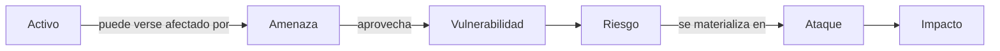
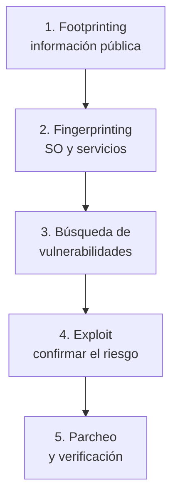
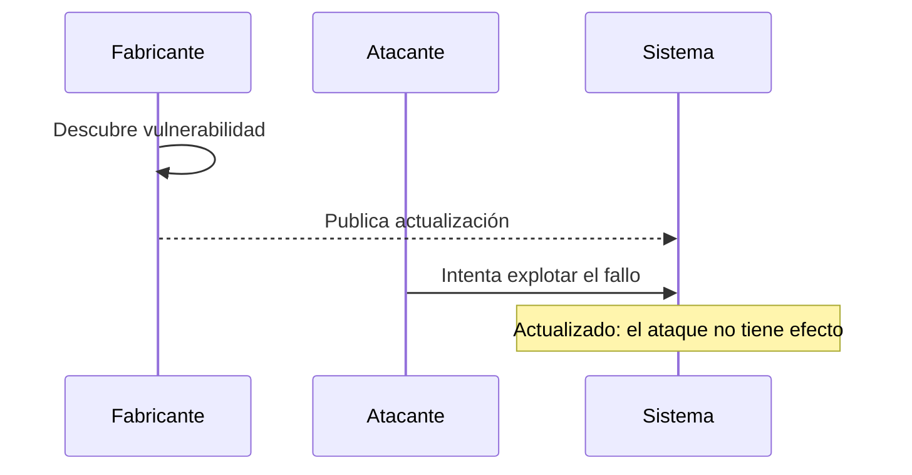
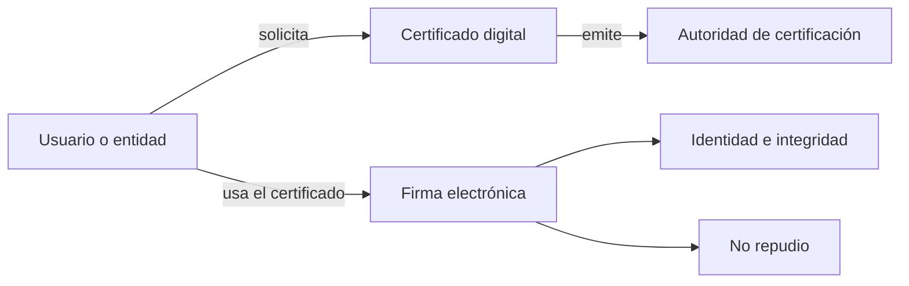
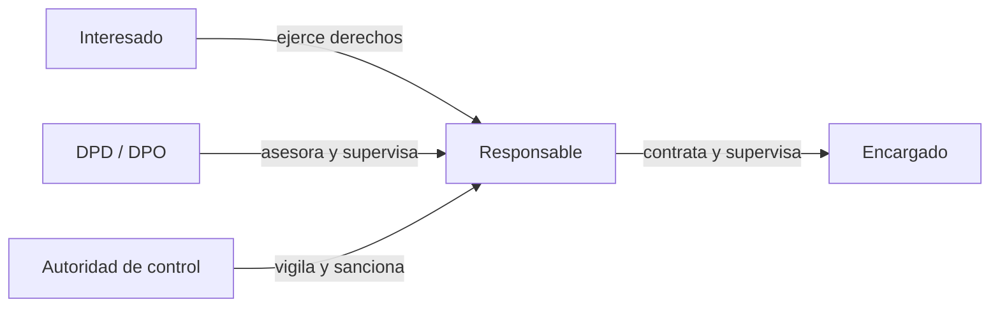

<!-- _class: lead -->

# UD01
## Introducción a la seguridad informática

**12 sesiones · RA1 · RA4 · RA5**

---

## ¿Por qué es necesaria?

Las organizaciones dependen de sistemas conectados que gestionan información crítica: cuentas bancarias, historiales médicos, comercio electrónico o infraestructuras.

Un fallo, una intrusión o una pérdida de información puede provocar:

- perjuicios económicos y reputacionales;
- vulneración de derechos;
- interrupción de servicios.

La seguridad combina **prevención**, **respuesta**, **recuperación** y **cumplimiento**.

---

## Mapa de la unidad

1. Conceptos básicos y objetivos.
2. Activos, amenazas, vulnerabilidades y ataques.
3. Auditorías y test de intrusión.
4. Malware y actualización de sistemas.
5. Privacidad e identificación digital.
6. Protección de datos y servicios de Internet.

<span class="muted">La secuencia conserva el orden de los contenidos de la especificación y progresa desde la protección técnica hasta el marco legal.</span>

---

<!-- _class: lead -->

# 1 · Conceptos básicos
### UD01-C01

De los objetivos de seguridad a las medidas que los hacen posibles.

---

<!-- content: UD01-C01 -->

## Seguridad informática: definición

La **seguridad informática** es el conjunto de medidas y controles que protegen los activos de un sistema de información —hardware, software, firmware y datos— para preservar su:

- **confidencialidad**: acceso solo por personas autorizadas;
- **integridad**: ausencia de modificaciones no autorizadas;
- **disponibilidad**: acceso cuando se necesita;
- **no repudio**: imposibilidad de negar una participación verificable.

> No es un producto que se instala una vez: es un proceso continuo de medidas técnicas, organizativas y normativas.

---

<!-- content: UD01-C01 -->

## Objetivos: modelo CIDN

| Objetivo | Pregunta de control | Ejemplo |
|---|---|---|
| **Confidencialidad** | ¿Quién puede leerlo? | Expediente médico restringido |
| **Integridad** | ¿Se ha alterado? | Boletín sin cambios no autorizados |
| **Disponibilidad** | ¿Está accesible? | Tienda online en alta demanda |
| **No repudio** | ¿Puede negarse la autoría? | Factura firmada digitalmente |

---

<!-- content: UD01-C01 -->

## Mecanismos de protección

| Mecanismo | Función principal |
|---|---|
| Autenticación | Identificar al usuario, emisor o equipo. |
| Autorización | Decidir qué puede hacer un usuario autenticado. |
| Cifrado | Ocultar información almacenada o transmitida. |
| Auditoría | Verificar políticas y controles. |
| Copias de seguridad | Recuperar información tras un incidente. |
| Firewall / proxy | Controlar y mediar conexiones de red. |
| Anti-malware | Detectar y eliminar software malicioso. |
| Certificado y firma | Acreditar identidad y no repudio. |

---

<!-- content: UD01-C01 -->

## Clasificaciones complementarias

| Eje | Tipo | Qué protege o cuándo actúa | Ejemplos |
|---|---|---|---|
| Elemento | **Física** | Hardware y entorno | SAI, extintores, control de acceso |
| Elemento | **Lógica** | Software, aplicaciones y datos | Contraseñas, permisos, cifrado |
| Momento | **Activa** | Previene antes del incidente | Firewall, antivirus |
| Momento | **Pasiva** | Minimiza el daño posterior | Copias, SAI, RAID |

> **Seguridad pasiva** no significa inacción: permite continuar o recuperar el servicio después de un fallo.

---

<!-- content: UD01-C01 -->

## Ejercicio · mecanismo y objetivo

Relaciona cada medida con el objetivo que protege principalmente:

1. Cifrado de una comunicación.
2. Copia de seguridad restaurable.
3. Firma electrónica de una factura.
4. Control de permisos de una carpeta.

<details><summary>Ver solución</summary>

1. Cifrado → **confidencialidad**.
2. Copia → **disponibilidad** (y recuperación frente a pérdida).
3. Firma → **no repudio** e integridad.
4. Permisos → **confidencialidad** y control de acceso.

</details>

---

<!-- _class: lead -->

# 2 · Riesgos y ataques
### UD01-C02

Nombrar correctamente el riesgo permite decidir cómo reducirlo.

---

<!-- content: UD01-C02 -->

## Terminología de seguridad

| Término | Definición técnica | Ejemplo |
|---|---|---|
| **Activo** | Elemento que la organización desea proteger. | Datos de clientes |
| **Amenaza** | Persona, máquina o suceso capaz de causar daño. | Incendio o atacante |
| **Vulnerabilidad** | Debilidad que permite materializar una amenaza. | Sistema sin parchear |
| **Riesgo** | Probabilidad de que una amenaza explote una vulnerabilidad. | Ataque probable |
| **Ataque** | Materialización efectiva de la amenaza. | Explotación del fallo |
| **Impacto** | Consecuencia cuantitativa o cualitativa sobre el activo. | Coste o filtración |

---

<!-- content: UD01-C02 -->

## Cadena causal del incidente



<span class="muted">La cadena orienta el análisis de riesgos: se protege el activo reduciendo vulnerabilidades y amenazas.</span>

---

<!-- content: UD01-C02 -->

## Del análisis al plan de contingencia

1. Identificar activos.
2. Identificar amenazas para cada activo.
3. Identificar vulnerabilidades.
4. Definir requisitos de seguridad.
5. Elaborar un **plan de contingencia** para garantizar la continuidad.

| Subplan | Momento | Ejemplo |
|---|---|---|
| Respaldo | Antes | Copias, pararrayos, simulacros |
| Emergencia | Durante o justo después | Activar extinción, restaurar copias |
| Recuperación | Después del desastre | Local alternativo, reinstalación |

---

<!-- content: UD01-C02 -->

## Vulnerabilidades y tiempo de reacción

- **Conocida en software instalado**: existe una solución; aplicar el parche.
- **Conocida en software no instalado**: no afecta al sistema, pero debe vigilarse el inventario.
- **Día cero**: vulnerabilidad todavía no conocida por el fabricante o sin parche disponible.

Una vulnerabilidad puede registrarse mediante un **CVE** (*Common Vulnerabilities and Exposures*). La gestión típica es:

**detección → prueba de concepto/exploit → solución → parche**

> Cuanto mayor sea el tiempo de reacción, mayor será la ventana de exposición.

---

<!-- content: UD01-C02 -->

## Atacantes y tipos de ataque

| Perfil | Objetivo descrito en la unidad |
|---|---|
| Cracker | Romper la protección de un software. |
| Phreaker | Aprovechar ilegalmente telecomunicaciones. |
| Crasher | Provocar que un sistema deje de funcionar. |
| Hacker | Saltarse la seguridad para acceder a información. |

Los ataques pueden ser **internos** —personal o ex-personal con conocimiento del sistema— o **externos**. También pueden explotar bugs, malware, amenazas físicas o ingeniería social.

---

<!-- content: UD01-C02 -->

## Ejemplo · ingeniería social

Un mensaje promete descubrir quiénes son los principales seguidores y enlaza a una aplicación. La aplicación solicita credenciales y permisos para publicar y acceder a contactos.

**Análisis:**

- amenaza: suplantación y propagación;
- vulnerabilidad: confianza del usuario y permisos excesivos;
- ataque: entrega de credenciales y autorización;
- impacto: publicaciones virales y exposición de contactos.

> La ingeniería social manipula a la persona: no necesita explotar un fallo técnico para ser eficaz.

---

<!-- content: UD01-C02 -->

## Ejercicio · clasificar un incidente

Un servidor contiene datos de clientes y ejecuta un sistema sin actualizar. Un atacante utiliza un fallo conocido, copia los datos y la empresa deja de prestar servicio.

Identifica: **activo, vulnerabilidad, amenaza, ataque e impacto**.

<details><summary>Ver solución</summary>

Activo → datos de clientes y servidor. Vulnerabilidad → sistema sin actualizar. Amenaza → atacante externo. Ataque → explotación del fallo y copia de datos. Impacto → filtración e interrupción del servicio.

</details>

---

<!-- _class: lead -->

# 3 · Auditoría y PenTest
### UD01-C03

Comprobar la seguridad antes de que lo haga un atacante.

---

<!-- content: UD01-C03 -->

## Auditoría de seguridad

Una **auditoría de seguridad informática** estudia un sistema para **identificar, enumerar y describir vulnerabilidades** en estaciones, redes y servidores.

Su informe debe recoger:

1. activos y procesos;
2. relaciones entre activos y flujo de información;
3. vulnerabilidades de cada activo;
4. cumplimiento de la normativa;
5. medidas preventivas propuestas.

Puede usar técnicas manuales —observación, entrevistas y pruebas— y herramientas CAAT (*Computer-Assisted Audit Tools*).

---

<!-- content: UD01-C03 -->

## Modalidades de auditoría

| Clasificación | Modalidad | Característica |
|---|---|---|
| Responsable | Interna | La realiza personal de la organización. |
| Responsable | Externa | La realiza una empresa especializada. |
| Información inicial | Caja negra | Desde fuera y sin credenciales previas. |
| Información inicial | Caja blanca | Desde dentro, con información privilegiada. |

Un **test de intrusión (PenTest)** simula un ataque externo autorizado; en los apuntes se presenta como auditoría de caja negra.

---

<!-- content: UD01-C03 -->

## Fases de un test de intrusión



---

<!-- content: UD01-C03 -->

## Herramientas y autorización

| Fase | Herramientas citadas |
|---|---|
| Footprinting | Buscadores, DNS, WHOIS, traceroute, spidering |
| Fingerprinting | Nmap, SuperScan, Netcat |
| Vulnerabilidades | Nessus, GFI LanGuard, Retina |
| Exploit | Metasploit |
| Corrección | Actualizaciones del fabricante |

Un **exploit** aprovecha una vulnerabilidad concreta: su cabecera implementa el fallo y su *payload* define la acción posterior.

> Sin consentimiento expreso y alcance definido, no es un PenTest: es una intrusión.

---

<!-- content: UD01-C03 -->

## Ejercicio · interpretar un informe

Un informe detecta un servicio y su versión, consulta un CVE, confirma el riesgo con un exploit autorizado y recomienda instalar un parche.

Ordena las fases y señala qué resultado aporta cada una.

<details><summary>Ver solución</summary>

Fingerprinting → identifica servicio y versión. Búsqueda de vulnerabilidades → relaciona la versión con un CVE. Explotación autorizada → confirma el riesgo real. Parcheo → corrige el fallo y debe verificarse.

</details>

---

<!-- _class: lead -->

# 4 · Malware y actualización
### UD01-C04

Reconocer el software malicioso y reducir la ventana de exposición.

---

<!-- content: UD01-C04 -->

## Software malicioso

El **malware** es software que se ejecuta sin autorización con fines dañinos, como crear puertas traseras, dañar datos o reproducirse masivamente.

| Tipo | Definición | Imagen mental |
|---|---|---|
| **Virus** | Necesita un archivo o programa anfitrión para ejecutarse y propagarse. | Parásito |
| **Troyano** | Parece legítimo, pero oculta una función maliciosa. | Regalo envenenado |
| **Gusano** | Se propaga autónomamente por la red. | Plaga |

---

<!-- content: UD01-C04 -->

## Actualización como medida activa

Una vulnerabilidad conocida y no parcheada es una puerta abierta. La actualización elimina el fallo de origen; el antivirus no la sustituye.

Buenas prácticas:

- actualizar sistema operativo y aplicaciones;
- usar cortafuegos;
- instalar software de procedencia verificada;
- formar a las personas usuarias;
- mantener copias de seguridad periódicas.

---

<!-- content: UD01-C04, UD01-C02 -->

## De la vulnerabilidad al parche



<span class="muted">El riesgo depende también de la exposición y del tiempo que se tarde en aplicar la solución.</span>

---

<!-- content: UD01-C04 -->

## Comprobación de integridad del sistema

En Windows, los apuntes incluyen estas comprobaciones:

```text
# Comprobar sin modificar archivos protegidos
sfc /verifyonly

# Comprobar y reparar archivos dañados
sfc /scannow
```

En sistemas Unix/Linux, `fsck` comprueba y repara la estructura del sistema de archivos.

<span class="muted">Son comprobaciones de integridad; no reemplazan la actualización ni las copias de seguridad.</span>

---

<!-- content: UD01-C04 -->

## Ejercicio · elegir la respuesta

Un equipo mantiene un sistema operativo vulnerable, aunque tiene antivirus instalado. ¿Qué medidas priorizarías?

<details><summary>Ver solución</summary>

Aplicar la actualización del fabricante, verificar el estado del sistema, mantener el firewall, revisar el software instalado, formar al usuario y conservar una copia de seguridad. El antivirus complementa estas medidas, pero no corrige el fallo del sistema operativo.

</details>

---

<!-- _class: lead -->

# 5 · Privacidad e identidad
### UD01-C05 · UD01-C06

Proteger los datos durante la comunicación y acreditar quién participa.

---

<!-- content: UD01-C05 -->

## Privacidad de la información

La **confidencialidad** garantiza que la información solo esté disponible para personas autorizadas. La **privacidad** aplica ese principio al tratamiento y circulación de información personal o sensible.

En una transmisión deben combinarse:

- **cifrado** de las comunicaciones;
- **autenticación de los extremos** para reducir suplantaciones;
- **control de acceso** a los servicios de red.

> Si un interceptor obtiene datos cifrados, no debería poder interpretarlos sin la clave adecuada.

---

<!-- content: UD01-C05 -->

## Contraseñas y fuerza bruta

Usuario y contraseña permiten autenticar a una persona antes de concederle acceso. La resistencia frente a fuerza bruta aumenta con la **longitud** y la **variedad de caracteres**.

| Longitud | Solo minúsculas | Mayúsculas, minúsculas y especiales |
|---:|---|---|
| 3 | Un suspiro | 1 segundo |
| 5 | 10 segundos | Más de 2 horas |
| 7 | Más de 2 horas | 2–3 años |
| 8 | Menos de 3 días | Alrededor de 2 siglos |

Evitar diccionario, envío en claro y almacenamiento automático sin protección adicional.

---

<!-- content: UD01-C05 -->

## Ejercicio · proteger una transmisión

Una persona envía datos personales por una red y recibe un enlace que imita al servicio legítimo. Propón tres controles alineados con el problema.

<details><summary>Ver solución</summary>

Cifrar la comunicación, autenticar los extremos y controlar el acceso al servicio. Además, debe comprobarse la identidad del sitio antes de introducir credenciales y aplicarse una política de contraseñas robustas.

</details>

---

<!-- _class: lead -->

# 5b · Identificación digital
### UD01-C06

De autenticar el acceso a acreditar identidad y no repudio.

---

<!-- content: UD01-C06 -->

## Firma electrónica y certificado digital

| Mecanismo | Definición y aportación | Ejemplo |
|---|---|---|
| **Firma electrónica** | Vincula a una persona con el contenido de un documento; aporta autoría, integridad y no repudio. | Firmar una declaración online |
| **Certificado digital** | Documento electrónico que vincula identidad verificada y claves criptográficas; lo emite una autoridad de certificación. | Acceder a una sede electrónica |

Ambos extienden la autenticación y el no repudio más allá del acceso local con contraseña.

---

<!-- content: UD01-C06 -->

## Flujo de identificación digital



<span class="muted">La unidad introduce finalidad y conceptos; la infraestructura de clave pública se desarrolla posteriormente.</span>

---

<!-- _class: lead -->

# 6 · Marco legal
### UD01-C07 · UD01-C08

La seguridad también exige proteger derechos y cumplir obligaciones.

---

<!-- content: UD01-C07 -->

## 8 · Protección de datos personales

El derecho a la protección de datos deriva del **artículo 18.4 de la Constitución Española**: la informática no puede utilizarse para vulnerar el honor y la intimidad.

La normativa vigente combina:

| Norma | Función |
|---|---|
| **RGPD** · Reglamento (UE) 2016/679 | Marco común europeo, aplicable desde el 25 de mayo de 2018. |
| **LOPDGDD** · Ley Orgánica 3/2018 | Adapta el RGPD a España y reconoce derechos digitales. |
| **AEPD** | Autoridad española de control: supervisa, atiende reclamaciones y sanciona. |

<span class="muted">La antigua LOPD 15/1999 y el RD 1720/2007 están derogados.</span>

---

<!-- content: UD01-C07 -->

## Conceptos y principios del RGPD

- **Dato personal**: información sobre una persona identificada o identificable: nombre, DNI, foto, correo, matrícula o IP.
- **Tratamiento**: recoger, guardar, consultar, modificar, comunicar o borrar datos.
- **Categorías especiales**: salud, ideología, religión, origen étnico, afiliación sindical, orientación sexual, datos genéticos y biométricos; su tratamiento exige una excepción legal.
- **Consentimiento**: libre, informado, específico e inequívoco; no valen casillas premarcadas.

| Principio | Aplicación práctica |
|---|---|
| Licitud, lealtad y transparencia | Informar y contar con una base legal. |
| Limitación de finalidad | Usar los datos solo para el fin indicado. |
| Minimización y exactitud | Pedir lo necesario y mantenerlo correcto. |
| Conservación limitada | No conservarlos más tiempo del preciso. |
| Integridad y confidencialidad | Aplicar medidas técnicas y organizativas. |
| Responsabilidad proactiva | Poder demostrar el cumplimiento. |

---

<!-- content: UD01-C07 -->

## Figuras que intervienen



| Figura | Función | Ejemplo en un instituto |
|---|---|---|
| **Interesado** | Persona cuyos datos se tratan. | Alumno o familia. |
| **Responsable** | Decide para qué y cómo se tratan. | Centro o Consejería. |
| **Encargado** | Trata datos por cuenta del responsable, con contrato. | Plataforma educativa en la nube. |
| **DPD/DPO** | Asesora y supervisa el cumplimiento. | DPD de la Consejería. |

---

<!-- content: UD01-C07 -->

## Derechos: de ARCO a ARSOL/ARCO+

La persona puede solicitar gratuitamente, normalmente con respuesta en **un mes**:

| Derecho | Qué permite |
|---|---|
| **Acceso** | Saber qué datos se tratan, para qué y obtener una copia. |
| **Rectificación** | Corregir datos inexactos o incompletos. |
| **Supresión** | Borrar datos cuando ya no son necesarios: derecho al olvido. |
| **Oposición** | Oponerse a tratamientos, como la publicidad. |
| **Limitación** | Congelar el uso mientras se resuelve una reclamación. |
| **Portabilidad** | Recibir los datos en formato estándar y trasladarlos. |
| **No decisiones automatizadas** | No quedar sometido a una decisión importante tomada solo por un algoritmo. |

**ARCO** era acceso, rectificación, cancelación y oposición. El RGPD sustituye cancelación por **supresión** y añade limitación y portabilidad: **ARSOL/ARCO+**.

---

<!-- content: UD01-C07 -->

## Seguridad, brechas y sanciones

El RGPD no establece niveles cerrados: exige un **enfoque de riesgo** y medidas apropiadas, como permisos mínimos, cifrado, seudonimización, copias y revisión periódica.

- Mantener un **registro de actividades de tratamiento**.
- Notificar una brecha a la AEPD en un máximo de **72 horas**; si el riesgo es alto, también a las personas afectadas.
- Realizar una evaluación de impacto antes de tratamientos de alto riesgo.

| Incumplimiento | Límite máximo RGPD |
|---|---:|
| Obligaciones del responsable/encargado | 10 M€ o 2 % de facturación mundial |
| Principios, consentimiento o derechos | 20 M€ o 4 % de facturación mundial |

Se aplica siempre la cantidad mayor. La LOPDGDD clasifica además las infracciones como leves, graves o muy graves.

---

<!-- content: UD01-C07 -->

## Ejercicio · respuesta ante una brecha

Una academia pierde un portátil sin cifrar con datos de alumnado. No sabe qué tratamientos tiene registrados y espera varias semanas antes de avisar.

Identifica al responsable, dos medidas incumplidas y el plazo de notificación.

<details><summary>Ver solución</summary>

La academia es el **responsable** si decide la finalidad y los medios. Incumple la aplicación de medidas apropiadas —por ejemplo, cifrado y control de acceso— y la obligación de mantener el registro de actividades. Debe valorar la brecha y notificarla a la AEPD, cuando proceda, en un máximo de **72 horas** desde que la conoce; con riesgo alto, informará también a las personas afectadas.

</details>

---

<!-- _class: lead -->

# 9 · Propiedad intelectual y software
### UD01-C08

Usar, copiar, modificar y distribuir software depende de sus derechos y de la licencia.

---

<!-- content: UD01-C08 -->

## LPI: qué protege

La **Ley de Propiedad Intelectual (LPI)** protege las creaciones originales, incluido el software. El titular decide, dentro de los límites legales, cómo se reproduce, distribuye, comunica y transforma la obra.

| Tipo de derecho | Características | Ejemplo |
|---|---|---|
| **Moral** | Vinculado al autor; reconocimiento de autoría e integridad de la obra. | Exigir que se cite al autor. |
| **Patrimonial** | Permite explotar la obra y autorizar usos. | Copiar, distribuir o transformar un programa. |

En software, comprar una copia o acceder a una descarga **no equivale** a adquirir todos los derechos de explotación.

---

<!-- content: UD01-C08 -->

## Licencias de software

La licencia concreta qué puede hacer legalmente quien recibe el programa:

| Familia | Permisos y límites habituales |
|---|---|
| **Privativa** | El titular conserva el control; puede limitar copia, modificación, acceso al código y redistribución. |
| **Libre / copyleft** | Permite usar, estudiar, modificar y redistribuir; el copyleft exige conservar libertades y licencia en las versiones derivadas. |
| **Libre permisiva** | Permite reutilizar y redistribuir con pocas condiciones; suele admitir combinar el código con software privativo. |

**Código abierto** describe la disponibilidad del código y las condiciones de la licencia; no significa automáticamente que no existan obligaciones.

---

<!-- content: UD01-C08 -->

## Comparar licencias antes de reutilizar

Antes de copiar una biblioteca o un programa hay que comprobar:

1. si la licencia permite el uso previsto;
2. si exige conservar avisos de autoría o incluir el texto de la licencia;
3. si obliga a publicar las modificaciones con la misma licencia;
4. si permite distribuir el resultado junto con software privativo.

> **Regla práctica:** que un código esté publicado en Internet no autoriza a copiarlo sin revisar sus derechos y condiciones.

---

<!-- content: UD01-C08 -->

## Ejercicio · elegir una licencia

Un equipo quiere publicar una biblioteca, permitir su uso en proyectos privativos y exigir que las versiones modificadas mantengan las mismas libertades. ¿Qué familia de licencia encaja mejor? ¿Qué debe comprobar antes de reutilizar otra biblioteca?

<details><summary>Ver solución</summary>

La primera condición —uso en proyectos privativos— encaja mejor con una licencia **libre permisiva**. La segunda —obligar a mantener las mismas libertades en las versiones derivadas— es propia del **copyleft**; por tanto, ambas exigencias deben analizarse porque pueden entrar en conflicto. Antes de reutilizar una dependencia hay que revisar su licencia, las obligaciones de atribución, redistribución y compatibilidad.

</details>

---

<!-- content: UD01-C07, UD01-C08 -->

## Protección de datos y propiedad intelectual: no regulan lo mismo

| | RGPD + LOPDGDD | LPI y licencia de software |
|---|---|---|
| Objeto | Datos personales y derechos de las personas. | Obras, autoría y explotación del software. |
| Pregunta central | ¿Puedo tratar estos datos y con qué garantías? | ¿Puedo copiar, modificar o distribuir este código? |
| Riesgo típico | Brecha, uso sin base legal o pérdida de derechos. | Copia o redistribución sin autorización. |

Un proyecto puede estar sometido a ambos marcos: por ejemplo, una aplicación puede tratar datos personales y, al mismo tiempo, incorporar bibliotecas con licencias que deben respetarse.

---

<!-- content: UD01-C08 -->

## Ejercicio · aplicación web

Una empresa incorpora una biblioteca publicada en Internet, elimina el aviso de autoría y usa datos de clientes para entrenar una función sin informarles.

¿Qué dos ámbitos legales aparecen y qué debería revisar la empresa?

<details><summary>Ver solución</summary>

En propiedad intelectual, debe revisar la licencia de la biblioteca y conservar las obligaciones de autoría y redistribución; eliminar el aviso puede incumplirla. En protección de datos, debe identificar la base legal, informar de la finalidad, aplicar minimización y seguridad, y respetar los derechos de las personas. Son obligaciones distintas y pueden aplicarse simultáneamente.

</details>

---

<!-- _class: lead -->
<!-- content: UD01-C01, UD01-C02, UD01-C03, UD01-C04, UD01-C05, UD01-C06, UD01-C07, UD01-C08 -->

# Síntesis

Proteger un sistema significa **preservar sus activos**, gestionar sus riesgos, comprobar sus controles, corregir vulnerabilidades, proteger la privacidad, acreditar identidades y cumplir la normativa.

---

<!-- content: UD01-C01, UD01-C02, UD01-C03, UD01-C04, UD01-C05, UD01-C06, UD01-C07, UD01-C08 -->

## Ideas clave

- **CIDN**: confidencialidad, integridad, disponibilidad y no repudio.
- **Riesgo**: una amenaza puede aprovechar una vulnerabilidad y producir impacto.
- **PenTest**: auditoría autorizada para encontrar y corregir fallos.
- **Malware**: virus, troyano y gusano siguen patrones distintos.
- **Actualización**: reduce la ventana de exposición.
- **Privacidad e identidad**: cifrado, autenticación, firma y certificado cumplen funciones relacionadas, pero no idénticas.
- **Normativa**: LOPD protege datos personales; LSSI-CE regula servicios y contratación electrónica.

> La seguridad informática es un proceso continuo, no una herramienta aislada.
