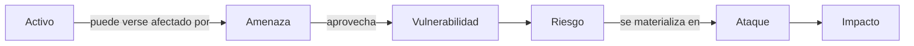
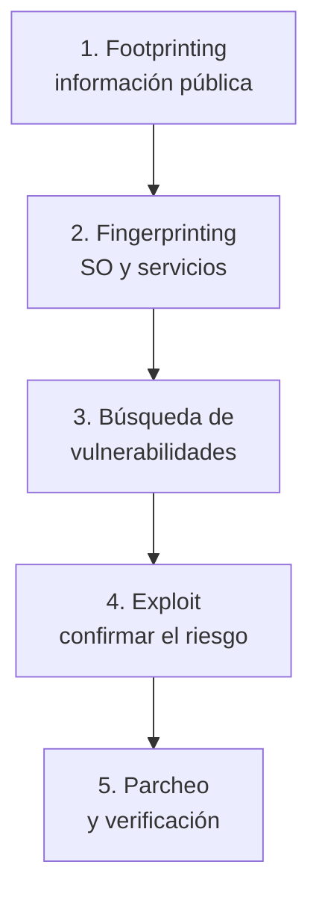
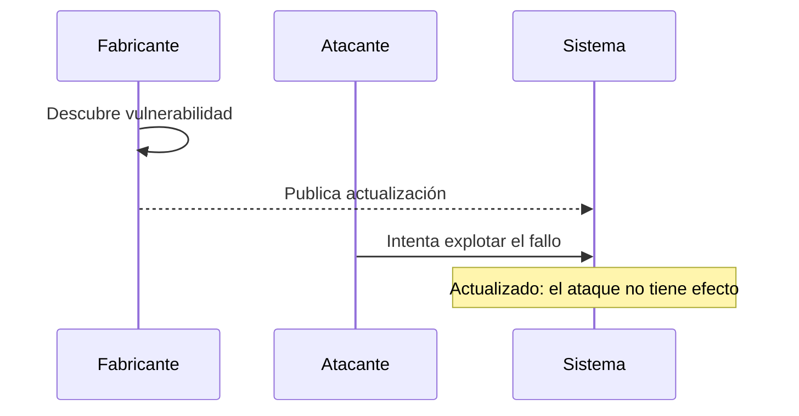
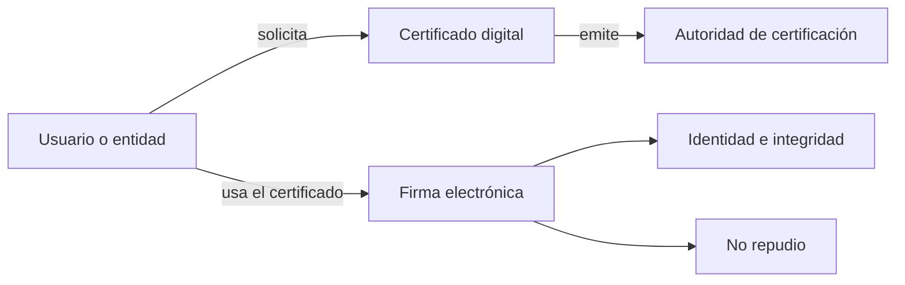

<!-- _class: lead -->

# UD01
## Introducción a la seguridad informática

**12 sesiones · RA1 · RA4 · RA5**

---

## ¿Por qué es necesaria?

Las organizaciones dependen de sistemas conectados que gestionan información crítica: cuentas bancarias, historiales médicos, comercio electrónico o infraestructuras.

Un fallo, una intrusión o una pérdida de información puede provocar:

- perjuicios económicos y reputacionales;
- vulneración de derechos;
- interrupción de servicios.

La seguridad combina **prevención**, **respuesta**, **recuperación** y **cumplimiento**.

---

## Mapa de la unidad

1. Conceptos básicos y objetivos.
2. Activos, amenazas, vulnerabilidades y ataques.
3. Auditorías y test de intrusión.
4. Malware y actualización de sistemas.
5. Privacidad e identificación digital.
6. Protección de datos y servicios de Internet.

<span class="muted">La secuencia conserva el orden de los contenidos de la especificación y progresa desde la protección técnica hasta el marco legal.</span>

---

<!-- _class: lead -->

# 1 · Conceptos básicos
### UD01-C01

De los objetivos de seguridad a las medidas que los hacen posibles.

---

<!-- content: UD01-C01 -->

## Seguridad informática: definición

La **seguridad informática** es el conjunto de medidas y controles que protegen los activos de un sistema de información —hardware, software, firmware y datos— para preservar su:

- **confidencialidad**: acceso solo por personas autorizadas;
- **integridad**: ausencia de modificaciones no autorizadas;
- **disponibilidad**: acceso cuando se necesita;
- **no repudio**: imposibilidad de negar una participación verificable.

> No es un producto que se instala una vez: es un proceso continuo de medidas técnicas, organizativas y normativas.

---

<!-- content: UD01-C01 -->

## Objetivos: modelo CIDN

<br>

| Objetivo | Pregunta de control | Ejemplo |
|---|---|---|
| **Confidencialidad** | ¿Quién puede leerlo? | Expediente médico restringido |
| **Integridad** | ¿Se ha alterado? | Boletín sin cambios no autorizados |
| **Disponibilidad** | ¿Está accesible? | Tienda online en alta demanda |
| **No repudio** | ¿Puede negarse la autoría? | Factura firmada digitalmente |

---

<!-- content: UD01-C01 -->

## Mecanismos de protección

<br>

| Mecanismo | Función principal |
|---|---|
| Autenticación | Identificar al usuario, emisor o equipo. |
| Autorización | Decidir qué puede hacer un usuario autenticado. |
| Cifrado | Ocultar información almacenada o transmitida. |
| Auditoría | Verificar políticas y controles. |
| Copias de seguridad | Recuperar información tras un incidente. |
| Firewall / proxy | Controlar y mediar conexiones de red. |
| Anti-malware | Detectar y eliminar software malicioso. |
| Certificado y firma | Acreditar identidad y no repudio. |

---

<!-- content: UD01-C01 -->

## Clasificaciones complementarias

<br>

| Eje | Tipo | Qué protege o cuándo actúa | Ejemplos |
|---|---|---|---|
| Elemento | **Física** | Hardware y entorno | SAI, extintores, control de acceso |
| Elemento | **Lógica** | Software, aplicaciones y datos | Contraseñas, permisos, cifrado |
| Momento | **Activa** | Previene antes del incidente | Firewall, antivirus |
| Momento | **Pasiva** | Minimiza el daño posterior | Copias, SAI, RAID |

<br>

> **Seguridad pasiva** no significa inacción: permite continuar o recuperar el servicio después de un fallo.

---

<!-- content: UD01-C01 -->

## Ejercicio · mecanismo y objetivo

Relaciona cada medida con el objetivo que protege principalmente:

1. Cifrado de una comunicación.
2. Copia de seguridad restaurable.
3. Firma electrónica de una factura.
4. Control de permisos de una carpeta.

<details><summary><strong>Ver solución</strong></summary>

1. Cifrado → **confidencialidad**.
2. Copia → **disponibilidad** (y recuperación frente a pérdida).
3. Firma → **no repudio** e integridad.
4. Permisos → **confidencialidad** y control de acceso.

</details>

---

<!-- _class: lead -->

# 2 · Riesgos y ataques
### UD01-C02

Nombrar correctamente el riesgo permite decidir cómo reducirlo.

---

<!-- content: UD01-C02 -->

## Terminología de seguridad

<br>

| Término | Definición técnica | Ejemplo |
|---|---|---|
| **Activo** | Elemento que la organización desea proteger. | Datos de clientes |
| **Amenaza** | Persona, máquina o suceso capaz de causar daño. | Incendio o atacante |
| **Vulnerabilidad** | Debilidad que permite materializar una amenaza. | Sistema sin parchear |
| **Riesgo** | Probabilidad de que una amenaza explote una vulnerabilidad. | Ataque probable |
| **Ataque** | Materialización efectiva de la amenaza. | Explotación del fallo |
| **Impacto** | Consecuencia cuantitativa o cualitativa sobre el activo. | Coste o filtración |

---

<!-- content: UD01-C02 -->

## Cadena causal del incidente



<span class="muted">La cadena orienta el análisis de riesgos: se protege el activo reduciendo vulnerabilidades y amenazas.</span>

---

<!-- content: UD01-C02 -->

## Del análisis al plan de contingencia

1. Identificar activos.
2. Identificar amenazas para cada activo.
3. Identificar vulnerabilidades.
4. Definir requisitos de seguridad.
5. Elaborar un **plan de contingencia** para garantizar la continuidad.

| Subplan | Momento | Ejemplo |
|---|---|---|
| Respaldo | Antes | Copias, pararrayos, simulacros |
| Emergencia | Durante o justo después | Activar extinción, restaurar copias |
| Recuperación | Después del desastre | Local alternativo, reinstalación |

---

<!-- content: UD01-C02 -->

## Vulnerabilidades y tiempo de reacción

- **Conocida en software instalado**: existe una solución; aplicar el parche.
- **Conocida en software no instalado**: no afecta al sistema, pero debe vigilarse el inventario.
- **Día cero**: vulnerabilidad todavía no conocida por el fabricante o sin parche disponible.

Una vulnerabilidad puede registrarse mediante un **CVE** (*Common Vulnerabilities and Exposures*). La gestión típica es:

**detección → prueba de concepto/exploit → solución → parche**

> Cuanto mayor sea el tiempo de reacción, mayor será la ventana de exposición.

---

<!-- content: UD01-C02 -->

## Atacantes y tipos de ataque

<br>

| Perfil | Objetivo descrito en la unidad |
|---|---|
| Cracker | Romper la protección de un software. |
| Phreaker | Aprovechar ilegalmente telecomunicaciones. |
| Crasher | Provocar que un sistema deje de funcionar. |
| Hacker | Saltarse la seguridad para acceder a información. |

<br>

Los ataques pueden ser **internos** —personal o ex-personal con conocimiento del sistema— o **externos**. También pueden explotar bugs, malware, amenazas físicas o ingeniería social.

---

<!-- content: UD01-C02 -->

## Ejemplo · ingeniería social

Un mensaje promete descubrir quiénes son los principales seguidores y enlaza a una aplicación. La aplicación solicita credenciales y permisos para publicar y acceder a contactos.

**Análisis:**

- amenaza: suplantación y propagación;
- vulnerabilidad: confianza del usuario y permisos excesivos;
- ataque: entrega de credenciales y autorización;
- impacto: publicaciones virales y exposición de contactos.

> La ingeniería social manipula a la persona: no necesita explotar un fallo técnico para ser eficaz.

---

<!-- content: UD01-C02 -->

## Ejercicio · clasificar un incidente

Un servidor contiene datos de clientes y ejecuta un sistema sin actualizar. Un atacante utiliza un fallo conocido, copia los datos y la empresa deja de prestar servicio.

Identifica: **activo, vulnerabilidad, amenaza, ataque e impacto**.

<details><summary><strong>Ver solución</strong></summary>

Activo → datos de clientes y servidor. Vulnerabilidad → sistema sin actualizar. Amenaza → atacante externo. Ataque → explotación del fallo y copia de datos. Impacto → filtración e interrupción del servicio.

</details>

---

<!-- _class: lead -->

# 3 · Auditoría y PenTest
### UD01-C03

Comprobar la seguridad antes de que lo haga un atacante.

---

<!-- content: UD01-C03 -->

## Auditoría de seguridad

Una **auditoría de seguridad informática** estudia un sistema para **identificar, enumerar y describir vulnerabilidades** en estaciones, redes y servidores.

Su informe debe recoger:

1. activos y procesos;
2. relaciones entre activos y flujo de información;
3. vulnerabilidades de cada activo;
4. cumplimiento de la normativa;
5. medidas preventivas propuestas.

Puede usar técnicas manuales —observación, entrevistas y pruebas— y herramientas CAAT (*Computer-Assisted Audit Tools*).

---

<!-- content: UD01-C03 -->

## Modalidades de auditoría

<br>

| Clasificación | Modalidad | Característica |
|---|---|---|
| Responsable | Interna | La realiza personal de la organización. |
| Responsable | Externa | La realiza una empresa especializada. |
| Información inicial | Caja negra | Desde fuera y sin credenciales previas. |
| Información inicial | Caja blanca | Desde dentro, con información privilegiada. |

<br>

Un **test de intrusión (PenTest)** simula un ataque externo autorizado; en los apuntes se presenta como auditoría de caja negra.

---

<!-- content: UD01-C03 -->

## Fases de un test de intrusión



---

<!-- content: UD01-C03 -->

## Herramientas y autorización

| Fase | Herramientas citadas |
|---|---|
| Footprinting | Buscadores, DNS, WHOIS, traceroute, spidering |
| Fingerprinting | Nmap, SuperScan, Netcat |
| Vulnerabilidades | Nessus, GFI LanGuard, Retina |
| Exploit | Metasploit |
| Corrección | Actualizaciones del fabricante |


Un **exploit** aprovecha una vulnerabilidad concreta: su cabecera implementa el fallo y su *payload* define la acción posterior.

> Sin consentimiento expreso y alcance definido, no es un PenTest: es una intrusión.

---

<!-- content: UD01-C03 -->

## Ejercicio · interpretar un informe

Un informe detecta un servicio y su versión, consulta un CVE, confirma el riesgo con un exploit autorizado y recomienda instalar un parche.

Ordena las fases y señala qué resultado aporta cada una.

<details><summary>Ver solución</summary>

Fingerprinting → identifica servicio y versión. Búsqueda de vulnerabilidades → relaciona la versión con un CVE. Explotación autorizada → confirma el riesgo real. Parcheo → corrige el fallo y debe verificarse.

</details>

---

<!-- _class: lead -->

# 4 · Malware y actualización
### UD01-C04

Reconocer el software malicioso y reducir la ventana de exposición.

---

<!-- content: UD01-C04 -->

## Software malicioso

El **malware** es software que se ejecuta sin autorización con fines dañinos, como crear puertas traseras, dañar datos o reproducirse masivamente.

| Tipo | Definición | Imagen mental |
|---|---|---|
| **Virus** | Necesita un archivo o programa anfitrión para ejecutarse y propagarse. | Parásito |
| **Troyano** | Parece legítimo, pero oculta una función maliciosa. | Regalo envenenado |
| **Gusano** | Se propaga autónomamente por la red. | Plaga |

---

<!-- content: UD01-C04 -->

## Actualización como medida activa

Una vulnerabilidad conocida y no parcheada es una puerta abierta. La actualización elimina el fallo de origen; el antivirus no la sustituye.

Buenas prácticas:

- actualizar sistema operativo y aplicaciones;
- usar cortafuegos;
- instalar software de procedencia verificada;
- formar a las personas usuarias;
- mantener copias de seguridad periódicas.

---

<!-- content: UD01-C04, UD01-C02 -->

## De la vulnerabilidad al parche



<span class="muted">El riesgo depende también de la exposición y del tiempo que se tarde en aplicar la solución.</span>

---

<!-- content: UD01-C04 -->

## Comprobación de integridad del sistema

En Windows, los apuntes incluyen estas comprobaciones:

```text
# Comprobar sin modificar archivos protegidos
sfc /verifyonly

# Comprobar y reparar archivos dañados
sfc /scannow
```

En sistemas Unix/Linux, `fsck` comprueba y repara la estructura del sistema de archivos.

<span class="muted">Son comprobaciones de integridad; no reemplazan la actualización ni las copias de seguridad.</span>

---

<!-- content: UD01-C04 -->

## Ejercicio · elegir la respuesta

Un equipo mantiene un sistema operativo vulnerable, aunque tiene antivirus instalado. ¿Qué medidas priorizarías?

<details><summary>Ver solución</summary>

Aplicar la actualización del fabricante, verificar el estado del sistema, mantener el firewall, revisar el software instalado, formar al usuario y conservar una copia de seguridad. El antivirus complementa estas medidas, pero no corrige el fallo del sistema operativo.

</details>

---

<!-- _class: lead -->

# 5 · Privacidad e identidad
### UD01-C05 · UD01-C06

Proteger los datos durante la comunicación y acreditar quién participa.

---

<!-- content: UD01-C05 -->

## Privacidad de la información

La **confidencialidad** garantiza que la información solo esté disponible para personas autorizadas. La **privacidad** aplica ese principio al tratamiento y circulación de información personal o sensible.

En una transmisión deben combinarse:

- **cifrado** de las comunicaciones;
- **autenticación de los extremos** para reducir suplantaciones;
- **control de acceso** a los servicios de red.

> Si un interceptor obtiene datos cifrados, no debería poder interpretarlos sin la clave adecuada.

---

<!-- content: UD01-C05 -->

## Contraseñas y fuerza bruta

Usuario y contraseña permiten autenticar a una persona antes de concederle acceso. La resistencia frente a fuerza bruta aumenta con la **longitud** y la **variedad de caracteres**.

| Longitud | Solo minúsculas | Mayúsculas, minúsculas y especiales |
|---:|---|---|
| 3 | Un suspiro | 1 segundo |
| 5 | 10 segundos | Más de 2 horas |
| 7 | Más de 2 horas | 2–3 años |
| 8 | Menos de 3 días | Alrededor de 2 siglos |

Evitar diccionario, envío en claro y almacenamiento automático sin protección adicional.

---

<!-- content: UD01-C05 -->

## Ejercicio · proteger una transmisión

Una persona envía datos personales por una red y recibe un enlace que imita al servicio legítimo. Propón tres controles alineados con el problema.

<details><summary>Ver solución</summary>

Cifrar la comunicación, autenticar los extremos y controlar el acceso al servicio. Además, debe comprobarse la identidad del sitio antes de introducir credenciales y aplicarse una política de contraseñas robustas.

</details>

---

<!-- _class: lead -->

# 5b · Identificación digital
### UD01-C06

De autenticar el acceso a acreditar identidad y no repudio.

---

<!-- content: UD01-C06 -->

## Firma electrónica y certificado digital

| Mecanismo | Definición y aportación | Ejemplo |
|---|---|---|
| **Firma electrónica** | Vincula a una persona con el contenido de un documento; aporta autoría, integridad y no repudio. | Firmar una declaración online |
| **Certificado digital** | Documento electrónico que vincula identidad verificada y claves criptográficas; lo emite una autoridad de certificación. | Acceder a una sede electrónica |

Ambos extienden la autenticación y el no repudio más allá del acceso local con contraseña.

---

<!-- content: UD01-C06 -->

## Flujo de identificación digital



<span class="muted">La unidad introduce finalidad y conceptos; la infraestructura de clave pública se desarrolla posteriormente.</span>

---

<!-- _class: lead -->

# 6 · Marco legal
### UD01-C07 · UD01-C08

La seguridad también exige proteger derechos y cumplir obligaciones.

---

<!-- content: UD01-C07 -->

## Protección de datos: LOPD

La **LOPD (Ley Orgánica 15/1999)** protege los derechos fundamentales relacionados con los datos personales, especialmente la intimidad.

- Desarrollo reglamentario: **RD 1720/2007**.
- Organismo supervisor citado: **Agencia Española de Protección de Datos (AEPD)**.
- Regula finalidades, recogida y derechos de las personas.

Se aplica a datos personales registrados susceptibles de tratamiento y a tratamientos sujetos a la legislación española.

---

<!-- content: UD01-C07 -->

## Ámbito y niveles de seguridad

No se aplica, según los apuntes, a ficheros exclusivamente domésticos ni a materias clasificadas.

El fichero recibe el **nivel más alto** correspondiente a sus datos:

| Nivel | Ejemplo |
|---|---|
| Básico | Datos identificativos |
| Medio | Datos relativos a infracciones |
| Alto | Salud, ideología o afiliación sindical |

---

<!-- content: UD01-C07 -->

## Infracciones, sanciones y derechos

| Gravedad | Rango indicado | Ejemplo |
|---|---:|---|
| Leve | 900–40.000 € | Recoger datos sin informar |
| Grave | 40.001–300.000 € | Usar el fichero para otra finalidad |
| Muy grave | 300.001–600.000 € | Recoger datos protegidos sin autorización |

Las personas pueden ejercer **acceso, rectificación, cancelación y oposición**. El responsable del fichero debe controlar accesos y aplicar medidas.

---

<!-- content: UD01-C07 -->

## Ejercicio · clasificar una situación

Una empresa utiliza datos de clientes para una finalidad distinta de la que justificó su recogida. ¿Qué ámbito se afecta y qué tipo de infracción señala la tabla de la unidad?

<details><summary>Ver solución</summary>

Afecta a la protección de datos personales y, según la tabla de los apuntes, corresponde a una **infracción grave** por utilizar el fichero para una finalidad distinta.

</details>

---

<!-- _class: lead -->

# 6b · Servicios de la sociedad de la información
### UD01-C08

Obligaciones para prestar servicios y contratar por vía electrónica.

---

<!-- content: UD01-C08 -->

## LSSI-CE: servicios y comercio electrónico

La **Ley 34/2002, de Servicios de la Sociedad de la Información y de Comercio Electrónico (LSSI-CE)** regula los servicios de la sociedad de la información y la contratación electrónica.

| Aspecto | Obligación o efecto |
|---|---|
| Información | Nombre, domicilio, correo, NIF y precios |
| Contratos electrónicos | Plena validez legal |
| Intermediarios | Exención condicionada si no existe conocimiento efectivo de ilicitud |

La documentación de la unidad menciona la **CMT** en la regulación de mercados de comunicaciones electrónicas y servicios audiovisuales.

---

<!-- content: UD01-C07, UD01-C08 -->

## LOPD y LSSI-CE: no regulan lo mismo

| | LOPD | LSSI-CE |
|---|---|---|
| Objeto | Protección del dato personal | Servicios de la sociedad de la información y comercio electrónico |
| Pregunta central | ¿Cómo se trata y protege el dato? | ¿Qué obligaciones tiene quien presta el servicio? |
| Organismo citado | AEPD | CMT, según la documentación |
| Criterios | RA5.a–RA5.d | RA5.e |

Una tienda online puede quedar sometida a **ambas**: una ley protege los datos de sus clientes y la otra regula el servicio y la contratación electrónica.

---

<!-- content: UD01-C08 -->

## Ejercicio · tienda online

Una tienda no muestra su domicilio ni NIF, pero acepta pedidos electrónicos. Además, almacena datos de clientes.

¿Qué ley se relaciona con cada problema?

<details><summary>Ver solución</summary>

La falta de información obligatoria y la contratación electrónica se relacionan con la **LSSI-CE**. El almacenamiento y protección de datos personales se relacionan con la **LOPD**. Ambas pueden aplicarse simultáneamente.

</details>

---

<!-- _class: lead -->
<!-- content: UD01-C01, UD01-C02, UD01-C03, UD01-C04, UD01-C05, UD01-C06, UD01-C07, UD01-C08 -->

# Síntesis

Proteger un sistema significa **preservar sus activos**, gestionar sus riesgos, comprobar sus controles, corregir vulnerabilidades, proteger la privacidad, acreditar identidades y cumplir la normativa.

---

<!-- content: UD01-C01, UD01-C02, UD01-C03, UD01-C04, UD01-C05, UD01-C06, UD01-C07, UD01-C08 -->

## Ideas clave

- **CIDN**: confidencialidad, integridad, disponibilidad y no repudio.
- **Riesgo**: una amenaza puede aprovechar una vulnerabilidad y producir impacto.
- **PenTest**: auditoría autorizada para encontrar y corregir fallos.
- **Malware**: virus, troyano y gusano siguen patrones distintos.
- **Actualización**: reduce la ventana de exposición.
- **Privacidad e identidad**: cifrado, autenticación, firma y certificado cumplen funciones relacionadas, pero no idénticas.
- **Normativa**: LOPD protege datos personales; LSSI-CE regula servicios y contratación electrónica.

> La seguridad informática es un proceso continuo, no una herramienta aislada.
