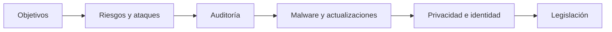
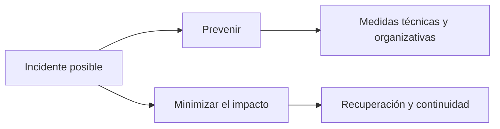
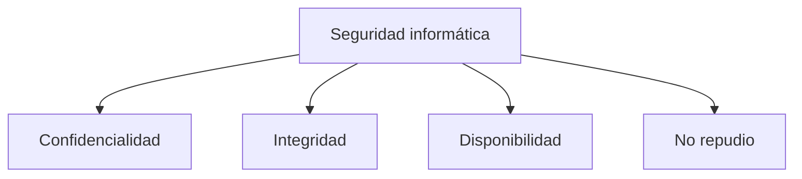
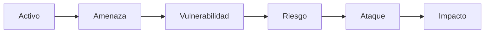
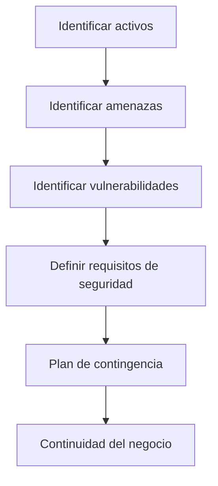
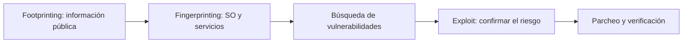
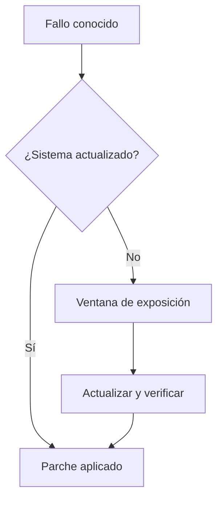
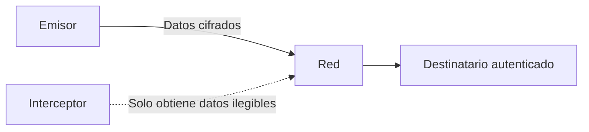
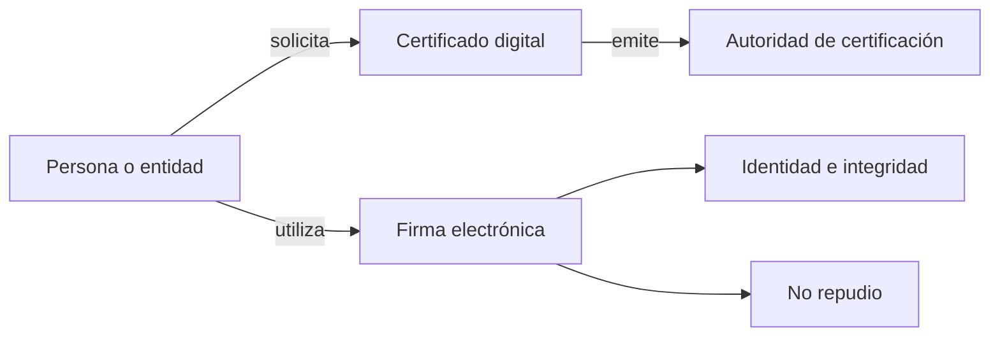
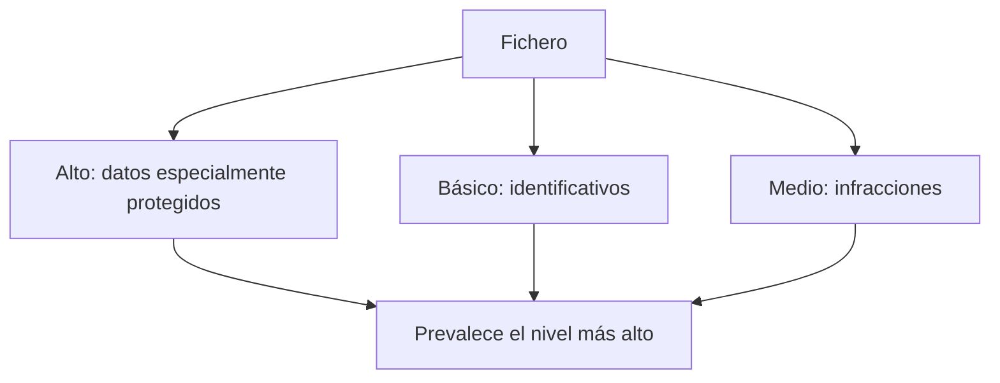

<!-- _class: lead -->

# UD01

## Introducción a la seguridad informática

**RA1 · RA4 · RA5**

---

## ¿Qué vamos a construir?

La seguridad informática protege información, sistemas y servicios frente a fallos, amenazas y usos no autorizados.

En esta unidad pasaremos de los **objetivos de seguridad** a:

- analizar riesgos y ataques;
- auditar y corregir sistemas;
- proteger privacidad e identidad;
- comprender el marco legal aplicable.

<span class="muted">La seguridad combina prevención, respuesta, recuperación y cumplimiento.</span>

---

## Mapa de la unidad



| Bloque | Contenido |
|---|---|
| 1–2 | Conceptos básicos; activos, amenazas y ataques |
| 3–4 | Auditorías; malware y actualización |
| 5–6 | Privacidad; identificación digital |
| 7–8 | Protección de datos; servicios de la sociedad de la información |

---

<!-- content: UD01-C01 -->

## 1. Seguridad informática: un proceso continuo

**Seguridad informática**: conjunto de medidas y controles que protegen la confidencialidad, integridad y disponibilidad de los activos de un sistema, incluido el hardware, el software y la información.

No es un producto que se instala una vez: combina medidas **técnicas, organizativas y normativas**.



---

<!-- content: UD01-C01 -->

## 2. Los cuatro objetivos: CIDN

| Objetivo | Pregunta de control | Ejemplo |
|---|---|---|
| **Confidencialidad** | ¿Quién puede acceder? | Expediente médico restringido |
| **Integridad** | ¿Ha sido modificado? | Boletín sin cambios no autorizados |
| **Disponibilidad** | ¿Está accesible cuando se necesita? | Tienda online en alta demanda |
| **No repudio** | ¿Puede negarse la autoría? | Factura firmada digitalmente |



---

<!-- content: UD01-C01 -->

## 3. Mecanismos y clasificación

**Mecanismos habituales**

- autenticación y autorización;
- cifrado, certificados y firma electrónica;
- auditoría, firewall, proxy y anti-malware;
- copias de seguridad e imágenes de respaldo.

| Eje | Tipo | Ejemplos |
|---|---|---|
| Elemento protegido | **Física** | SAI, control de acceso, extintores |
|  | **Lógica** | Contraseñas, permisos, cifrado |
| Momento de actuación | **Activa** · previene | Firewall, antivirus |
|  | **Pasiva** · minimiza daños | SAI, copias, discos redundantes |

<span class="muted">Pasiva no significa ausencia de medidas: actúa después del fallo para reducir sus efectos.</span>

---

<!-- content: UD01-C02 -->

## 4. Del activo al impacto



| Término | Significado | Ejemplo |
|---|---|---|
| Activo | Elemento que se quiere proteger | Datos de clientes |
| Amenaza | Factor capaz de causar daño | Atacante o incendio |
| Vulnerabilidad | Debilidad aprovechable | Sistema sin actualizar |
| Riesgo | Probabilidad de materialización | Ataque al sistema vulnerable |
| Ataque / impacto | Amenaza materializada / consecuencia | Explotación / filtración |

---

<!-- content: UD01-C02 -->

## 5. Análisis de riesgos y continuidad



| Subplan | Momento | Ejemplo |
|---|---|---|
| **Respaldo** | Antes | Copias, pararrayos, simulacros |
| **Emergencia** | Durante o justo después | Activar extinción, restaurar copias |
| **Recuperación** | Después del desastre | Local alternativo, reinstalación |

---

<!-- content: UD01-C02, UD01-C04 -->

## 6. Vulnerabilidades y tiempo de reacción

| Situación | Respuesta |
|---|---|
| Conocida en software instalado | Aplicar el parche disponible |
| Conocida en software no instalado | Mantener inventario y vigilar |
| No conocida: **día cero** | Reducir exposición y seguir avisos |

Una vulnerabilidad se registra con identificadores como **CVE**. Su gestión habitual es:

**detección → prueba de concepto/exploit → solución → parche**

Cuanto mayor es el tiempo de reacción del fabricante, mayor es la ventana de exposición.

---

<!-- content: UD01-C02 -->

## 7. Atacantes, ataques e ingeniería social

| Perfil | Objetivo descrito en la unidad |
|---|---|
| Cracker | Romper la protección de un software |
| Phreaker | Aprovechar ilegalmente telecomunicaciones |
| Crasher | Dejar sistemas fuera de servicio |
| Hacker | Saltarse la seguridad para acceder a información |

Los ataques pueden ser **internos** o **externos**, y aprovechar fallos de software, malware, amenazas físicas o ingeniería social.

> La ingeniería social ataca la confianza: un mensaje atractivo puede inducir a entregar credenciales y permisos excesivos.

---

<!-- content: UD01-C03 -->

## 8. Auditoría de seguridad

Una auditoría identifica, enumera y describe vulnerabilidades de estaciones, redes y servidores.

El informe incluye:

1. activos, procesos y sus relaciones;
2. vulnerabilidades detectadas;
3. cumplimiento de la normativa;
4. medidas preventivas propuestas.

| Modalidad | Punto de partida |
|---|---|
| Interna / externa | Personal propio / empresa especializada |
| Caja negra | Sin credenciales ni información previa |
| Caja blanca | Con información privilegiada del sistema |

<span class="muted">Se combinan técnicas manuales y herramientas asistidas por ordenador (CAAT).</span>

---

<!-- content: UD01-C03 -->

## 9. Test de intrusión (PenTest)

Un PenTest simula un ataque externo para evaluar la seguridad. Es una auditoría de **caja negra** y requiere autorización expresa.



Herramientas citadas: `Nmap`, `SuperScan`, `Netcat`, `Nessus`, `GFI LanGuard`, `Retina` y `Metasploit`.

<span class="muted">Sin autorización, no es un PenTest: es una intrusión.</span>

---

<!-- content: UD01-C04 -->

## 10. Software malicioso: tres patrones

| Tipo | Característica principal | Analogía |
|---|---|---|
| **Virus** | Necesita un archivo o programa anfitrión | Parásito con huésped |
| **Troyano** | Parece legítimo, pero oculta una función dañina | Regalo envenenado |
| **Gusano** | Se propaga autónomamente por la red | Plaga que se extiende sola |

Finalidades frecuentes: crear puertas traseras, dañar datos o reproducirse masivamente.

---

<!-- content: UD01-C04, UD01-C02 -->

## 11. Actualizar reduce la exposición



Buenas prácticas: actualizar sistema y aplicaciones, usar firewall, instalar software de procedencia verificada, formar a las personas usuarias y mantener copias.

En Windows, los apuntes muestran:

```text
sfc /verifyonly   # comprueba sin modificar
sfc /scannow      # comprueba y repara
```

En Unix/Linux, `fsck` comprueba y repara la estructura del sistema de archivos.

---

<!-- content: UD01-C05 -->

## 12. Privacidad de la información transmitida

La privacidad aplica la **confidencialidad** al tratamiento y circulación de información personal o sensible.

| Medida | Qué protege |
|---|---|
| Cifrado de comunicaciones | Evita interpretar datos interceptados |
| Autenticación de extremos | Reduce la suplantación |
| Control de acceso | Limita servicios y personas expuestas |
| Usuario y contraseña | Comprueba la identidad antes de acceder |



<span class="muted">Esta unidad introduce la finalidad; los protocolos de cifrado se desarrollan posteriormente.</span>

---

<!-- content: UD01-C05 -->

## 13. Contraseñas: longitud y variedad

| Longitud | Solo minúsculas | Mayúsculas + minúsculas + especiales |
|---:|---|---|
| 3 | Un suspiro | 1 segundo |
| 4 | Un suspiro y medio | 2 minutos |
| 5 | 10 segundos | Más de 2 horas |
| 6 | 5 minutos | Más de 9 días |
| 7 | Más de 2 horas | 2–3 años |
| 8 | Menos de 3 días | Alrededor de 2 siglos |

Más longitud y variedad → más combinaciones → más tiempo de fuerza bruta.

Evitar: palabras de diccionario, envío en claro, guardado automático sin protección adicional y ausencia de política de contraseñas.

---

<!-- content: UD01-C06 -->

## 14. Identificación digital

La **firma electrónica** y el **certificado digital** ayudan a garantizar identidad y no repudio.



| Mecanismo | Qué aporta | Uso típico |
|---|---|---|
| Firma electrónica | Vincula firmante y contenido | Firmar una declaración online |
| Certificado digital | Vincula identidad verificada y claves | Acceder a una sede electrónica |

---

<!-- content: UD01-C07 -->

## 15. Protección de datos: LOPD

La **LOPD (LO 15/1999)**, desarrollada por el **RD 1720/2007** y supervisada por la **AEPD**, protege los derechos fundamentales relacionados con datos personales.

Se aplica a datos personales registrados susceptibles de tratamiento y a tratamientos sometidos a la legislación española.

No se aplica, según los apuntes, a:

- ficheros destinados exclusivamente a actividades domésticas;
- materias clasificadas.

---

<!-- content: UD01-C07 -->

## 16. Niveles de seguridad

El nivel exigible a un fichero es el **más alto** que corresponda a los datos que contiene.



Ejemplos de datos especialmente protegidos: salud, ideología y afiliación sindical.

---

<!-- content: UD01-C07 -->

## 17. Infracciones y sanciones

| Gravedad | Rango indicado en los apuntes | Ejemplo |
|---|---:|---|
| **Leve** | 900–40.000 € | Recoger datos sin informar previamente |
| **Grave** | 40.001–300.000 € | Usar el fichero para otra finalidad |
| **Muy grave** | 300.001–600.000 € | Recoger datos protegidos sin autorización |

La normativa también contempla derechos de las personas: **acceso, rectificación, cancelación y oposición**.

La persona responsable del fichero debe aplicar medidas y controlar accesos; la **AEPD** supervisa el cumplimiento.

---

<!-- content: UD01-C08 -->

## 18. LSSI-CE: servicios y comercio electrónico

La **Ley 34/2002 (LSSI-CE)** regula los servicios de la sociedad de la información y la contratación electrónica.

| Aspecto | Contenido |
|---|---|
| Información obligatoria | Nombre, domicilio, correo, NIF y precios |
| Contratos electrónicos | Tienen plena validez legal |
| Intermediarios | Exención condicionada si no hay conocimiento efectivo de ilicitud |

La documentación de la unidad menciona a la **CMT** en el contexto de la regulación de los mercados de comunicaciones electrónicas y servicios audiovisuales.

---

<!-- content: UD01-C07, UD01-C08 -->

## 19. LOPD y LSSI-CE: ámbitos distintos

| | LOPD | LSSI-CE |
|---|---|---|
| Objeto | Datos de carácter personal | Servicios de la sociedad de la información y comercio electrónico |
| Pregunta central | ¿Cómo se trata y protege el dato? | ¿Qué obligaciones tiene quien presta el servicio? |
| Organismo citado | AEPD | CMT, según la documentación |
| Criterios | RA5.a–RA5.d | RA5.e |

Una tienda online puede estar sometida a **ambas**: la LOPD protege los datos de sus clientes y la LSSI-CE regula el servicio y la contratación electrónica.

---

<!-- _class: lead -->
<!-- content: UD01-C01, UD01-C02, UD01-C03, UD01-C04, UD01-C05, UD01-C06, UD01-C07, UD01-C08 -->

# Síntesis

La seguridad no consiste en instalar una herramienta: es un proceso continuo para **proteger activos, analizar riesgos, verificar controles, corregir vulnerabilidades, preservar la privacidad y cumplir la normativa**.

---

<!-- content: UD01-C01, UD01-C02, UD01-C03, UD01-C04, UD01-C05, UD01-C06, UD01-C07, UD01-C08 -->

## Ideas clave

- **CIDN**: confidencialidad, integridad, disponibilidad y no repudio.
- **Riesgo**: una amenaza puede aprovechar una vulnerabilidad y producir impacto.
- **PenTest**: auditoría autorizada para encontrar y corregir fallos.
- **Malware**: virus, troyano y gusano siguen patrones distintos.
- **Actualizar**: reduce la ventana de exposición.
- **Privacidad e identidad**: cifrado, autenticación, firma y certificado cumplen funciones relacionadas, pero no idénticas.
- **Normativa**: LOPD protege datos personales; LSSI-CE regula servicios y contratación electrónica.
