<!-- _class: lead -->
<!-- _header: '' -->

# UD01 · Introducción al Hacking Ético

## Del conocimiento técnico a la actuación profesional

*¿Qué diferencia una intrusión delictiva de una auditoría que refuerza la seguridad corporativa?*

---

## Hoja de ruta de la unidad

1. **Cultura hacker y seguridad de la información** (`UD01-C01`)
2. **Diferencias conceptuales, perfiles e implicaciones legales** (`UD01-C02`)
3. **Autorizaciones previas y marco contractual (*Rules of Engagement*)** (`UD01-C03`)
4. **Metodología y fases del test de intrusión** (`UD01-C04`)
5. **Tipos de auditoría por conocimiento y alcance** (`UD01-C05`)
6. **Identificación y métricas de vulnerabilidades (CVE, CVSS, CWE)** (`UD01-C06`)
7. **Ecosistema profesional: herramientas, laboratorios y certificaciones** (`UD01-C07`)
8. **Capas de Internet: ClearNet, Deep Web, Dark Web y Darknets** (`UD01-C08`)

> **Hilo conductor:** toda técnica ofensiva solo cobra valor profesional si protege un activo, cuenta con autorización contractual previa y genera evidencia técnica reproducible para su remediación.

---

<!-- _class: lead -->
<!-- _header: '' -->
<!-- content: UD01-C01 -->

# 1 · Elementos esenciales del hacking ético
### Origen histórico, cultura *underground* y pilares de la seguridad de la información

---

<!-- content: UD01-C01 -->
## 1.1 · Origen histórico de la cultura hacker

**Pregunta guiada:** ¿por qué una solución ingeniosa terminó asociándose en el imaginario popular con el delito informático?

- **Etimología:** el término *hack* surgió en los laboratorios de computación del MIT (finales de los años 60 y principios de los 70) para designar una **solución rápida, elegante e ingeniosa** a un desafío técnico complejo.
- **Valores fundacionales:** experimentación empírica, optimización de recursos limitados y libre intercambio de información técnica entre investigadores.
- **El nacimiento del *phreaking*:** aplicación de la curiosidad técnica a las redes de telecomunicaciones analógicas para explorar su señalización interna y realizar llamadas sin coste.
- **La señal de 2600 Hz:** en las redes telefónicas de AT&T, un tono de 2600 Hz señalizaba al conmutador que la línea quedaba libre, permitiendo el control del sistema telefónico troncal (*trunk line*).
- **El submundo *underground*:** ante la respuesta punitiva de las corporaciones telefónicas, los practicantes se organizaron en foros privados, canales BBS y publicaciones clandestinas (*magazines* como *Phrack* o *2600*), usando seudónimos (*nicknames*).

---

<!-- content: UD01-C01 -->
## 1.2 · Pioneros y figuras históricas relevantes

| Figura / Alias | Hito técnico e histórico | Trascendencia para la seguridad |
|---|---|---|
| **John T. Draper**<br>*Captain Crunch* | Descubrió que un silbato promocional de cereales emitía exactamente a **2600 Hz**, liberando líneas telefónicas (construcción de la *Blue Box*). Diseñó luego interfaces telefónicas para Apple II. | Demostró que las señales de control integradas en banda (*in-band signaling*) vulneran la arquitectura del canal de comunicación. |
| **Vladimir Levin** | Accedió en 1994 a la red financiera de **Citibank** en Nueva York, realizando transferencias ilícitas por 10 millones de dólares mediante intercepción de datos. | Primer caso emblemático de ciberatraco transnacional; motivó el endurecimiento de protocolos y la cooperación con Interpol. |
| **Kevin Poulsen**<br>*Dark Dante* | *Phreaker* que manipuló las líneas telefónicas de la emisora KIIS-FM para ganar un Porsche. Tras cumplir condena, pasó al periodismo de ciberseguridad (*Wired*, *SecurityFocus*). | Ilustró la viabilidad de la reinserción técnica y el periodismo especializado en amenazas avanzadas. |
| **Kevin Mitnick** | Accedió a sistemas de la NASA, Motorola, Nokia y el DoD estadounidense mediante ingeniería social combinada con fallos técnicos. Autor de *El Arte de la Intrusión*. | Puso de relieve que el factor humano suele ser el eslabón más vulnerable de cualquier perímetro tecnológico. |

---

<!-- content: UD01-C01 -->
## 1.3 · La ética hacker y el Manifiesto Hacker (1986)

Publicado en la revista *Phrack* tras la detención de su autor, **Loyd Blankenship** (*The Mentor*), miembro del grupo *Legion of Doom*, bajo el título *The Conscience of a Hacker*:

> *"Sí, soy un delincuente. Mi delito es la curiosidad. Mi delito es juzgar a la gente por lo que dice y por lo que piensa, no por lo que parece. Mi delito es ser más inteligente que vosotros, algo que nunca me perdonaréis. Soy un hacker, y este es mi manifiesto..."*

### Lectura profesional contemporánea
- El manifiesto encapsula la **identidad cultural y la sed de conocimiento** de los pioneros de la informática.
- **Límite crítico:** la curiosidad intelectual no constituye amparo legal ni sustituye el consentimiento expreso del titular de un sistema informático.
- Para profundizar en el contexto en España: *Historia del hacking en España* (Mercè Molist, `hackstory.es`).

---

<!-- content: UD01-C01 -->
## 1.4 · Panorama actual de la ciberdelincuencia

Los delitos informáticos han evolucionado desde la curiosidad individual hacia la delincuencia organizada transnacional y la guerra híbrida:

| Incidente real reciente | Vector y técnica | Consecuencia y lección técnica |
|---|---|---|
| **Twitch (2021)** | Error de configuración en servidores internos expuestos | Exfiltración de 125 GB (código fuente de la plataforma e ingresos confidenciales de *streamers*). |
| **CSIC (2022)** | *Ransomware* con movimiento lateral originado externamente | Parada preventiva de redes de investigación científica para contener la propagación sin pérdida de datos. |
| **Pegasus (2022)** | *Spyware* con *exploit zero-click* orientado a dispositivos móviles | Compromiso de terminales de altos cargos estatales con exfiltración silenciosa de gigabytes de información. |

- Según el Observatorio Español de Delitos Informáticos (OEDI), las denuncias por ciberdelitos se cuadruplicaron entre 2016 (66 586) y 2021 (305 477), lideradas por el fraude informático.
- Según INCIBE, la brecha de talento requiere decenas de miles de especialistas titulados para labores defensivas y auditorías de seguridad preventiva.

---

<!-- content: UD01-C01 -->
## 1.5 · Pilares de la seguridad de la información: Tríada CIA ampliada

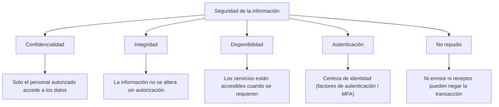

- **Tríada CIA:** núcleo universal de cualquier política de seguridad (Confidencialidad, Integridad y Disponibilidad).
- **Autenticación y No Repudio:** indispensables en arquitecturas distribuidas y comunicaciones entre múltiples partes.

---

<!-- content: UD01-C01 -->
## 1.6 · Vulneración de los principios: Escenarios técnicos

| Principio | Definición técnica | Escenario concreto de vulneración | Mecanismo de mitigación |
|---|---|---|---|
| **Confidencialidad** | Restricción del acceso exclusivamente a entidades autorizadas. | Inyección SQL que permite volcar la tabla `usuarios` y exponer números de tarjeta. | Cifrado en reposo (AES-256), TLS 1.3, consultas parametrizadas. |
| **Integridad** | Preservación de la exactitud y completitud de datos y métodos. | Modificación fraudulenta de saldos o registros contables en una base de datos. | Funciones *hash* criptográficas (SHA-256), firmas HMAC, auditoría de escrituras. |
| **Disponibilidad** | Garantía de acceso oportuno y confiable a los servicios e información. | Ataque distribuido de denegación de servicio (DDoS SYN Flood) contra la pasarela web. | Balanceadores de carga, CDN con mitigación anti-DDoS, clusters de alta disponibilidad. |
| **Autenticación** | Verificación inequívoca de la identidad de un usuario, proceso o nodo. | Ataque de fuerza bruta y robo de sesión por credenciales débiles en el panel de control. | MFA basado en TOTP/FIDO2 (saber + tener + ser), control de tasa de intentos. |
| **No repudio** | Imposibilidad de refutar la autoría de un mensaje enviado o recibido. | Un usuario niega haber ordenado una transferencia bancaria desde su cuenta. | Certificados X.509, firma electrónica cualificada, sellado de tiempo (*timestamping*). |

---

<!-- content: UD01-C01 -->
## 1.7 · Clasificación taxonómica de las medidas de seguridad

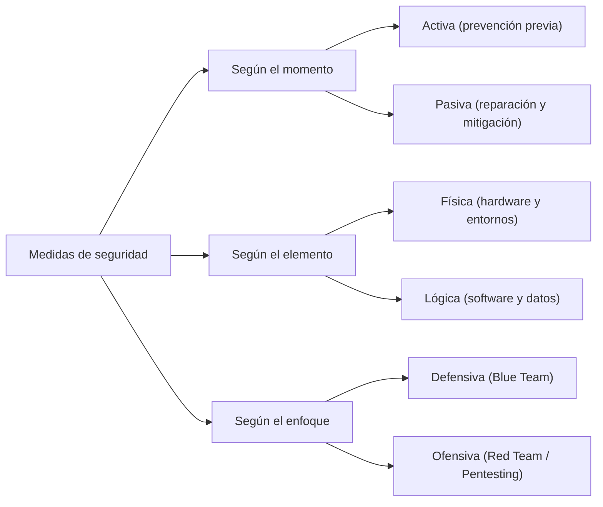

- **Seguridad Activa:** cortafuegos (iptables/nftables), WAF, controles de acceso por roles (RBAC).
- **Seguridad Pasiva:** copias de seguridad inmutables (estrategia 3-2-1), matrices RAID, SAI/UPS.
- **Seguridad Física:** biometría en CPD, sistemas antiincendios de gas inerte, cámaras CCTV.
- **Seguridad Lógica:** cifrado de particiones (LUKS/BitLocker), listas de control de acceso (ACL), antivirus/EDR.

---

<!-- content: UD01-C01 -->
## 1.8 · El término *hacker* según la RAE

La 23.ª edición del Diccionario de la Real Academia Española (actualizada en 2017) reconoce una doble acepción para el término **hacker** (o su adaptación ortográfica **jáquer**):

1. **Acepción 1:** *Pirata informático: persona que accede ilegalmente a sistemas informáticos ajenos para apropiárselos u obtener información secreta.*
2. **Acepción 2:** *Persona con grandes habilidades en el manejo de computadoras que investiga un sistema informático para avisar de los fallos y desarrollar técnicas de mejora.*

### Consecuencia técnica y didáctica
- La segunda acepción reconoce formalmente la figura del **hacker ético**.
- Un ciberatacante malicioso debe denominarse con propiedad **ciberdelincuente** o **cracker**, reservando *hacker* para la actitud técnica de investigación, optimización y resolución de problemas.

---

<!-- _class: lead -->
<!-- _header: '' -->
<!-- content: UD01-C02 -->

# 2 · Hacking, hacking ético, pentest y hacktivismo
### Delimitación conceptual, tipología de intrusos y marco penal español

---

<!-- content: UD01-C02 -->
## 2.1 · Clasificación por intenciones: Los sombreros (*hats*)

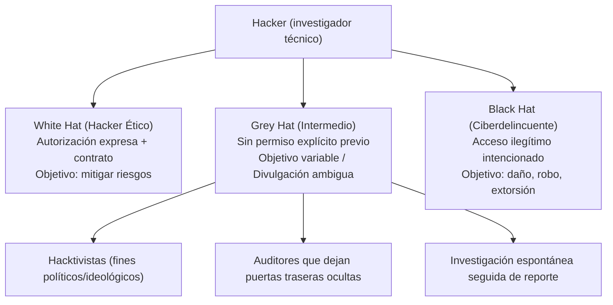

> **Axioma fundamental:** la intencionalidad moral o benevolente del investigador no neutraliza el tipo delictivo penal si la prueba carece de autorización contractual previa.

---

<!-- content: UD01-C02 -->
## 2.2 · Perfiles de intrusos y motivaciones operativas

| Perfil | Nivel técnico | Motivación principal | Modo de operación típico |
|---|---|---|---|
| **Cracker** | Medio / Alto | Lucro ilícito o sabotaje | Ingeniería inversa de software propietario, creación de *cracks*, elusión de DRM/licencias. |
| **Phreaker** | Medio | Curiosidad o fraude en telecomunicaciones | Manipulación de conmutadores, explotación de redes móviles y señalización SS7/VoIP. |
| **Script Kiddie / Lamer** | Bajo (nulo entendimiento) | Búsqueda de notoriedad o diversión | Descarga y ejecución de herramientas automáticas sin comprender el vector de ataque ni el código. |
| **Insider** | Medio / Alto | Venganza personal o soborno económico | Empleado o colaborador con acceso privilegiado legítimo que abusa deliberadamente de sus credenciales. |
| **Exempleado** | Medio / Alto | Resentimiento o espionaje corporativo | Utilización de cuentas residuales no revocadas a tiempo para acceder o sabotear infraestructura interna. |
| **Hacktivist** | Variable | Reivindicación política o ideológica | Ataques DDoS masivos, *defacements* de sitios web gubernamentales y filtraciones públicas de datos. |
| **State-Sponsored (APT)** | Muy Alto | Espionaje estratégico o guerra cibernética | Grupos financiados por Estados; campañas persistentes, ataques a infraestructuras críticas y uso de *0-days*. |

---

<!-- content: UD01-C02 -->
## 2.3 · Hacking vs. Hacking Ético vs. Pentest vs. Hacktivismo

| Parámetro | Hacking (genérico) | Hacking Ético | Test de Penetración (*Pentest*) | Hacktivismo |
|---|---|---|---|---|
| **Definición** | Acción de vulnerar o explorar sistemas más allá de su uso previsto. | Aplicación de técnicas ofensivas para detectar fallos y proteger la organización. | Proceso formal y metódico para simular un ataque real dentro de límites pactados. | Empleo de ciberataques con fines de protesta social, ideológica o política. |
| **Autorización** | No requerida por definición (término neutro). | **Indispensable**, por escrito y previa a la acción. | **Indispensable**, contractual y con firma autorizada. | **Ausente** (el objetivo no consiente el ataque). |
| **Marco legal** | Depende del acto específico y del consentimiento. | **Legal**, respaldado por contrato y deber de confidencialidad. | **Legal**, regido por *Rules of Engagement* formales. | **Ilegal**, tipificado en el Código Penal. |
| **Entregable** | Ninguno obligatorio. | Asesoramiento técnico y acompañamiento en seguridad. | **Informe de auditoría** (ejecutivo y técnico con PoCs). | Manifiestos públicos, filtraciones o denegación de servicio. |

---

<!-- content: UD01-C02 -->
## 2.4 · Marco penal español: Código Penal (Arts. 197 bis y ter)

El Código Penal tipifica de forma taxativa los delitos contra la intimidad y los sistemas de información:

```text
Artículo 197 bis.1 (Acceso ilícito):
"El que por cualquier medio o procedimiento, vulnerando las medidas de seguridad
establecidas para impedirlo, y sin estar debidamente autorizado, acceda o facilite a otro
el acceso al conjunto o una parte de un sistema de información o se mantenga en él en
contra de la voluntad de quien tenga el legítimo derecho a excluirlo..."
-> Pena: prisión de 6 meses a 2 años.

Artículo 197 bis.2 (Interceptación de transmisiones):
"El que mediante la utilización de artificios o instrumentos técnicos, y sin estar debidamente
autorizado, intercepte transmisiones no públicas de datos informáticos..."
-> Pena: prisión de 3 meses a 2 años o multa de 3 a 12 meses.

Artículo 197 ter (Herramientas y credenciales para el delito):
Castiga a quien produzca, adquiera, importe o facilite programas informáticos concebidos
principalmente para cometer accesos no autorizados, o contraseñas y códigos de acceso.
-> Pena: prisión de 6 meses a 2 años o multa.
```

---

<!-- content: UD01-C02 -->
## 2.5 · Lección jurídica: El caso del sistema LexNET

### Caso real de estudio
- En 2017, un investigador de seguridad descubrió una vulnerabilidad crítica de control de acceso (*Insecure Direct Object Reference*, IDOR) en la plataforma **LexNET** del Ministerio de Justicia.
- Dicha vulnerabilidad permitía acceder a expedientes judiciales de cualquier abogado cambiando el identificador numérico en la solicitud web.
- El investigador lo divulgó públicamente y colaboró en el aviso; no obstante, **al carecer de contrato previo o programa formal de reporte**, el Ministerio abrió diligencias penales contra él por acceso no autorizado.

### Conclusiones para el ejercicio profesional
1. **La buena fe no exime:** la ausencia de dolo no invalida el tipo objetivo de intrusión si no existía autorización expresa previa.
2. **Procedimiento estricto:** las vulnerabilidades solo deben investigarse en sistemas propios, bajo contrato o en plataformas con directrices públicas de *Responsible Disclosure* (RFC 9116).

---

<!-- _class: lead -->
<!-- _header: '' -->
<!-- content: UD01-C03 -->

# 3 · Permisos y autorizaciones previos
### Definición del alcance, *Rules of Engagement* (RoE) y marco regulatorio

---

<!-- content: UD01-C03 -->
## 3.1 · El Test de Intrusión (*Pentest*) como servicio contractual

Un **test de intrusión** es una auditoría técnica controlada en la que un equipo de profesionales cualificados evalúa la resistencia de los sistemas, redes y aplicaciones de una organización intentando vulnerarlos de forma metodológica.

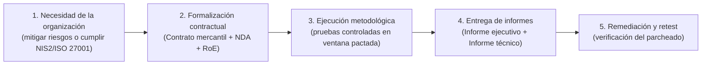

- **Objetivo estratégico:** anticiparse a los atacantes reales identificando vectores de intrusión antes de que sean explotados con fines lesivos.
- **Diferencia clave:** toda acción está acotada por **parámetros operativos y garantías legales**.

---

<!-- content: UD01-C03 -->
## 3.2 · *Rules of Engagement* (RoE): Delimitación operativa

Las **Rules of Engagement** (reglas de compromiso) constituyen el documento técnico anexo al contrato donde se fijan los límites operativos exactos de la prueba:

| Parámetro operativo | Preguntas que responde | Implicación técnica |
|---|---|---|
| **Ventana temporal** | ¿En qué días y franjas horarias se autoriza el escaneo? | Pruebas nocturnas o en fines de semana para evitar sobrecargar sistemas en producción. |
| **Límites de carga** | ¿Qué umbral de ancho de banda o peticiones por segundo se tolera? | Configurar herramientas como `nmap` o `dirsearch` con retardos (`--scan-delay`, `-T2/-T3`). |
| **Pruebas de estrés / DoS** | ¿Se autorizan ataques de denegación de servicio? | **Prohibidos por defecto**; solo permitidos en entornos de preproducción con réplicas idénticas. |
| **Ingeniería social** | ¿Se permite enviar correos de *phishing* simulados a la plantilla? | Requiere autorización expresa de Recursos Humanos y Dirección General. |
| **Uso de *exploits* destructivos** | ¿Se autorizan cargas útiles que puedan provocar reinicios o *kernel panic*? | Prohibido el uso de exploits inestables; se priorizan pruebas de concepto no intrusivas (*harmless PoC*). |
| **Canal de escalada** | ¿A quién se notifica en caso de parada inesperada de servicio? | Matriz de contacto con disponibilidad 24/7 de los responsables de IT y del pentester. |

---

<!-- content: UD01-C03 -->
## 3.3 · Ciclo contractual formal del pentesting

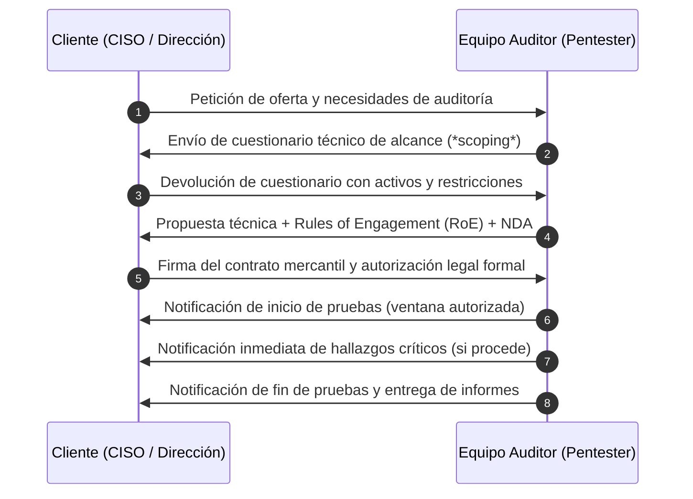

> **Aviso operativo:** si durante la auditoría se detecta un servidor vulnerable que no figura en la lista de activos autorizados, **el auditor debe detenerse de inmediato y solicitar ampliación por escrito**, sin lanzar ningún escaneo sobre él.

---

<!-- content: UD01-C03 -->
## 3.4 · Elementos indispensables de un contrato de pentesting

Para gozar de validez jurídica plena frente a terceros y ante la jurisdicción penal, el contrato debe contener:

1. **Definición inequívoca del alcance (*scope*):**
   - Direcciones IP públicas, rangos CIDR (p. ej., `198.51.100.0/26`), FQDNs autorizados y aplicaciones web.
   - Lista explícita de sistemas **excluidos** (p. ej., proveedores SaaS externos, pasarelas de pago de terceros, filiales no incluidas en el pliego).
2. **Vigencia y calendario de ejecución:** marcas temporales exactas de inicio y conclusión.
3. **Modalidad técnica pactada:** caja negra, gris o blanca (según especificación).
4. **Punto de contacto y protocolo de emergencia:** comunicación cifrada para incidentes críticos.
5. **Acuerdo de Confidencialidad (*Non-Disclosure Agreement*, NDA):** secreto profesional vitalicio sobre código, debilidades y datos corporativos.
6. **Legitimación del firmante:** el firmante debe poseer potestad legal suficiente para autorizar la prueba sobre la titularidad de los sistemas auditados.

---

<!-- content: UD01-C03 -->
## 3.5 · Relación con RGPD, LOPDGDD y Directiva NIS2

### Protección de Datos Personales (RGPD y LOPDGDD)
- **Acceso incidental a datos personales:** en la explotación de un fallo (p. ej., una inyección SQL), el auditor puede visualizar datos de empleados o clientes.
- **Obligaciones contractuales:**
  - El contrato debe regular el deber de secreto y la **destrucción certificada** de volcados de datos tras la redacción del informe.
  - Si se descubre una brecha preexistente que comprometa datos personales, el responsable debe notificar a la AEPD en **máximo 72 horas** (art. 33 RGPD).

### Directiva NIS2 (Directiva UE 2022/2555)
- Aplica a entidades esenciales e importantes (energía, sanidad, banca, infraestructuras digitales).
- Obliga a implementar medidas de gestión de riesgos cibernéticos y someterse a **auditorías técnicas periódicas**, convirtiendo el pentesting en un imperativo de cumplimiento normativo.

---

<!-- _class: lead -->
<!-- _header: '' -->
<!-- content: UD01-C04 -->

# 4 · Fases del hacking
### Metodología de auditoría: de la inteligencia abierta a la remediación técnica

---

<!-- content: UD01-C04 -->
## 4.1 · Las cinco fases de un test de intrusión

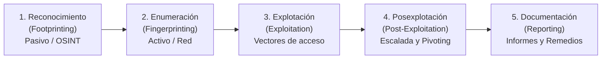

- Cada fase se apoya rigurosamente en la información recopilada en la fase anterior.
- Un error frecuente en principiantes es saltar a la explotación sin haber completado una fase rigurosa de reconocimiento y enumeración.

---

<!-- content: UD01-C04 -->
## 4.2 · Fase 1: Reconocimiento (*Footprinting*) pasivo y OSINT

**Objetivo:** obtener el mapa de información pública del objetivo **sin interactuar directamente con sus servidores ni enviar paquetes a su infraestructura**.

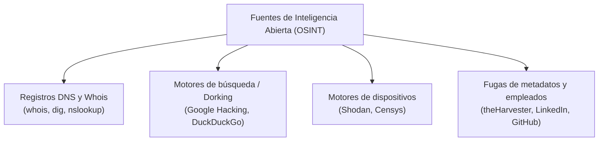

- **Legalidad:** al no haber tráfico directo contra los servidores del cliente, no constituye interacción intrusiva.
- **Ejemplo técnico:** localizar repositorios públicos de desarrolladores de la empresa donde se hayan filtrado por error claves de API o nombres de servidores internos.

---

<!-- content: UD01-C04 -->
## 4.3 · Fase 2: Enumeración y escaneo activo (*Fingerprinting*)

**Objetivo:** enviar paquetes de red directamente a los sistemas del cliente para identificar puertos abiertos, versiones exactas de software y rutas web.

- **Requiere autorización previa:** al enviar tráfico directo que interactúa con los servicios, esta fase ya está sujeta al Código Penal si carece de contrato.
- **Técnicas habituales:**
  - Descubrimiento de hosts activos en la red (`netdiscover`, ICMP/ARP sweeps).
  - Escaneo de puertos TCP/UDP y detección de versiones de servicio (`nmap`).
  - Enumeración de directorios web ocultos (`gobuster`, `ffuf`, `dirsearch`).

```bash
# Ejemplo de escaneo SYN sigiloso con detección de versiones y scripts por defecto
nmap -sS -sV -sC -p- 198.51.100.25 -oA escaneo_inicial_cliente
```

> **Resultado esperado:** inventario detallado de la superficie de ataque (ej. Puerto 80: Apache 2.4.49, Puerto 22: OpenSSH 8.2p1, Puerto 3306: MySQL 5.7).

---

<!-- content: UD01-C04 -->
## 4.4 · Fase 3: Explotación (*Exploitation*)

**Objetivo:** validar técnicamente si una vulnerabilidad identificada en la fase previa puede ser aprovechada para obtener acceso no autorizado a los sistemas.

- **Diseño del vector de ataque:**
  - Localización de pruebas de concepto (*Proof of Concept*, PoC) mediante herramientas como `searchsploit` o bases de datos de vulnerabilidades.
  - Configuración de cargas útiles (*payloads*) mediante marcos de trabajo como **Metasploit Framework** o scripts en Python adaptados al entorno.
  - Abuso de malas configuraciones (credenciales por defecto en paneles de administración, inyecciones de comandos web).

```bash
# Búsqueda local de exploits verificados en la base de datos de Exploit-DB
searchsploit "Drupal 7.x"
```

> **Principio de proporcionalidad:** el pentester busca evidenciar el acceso mediante una prueba inocua (p. ej., ejecutar `id` o `whoami`), evitando alterar datos o bloquear el servicio.

---

<!-- content: UD01-C04 -->
## 4.5 · Fase 4: Posexplotación (*Post-Exploitation*)

**Objetivo:** evaluar el impacto potencial del compromiso inicial: ¿qué puede hacer un atacante una vez dentro?

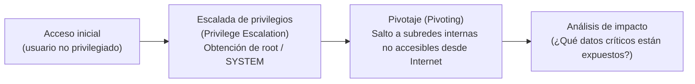

- **Técnicas de escalada:** búsqueda de binarios con bit SUID activado, configuraciones de `sudo` mal asignadas (`sudo -l`), o vulnerabilidades del kernel local.
- **Pivoting:** uso del host comprometido como pasarela (*proxy socks*, túnel SSH) para auditar la red interna de la organización.
- **Comprobación típica de permisos SUID:**
  ```bash
  find / -perm -u=s -type f 2>/dev/null
  ```

---

<!-- content: UD01-C04 -->
## 4.6 · Fase 5: Documentación (*Reporting*) vs. "Cubrir huellas"

| Aspecto | Pentest ético (Fase 5: Documentación) | Ataque malicioso (*Black Hat*) |
|---|---|---|
| **Acción tras el compromiso** | Redacción rigurosa de informes con pasos reproducibles y recomendaciones. | Eliminación de registros de logs (`/var/log/`, Event Viewer) y alteración de fechas (*timestomp*). |
| **Persistencia** | Se retiran todas las herramientas y usuarios temporales creados (*housekeeping*). | Instalación de puertas traseras (*backdoors*), *rootkits* y canales de comando y control (C2). |
| **Destinatario** | El cliente (C-level e ingenieros de sistemas). | Canales clandestinos para extorsión o venta en foros oscuros. |

### Tipos de informe entregados
1. **Informe Ejecutivo:** orientado a la dirección (CISO, CEO, DPO); evalúa el riesgo global del negocio en lenguaje accesible y resume los costes de no corregir.
2. **Informe Técnico:** orientado al equipo de IT y desarrolladores; describe cada hallazgo con vector CVSS, evidencia gráfica (capturas), PoC reproducible y parches recomendados.

---

<!-- content: UD01-C04 -->
## 4.7 · Caso práctico guiado: Progresión de un pentest web

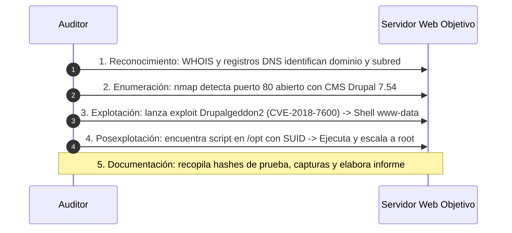

- **Paso 1 (OSINT):** se descubren subdominios corporativos.
- **Paso 2 (Escaneo):** se confirma la versión desactualizada del gestor de contenidos.
- **Paso 3 (Explotación):** se obtiene una terminal remota con permisos limitados (`www-data`).
- **Paso 4 (Posexplotación):** se escala a privilegios de administración (`root`).
- **Paso 5 (Documentación):** se describe la cadena completa de ataque y la solución: *actualizar Drupal a la versión soportada y eliminar el bit SUID del binario en `/opt`*.

---

<!-- _class: lead -->
<!-- _header: '' -->
<!-- content: UD01-C05 -->

# 5 · Auditorías de caja negra, gris y blanca
### Dimensiones de evaluación: conocimiento previo, posición de red y alcance

---

<!-- content: UD01-C05 -->
## 5.1 · Tipos de auditoría según el conocimiento previo

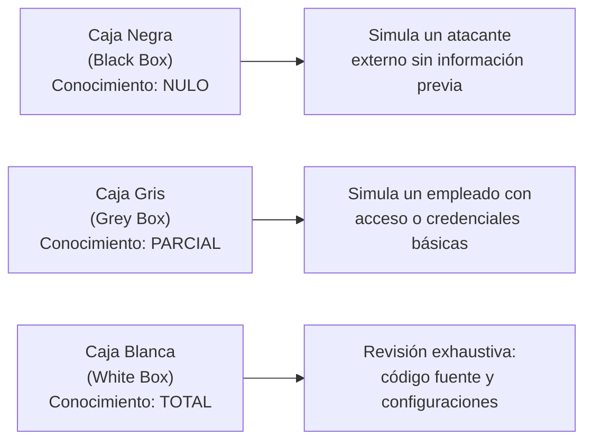

- **Caja Negra:** el auditor solo recibe el dominio o la IP. Obliga a maximizar el tiempo dedicado a reconocimiento y enumeración.
- **Caja Gris:** se facilitan credenciales de usuario raso o esquemas lógicos de red. Es la modalidad más coste-eficiente en el mercado actual.
- **Caja Blanca:** acceso a repositorios Git, archivos de configuración de cortafuegos y diagramas de arquitectura. Permite análisis de código estático (SAST) y dinámico (DAST).

---

<!-- content: UD01-C05 -->
## 5.2 · Comparativa de metodologías por nivel de conocimiento

| Tipo de caja | Información aportada al auditor | Ventajas para la organización | Limitaciones técnicas |
|---|---|---|---|
| **Caja Negra** (*Black Box*) | Únicamente el nombre de la empresa, dominio o rango de red. | Máximo realismo respecto a lo que vería un ciberdelincuente externo. | Mayor tiempo invertido en escaneo; puede dejar vulnerabilidades internas sin auditar. |
| **Caja Gris** (*Grey Box*) | Credenciales de usuario normal, URL de la API y mapa básico de red. | Equilibrio óptimo entre tiempo de auditoría, coste y cobertura de fallos en lógica de negocio. | Requiere coordinar la asignación y mantenimiento de las credenciales de prueba. |
| **Caja Blanca** (*White Box*) | Código fuente completo, esquemas de red, configuraciones y usuarios administradores. | Máxima exhaustividad; detecta vulnerabilidades profundas de diseño y código que un escaneo no ve. | Menos representativa del comportamiento de un atacante ciego; mayor volumen de datos a analizar. |

---

<!-- content: UD01-C05 -->
## 5.3 · Tipos de auditoría según la posición del auditor

No debe confundirse el **nivel de conocimiento** (negra/gris/blanca) con la **posición de red** desde donde se realizan los ataques:

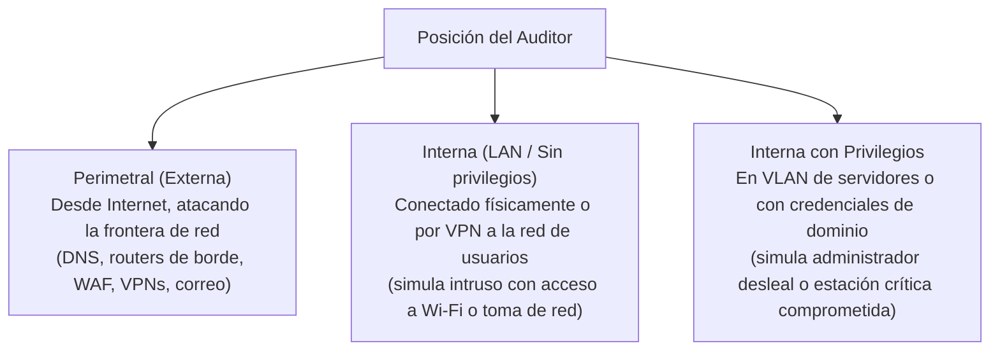

---

<!-- content: UD01-C05 -->
## 5.4 · Tipos de auditoría según el alcance de los activos

La auditoría se adapta a la tipología específica de la tecnología evaluada:

- **Auditoría de Aplicaciones Web:** pruebas centradas en el OWASP Top 10 (inyecciones SQL, XSS, fallos de control de acceso IDOR, desbordamientos de lógica).
- **Auditoría de Aplicaciones Móviles:** análisis de binarios APK/IPA, almacenamiento inseguro en el dispositivo, certificados SSL/TLS y comunicación con APIs backend.
- **Auditoría Wireless y VoIP:** evaluación del cifrado Wi-Fi (WPA2/WPA3 Enterprise, ataques Evil Twin), segmentación de redes de invitados y robustez de centralitas SIP.
- **Pruebas de Estrés DoS/DDoS:** simulación controlada de avalancha de tráfico (SYN flood, HTTP GET floods) para medir la capacidad de respuesta y la resiliencia de la infraestructura.

---

<!-- content: UD01-C05 -->
## 5.5 · Matriz de combinación práctica de auditorías

Los ejes de conocimiento, posición y tecnología se combinan en función del objetivo del negocio:

| Escenario empresarial | Posición de red | Nivel de conocimiento | Enfoque tecnológico |
|---|---|---|---|
| Comprobar la resistencia de la sede web corporativa frente a Internet. | **Perimetral** | **Caja Negra** | Auditoría Web externa |
| Evaluar el riesgo de que un empleado descontento robe nóminas en la LAN. | **Interna** | **Caja Gris** | Auditoría de Directorio Activo y redes internas |
| Certificar la seguridad del software antes del despliegue en producción. | **Interna / Laboratorio** | **Caja Blanca** | Revisión de código fuente (SAST) + Web API |
| Analizar el riesgo de intrusión física en oficinas a través de la red de invitados. | **Interna** | **Caja Negra** | Auditoría Wi-Fi y segmentación de VLANs |

---

<!-- _class: lead -->
<!-- _header: '' -->
<!-- content: UD01-C06 -->

# 6 · Documentación de vulnerabilidades
### Estándares de la industria: catálogo CVE, métricas CVSS y taxonomía CWE

---

<!-- content: UD01-C06 -->
## 6.1 · ¿Qué es una vulnerabilidad? Del primer *bug* a la actualidad

- **Definición técnica:** una debilidad o fallo en el diseño, implementación o configuración de un sistema informático que permite a un agente de amenazas comprometer los principios de confidencialidad, integridad o disponibilidad.
- **Origen del término *bug*:** el 9 de septiembre de 1947, la pionera **Grace Murray Hopper** documentó en el ordenador electromecánico Harvard Mark II una polilla real (*bug*) atrapada en el relé n.º 70, que impedía el correcto paso de la señal eléctrica.

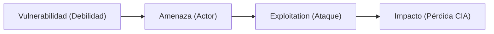

- Las vulnerabilidades contemporáneas no se deben a insectos físicos, sino a fallos en la lógica de programación del software o a defectos de microarquitectura en el hardware.

---

<!-- content: UD01-C06 -->
## 6.2 · Vulnerabilidades de software: Casos reales de alto impacto

| CVE | Denominación | Componente afectado | Vector e impacto técnico |
|---|---|---|---|
| **CVE-2021-44228** | *Log4Shell* | Biblioteca Java **Apache Log4j** | Ejecución remota de código (RCE) mediante inyección de cadenas JNDI/LDAP no saneadas en registros de log. CVSS: **10.0** (Crítica). |
| **CVE-2022-22965** | *Spring4Shell* | Framework Java **Spring Framework** | RCE mediante *Data Binding* que permitía escribir archivos arbitrarios en el servidor Tomcat. CVSS: **9.8** (Crítica). |
| **CVE-2021-4034** | *PwnKit* | Componente **polkit** (`pkexec`) en Linux | Escalada de privilegios local a `root` por un desbordamiento de memoria presente en sistemas Linux durante más de una década. |
| **CVE-2020-1472** | *Zerologon* | Protocolo **Netlogon** en Windows Server | Uso erróneo del vector de inicialización (todo ceros) en el cifrado AES-CFB8; permitía a un atacante en la red tomar el control del Dominio en segundos. |
| **CVE-2021-36934** | *HiveNightmare* / *#SeriousSAM* | Sistema de ficheros NTFS en Windows 10 | Permisos de lectura excesivos sobre el archivo SAM; cualquier usuario no privilegiado podía volcar las contraseñas del sistema. |

---

<!-- content: UD01-C06 -->
## 6.3 · Vulnerabilidades de hardware y microarquitectura

Afectan al diseño físico de los circuitos integrados y a los microprocesadores; no se corrigen simplemente reinstalando el sistema operativo:

| CVE / Nombre | Arquitectura afectada | Mecanismo técnico del fallo |
|---|---|---|
| **Meltdown**<br>(CVE-2017-5754) | Procesadores Intel / ARM | Rompe el aislamiento entre aplicaciones de usuario y la memoria del kernel mediante la ejecución fuera de orden (*out-of-order execution*). |
| **Spectre**<br>(CVE-2017-5753 / 5715) | Intel, AMD, ARM | Abusa de la ejecución especulativa (*speculative execution*) y los canales laterales de la caché de CPU para leer datos de otros procesos. |
| **Retbleed**<br>(CVE-2022-29900/29901) | Procesadores Intel y AMD | Vulnera las defensas de retorno predictivo (*retpoline*) diseñadas inicialmente para mitigar Spectre. |
| **Zenbleed**<br>(CVE-2023-20593) | AMD Zen 2 | Fuga de registros vectoriales de la CPU a 30 KB/s por núcleo debido a un fallo en la instrucción `vzeroupper`. |
| **Rowhammer** | Memorias DRAM DDR3/DDR4 | Acceso reiterado y a alta frecuencia a una fila de celdas de memoria que provoca alteración de bits (*bit flipping*) en filas contiguas. |

---

<!-- content: UD01-C06 -->
## 6.4 · Vulnerabilidades de día cero (*0-days*) y el mercado de *exploits*

- **Vulnerabilidad de día cero (*Zero-Day*):** fallo de seguridad desconocido para el fabricante del software o para el cual no existe aún parche oficial disponible.
- **Ventana de vulnerabilidad:** el tiempo que transcurre entre el descubrimiento del fallo por actores hostiles y la publicación del parche por parte del proveedor.

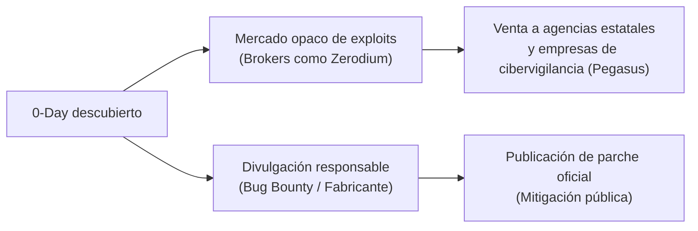

- **Plataformas de corretaje (*Brokers*):** empresas privadas (p. ej., Zerodium) pagan hasta 2,5 millones de dólares por cadenas de explotación *zero-click* en Android o iOS, destinadas a clientes gubernamentales en lugar de ser reportadas para su corrección.

---

<!-- content: UD01-C06 -->
## 6.5 · Documentación estándar: La tríada CVE, CVSS y CWE

Para describir un fallo técnico con rigor profesional y sin ambigüedad se combinan tres estándares complementarios:

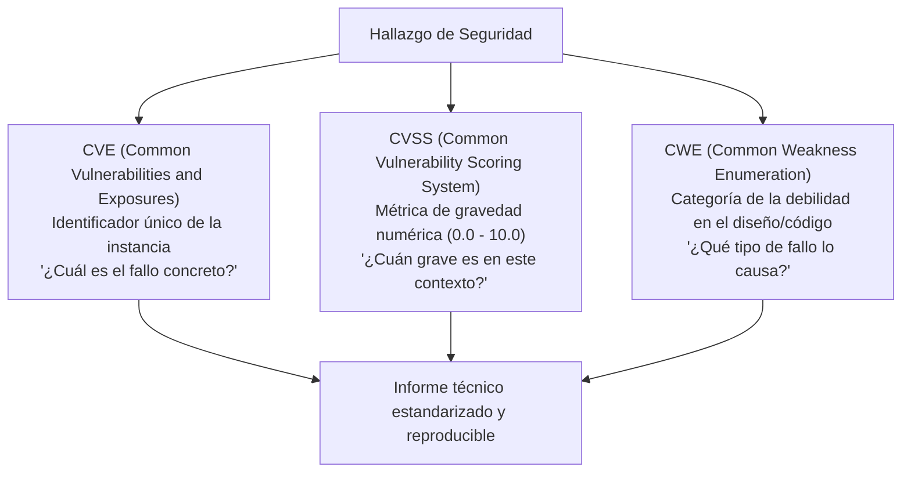

> **Regla de oro profesional:** el CVE **identifica**, el CWE **clasifica** la causa raíz y el CVSS **prioriza** la urgencia de la remediación.

---

<!-- content: UD01-C06 -->
## 6.6 · CVE (*Common Vulnerabilities and Exposures*)

- **Gestor:** Corporación **MITRE** (`cve.org`) con respaldo de la CISA y las Autoridades de Asignación de Números (CNA).
- **Formato del identificador:**
  $$\text{CVE-AAAA-NNNNN}$$
  - `CVE`: prefijo identificativo del estándar.
  - `AAAA`: año de asignación o publicación pública de la vulnerabilidad.
  - `NNNNN`: número correlativo asignado por la autoridad competente (mínimo 4 dígitos).
- **Ejemplo:** `CVE-2021-44228` corresponde inequívocamente al fallo *Log4Shell* reportado a finales de 2021.
- **Base de datos nacional de vulnerabilidades (NVD del NIST):** enriquece las entradas CVE añadiendo el impacto en productos específicos (CPE), enlaces a parches y el vector CVSS oficial.

---

<!-- content: UD01-C06 -->
## 6.7 · CVSS v3.1: Desglose de métricas base

El estándar **Common Vulnerability Scoring System** evalúa la severidad mediante tres grupos de métricas: **Base**, **Temporal** y **Ambiental** (de entorno). Las métricas base se dividen en dos subgrupos:

### 1. Métricas de Explotabilidad (*Exploitability Metrics*)
- **Attack Vector (AV):** Network (N) | Adjacent (A) | Local (L) | Physical (P).
- **Attack Complexity (AC):** Low (L) | High (H).
- **Privileges Required (PR):** None (N) | Low (L) | High (H).
- **User Interaction (UI):** None (N) | Required (R).

### 2. Métrica de Alcance (*Scope*)
- **Scope (S):** Unchanged (U) | Changed (C) *(el fallo salta a otro componente)*.

### 3. Métricas de Impacto (*Impact Metrics*)
- **Confidentiality (C) / Integrity (I) / Availability (A):** None (N) | Low (L) | High (H).

---

<!-- content: UD01-C06 -->
## 6.8 · Escala de severidad y cálculo práctico de CVSS v3.1

| Rango de puntuación CVSS | Nivel de Severidad | Prioridad de remediación en producción |
|---|---|---|
| **0.0** | Ninguna (*None*) | Informativo. |
| **0.1 – 3.9** | Baja (*Low*) | Corrección planificada en próximos ciclos de mantenimiento. |
| **4.0 – 6.9** | Media (*Medium*) | Mitigación recomendada a medio plazo. |
| **7.0 – 8.9** | Alta (*High*) | Parcheado prioritario; vector accesible. |
| **9.0 – 10.0** | Crítica (*Critical*) | **Acción inmediata (24-48 h)**; explotación remota sin interacción. |

### Ejemplo real de vector calculado: 9.4 (Crítica)
$$\text{CVSS:3.1/AV:N/AC:L/PR:N/UI:N/S:U/C:L/I:H/A:H}$$
- Explotable remotamente por red (`AV:N`), complejidad trivial (`AC:L`), sin necesidad de credenciales (`PR:N`), sin interacción de víctimas (`UI:N`), el alcance no cambia (`S:U`), impacto bajo en confidencialidad (`C:L`) e impacto devastador en integridad (`I:H`) y disponibilidad (`A:H`).

---

<!-- content: UD01-C06 -->
## 6.9 · CWE (*Common Weakness Enumeration*) y el Top 25

El catálogo **CWE** (mantenido por MITRE) categoriza los fallos de programación, diseño y arquitectura subyacentes. El informe anual **CWE Top 25** recopila las debilidades más peligrosas y frecuentes:

| CWE ID | Nombre de la debilidad | Descripción del defecto en el software |
|---|---|---|
| **CWE-79** | *Cross-Site Scripting* (XSS) | Neutralización incorrecta de entradas de usuario en páginas web dinámicas. |
| **CWE-89** | *SQL Injection* (SQLi) | Concatenación de entradas no saneadas en sentencias SQL dirigidas a la base de datos. |
| **CWE-20** | *Improper Input Validation* | Falta de validación del tipo, longitud o formato de los datos recibidos de clientes. |
| **CWE-352** | *Cross-Site Request Forgery* (CSRF) | El servidor procesa órdenes no autorizadas transmitidas por un usuario de confianza. |
| **CWE-22** | *Path Traversal* | Acceso a archivos fuera de la raíz web mediante secuencias relativas (`../`). |
| **CWE-77** | *Command Injection* | Ejecución de comandos del sistema operativo mediante parámetros no escapados. |
| **CWE-918** | *Server-Side Request Forgery* (SSRF) | El servidor realiza peticiones arbitrarias hacia redes internas a petición del atacante. |

---

<!-- _class: lead -->
<!-- _header: '' -->
<!-- content: UD01-C07 -->

# 7 · Herramientas, equipos y ecosistema profesional
### Red/Blue Teams, retos CTF, certificaciones, *bug bounty* y distribuciones

---

<!-- content: UD01-C07 -->
## 7.1 · Equipos de seguridad organizativos: Red, Blue y Purple Team

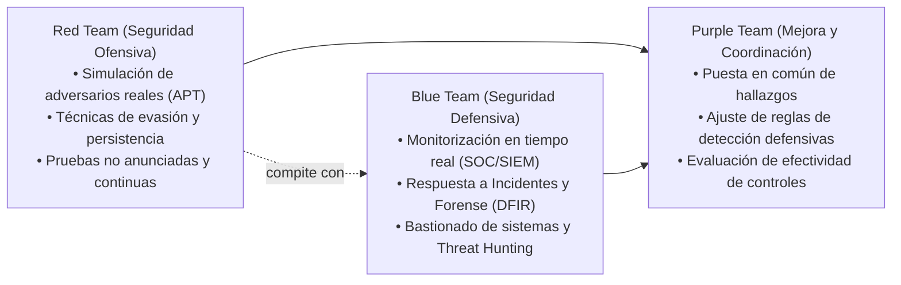

### La pirámide BAD (*Build, Attack, Defend*)
- Propuesta por Daniel Miessler: la seguridad integral no es solo atacar o defender, sino construir arquitecturas robustas (*Build*), probarlas continuamente (*Attack*) y monitorizarlas con agilidad (*Defend*).

---

<!-- content: UD01-C07 -->
## 7.2 · Red Teaming vs. Pentesting: Diferencias operativas

| Criterio | Test de Penetración (*Pentest*) | Ejercicio de *Red Teaming* |
|---|---|---|
| **Objetivo principal** | Encontrar y listar **tantas vulnerabilidades como sea posible** en el alcance acordado. | Validar la capacidad de **detección y respuesta** del Blue Team ante un objetivo crítico específico. |
| **Duración temporal** | Acotada (generalmente 1 a 3 semanas). | Prolongada en el tiempo (semanas a meses). |
| **Visibilidad defensiva** | Generalmente conocido por los administradores de sistemas. | **Ciego**: el Blue Team no sabe que se está realizando la simulación. |
| **Tácticas y técnicas** | Escaneo exhaustivo y explotación directa. | Emulación de amenazas persistentes avanzadas (**APT**) usando la matriz de TTPs de **MITRE ATT&CK**. |
| **Éxito del ejercicio** | Informe completo de fallos encontrados con su CVSS. | Demostrar si el Red Team logró el objetivo estratégico (ej. extraer la base de datos central) sin ser detectado. |

---

<!-- content: UD01-C07 -->
## 7.3 · Áreas de conocimiento base del profesional de ciberseguridad

El dominio de las herramientas de hacking solo es eficaz si se apoya en fundamentos sólidos de ciencias de la computación:

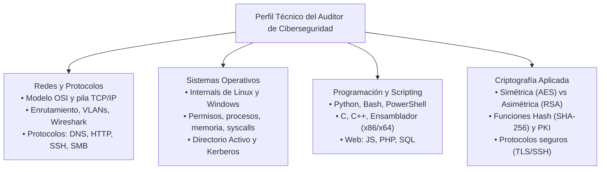

---

<!-- content: UD01-C07 -->
## 7.4 · Aprendizaje práctico legal: Retos CTF (*Capture The Flag*)

Al ser delito atacar sistemas no autorizados, los entornos de simulación son la vía legal y didáctica para adquirir destrezas:

- **Mecánica CTF:** el participante debe analizar y explotar un reto técnico para localizar una cadena alfanumérica oculta denominada **bandera** (*flag*, p. ej., `FLAG{5ql_1nj3ct10n_m4st3r}`).

| Modalidad de CTF | Dinámica de la competición | Habilidades entrenadas |
|---|---|---|
| **Jeopardy (Retos)** | Puntuación por resolver problemas independientes clasificados por categorías. | Criptografía (*crypto*), Esteganografía (*stego*), Análisis Forense (*forensics*), Ingeniería Inversa (*reversing*), Explotación Binaria (*pwn*), Web. |
| **Máquinas (*Boxes*)** | Explotación de una máquina virtual vulnerable completa (*boot2root*). | Fase 1: compromiso y bandera de usuario común (`user.txt`).<br>Fase 2: escalada de privilegios a administrador (`root.txt`). |
| **Ataque y Defensa** | Equipos defienden sus servidores propios mientras atacan los servidores idénticos de los rivales. | Bastionado contra reloj, parcheado en vivo y desarrollo ágil de exploits. |

---

<!-- content: UD01-C07 -->
## 7.5 · Plataformas de entrenamiento en ciberseguridad

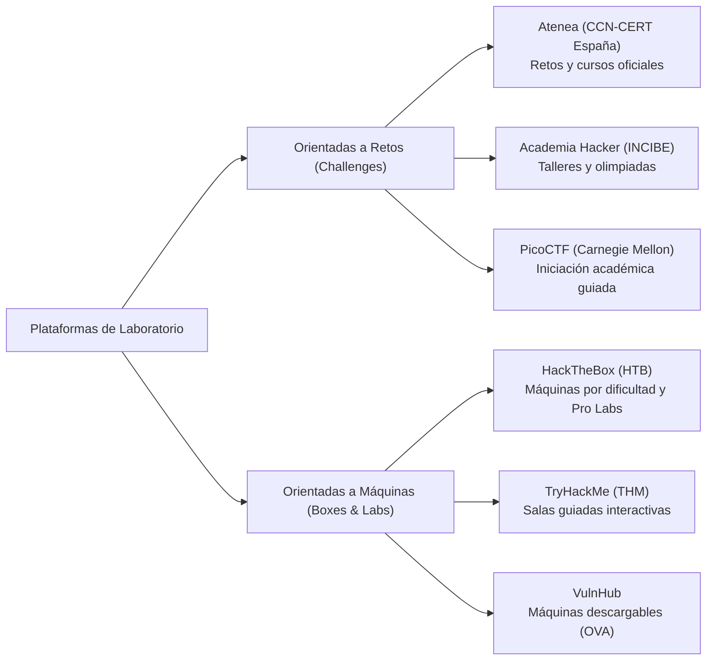

> **Código de honor ético:** está terminantemente prohibido publicar la solución técnica (*writeup* o *walkthrough*) de un reto o máquina activa en una plataforma de entrenamiento.

---

<!-- content: UD01-C07 -->
## 7.6 · Certificaciones profesionales en seguridad ofensiva

Acreditan competencias técnicas ante el mercado laboral; se diferencian según su metodología de examen (teórica vs. 100 % práctica):

| Certificación | Entidad emisora | Enfoque y dificultad | Metodología de examen |
|---|---|---|---|
| **CEH** (*Certified Ethical Hacker*) | EC-Council | Básico / Generalista | Teórico (preguntas tipo test; criticado tradicionalmente por bajo componente práctico). |
| **CompTIA PenTest+** | CompTIA | Intermedio | Examen mixto (preguntas teóricas + simulaciones de laboratorio prácticas). |
| **eJPT** (*Junior Penetration Tester*) | INE Security | Principiante / Práctico | Examen práctico en red simulada; ideal como primer escalón profesional. |
| **PNPT** (*Practical Network Pentester*) | TCM Security | Intermedio / Realista | 5 días de auditoría integral sobre un entorno empresarial con prueba de OSINT y reporte. |
| **HTB CPTS** (*Penetration Testing Specialist*) | HackTheBox | Avanzado / Práctico | Auditoría exhaustiva de red empresarial y redacción de informe formal. |
| **OSCP** (*Offensive Security Certified Professional*) | OffSec | Avanzado / Muy exigente | **24 horas seguidas** para comprometer múltiples máquinas y Active Directory; lema: *"Try Harder"*. |

---

<!-- content: UD01-C07 -->
## 7.7 · Programas de recompensas (*Bug Bounty*) y RFC 9116

Los programas de recompensas incentivan a investigadores independientes a reportar vulnerabilidades de manera confidencial y ética a cambio de compensaciones económicas:

- **Ventajas:** miles de ojos analizan la superficie externa de la empresa de forma continua; solo se paga por vulnerabilidades válidas y reproducibles.
- **Plataformas intermediarias:** **HackerOne**, **Bugcrowd**, **Intigriti** (europea) e **Immunefi** (especializada en contratos inteligentes Web3 y finanzas descentralizadas).

### El estándar RFC 9116: `security.txt`
Archivo de texto ubicado obligatoriamente en `/.well-known/security.txt` donde las organizaciones informan a los hackers cómo reportar incidentes legalmente:

```http
Contact: mailto:security@ejemplo.com
Contact: https://hackerone.com/ejemplo
Expires: 2027-12-31T23:59:59.000Z
Policy: https://ejemplo.com/responsible-disclosure-policy
Preferred-Languages: es, en
```

---

<!-- content: UD01-C07 -->
## 7.8 · Distribuciones especializadas para pentesting

Optimizadas con centenares de herramientas preconfiguradas, controladores para inyección inalámbrica y entornos aislados:

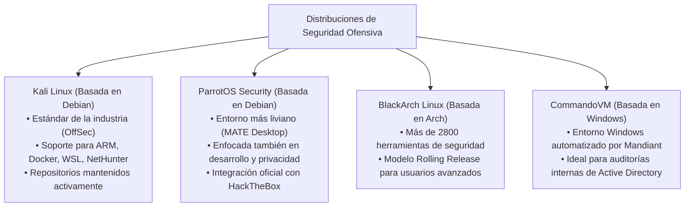

---

<!-- content: UD01-C07 -->
## 7.9 · Mapa de herramientas por fase del pentest

| Fase del Pentest | Herramientas de referencia | Función técnica concreta |
|---|---|---|
| **Reconocimiento**<br>(*Footprinting*) | `whois`, `dig`, `theHarvester`, Shodan, Maltego, `netdiscover` | Recopilación de metadatos DNS, bloques IP, subdominios, correos y dispositivos expuestos en Internet. |
| **Enumeración**<br>(*Scanning*) | `nmap`, `masscan`, `gobuster`, `ffuf`, `nikto`, `wpscan` | Detección de puertos abiertos, *banner grabbing*, descubrimiento de rutas HTTP y versiones de software. |
| **Explotación** | **Metasploit**, `searchsploit`, `sqlmap`, `hydra`, Burp Suite | Lanzamiento de exploits controlados, inyecciones SQL automatizadas, fuerza bruta y manipulación de peticiones HTTP. |
| **Posexplotación** | `netcat`, LinPEAS, WinPEAS, Mimikatz, Chisel, BloodHound | Movimiento lateral, volcado de credenciales en memoria LSASS, túneles TCP y auditoría de permisos en el Dominio. |

---

<!-- _class: lead -->
<!-- _header: '' -->
<!-- content: UD01-C08 -->

# 8 · ClearNet, Deep Web, Dark Web y Darknets
### Capas de Internet, enrutamiento cebolla (Tor), redes P2P y límites legales

---

<!-- content: UD01-C08 -->
## 8.1 · Las capas de Internet: ClearNet, Deep Web y Dark Web

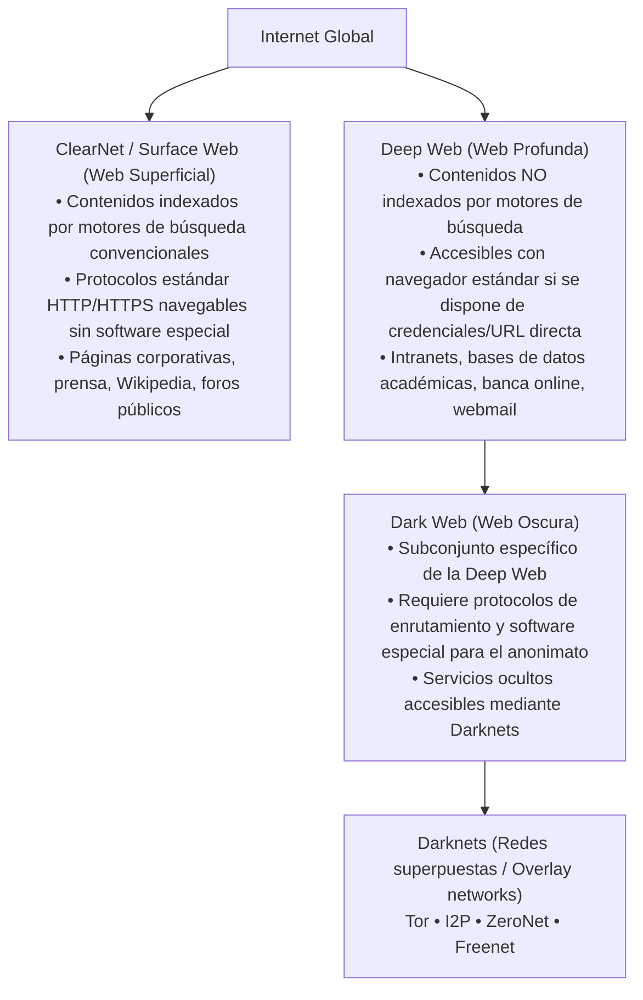

---

<!-- content: UD01-C08 -->
## 8.2 · Desmitificando la Deep Web frente a la Dark Web

Existe una confusión generalizada generada por metáforas sensacionalistas (como el iceberg de Internet):

| Dimensión | Deep Web (Web Profunda) | Dark Web (Web Oscura) |
|---|---|---|
| **Definición** | Cualquier recurso web no indexado por buscadores públicos (Google, Bing). | Contenido web intencionadamente oculto que reside en **darknets**. |
| **Tamaño relativo** | Constituye la inmensa mayoría de la información en Internet (**> 90 %**). | Subconjunto minúsculo dentro de la Deep Web (estimado en **< 1 %**). |
| **Navegación** | Navegador web ordinario (Chrome, Firefox, Safari, Edge). | Software específico preparado para la red diana (**Tor Browser**, I2P Router). |
| **Naturaleza del contenido** | **Legítimo y necesario**: historiales médicos, carpetas privadas de Google Drive, intranets de institutos. | Dual: foros de disidentes y periodistas, pero también mercados ilícitos de credenciales y drogas. |
| **Anonimato del servidor** | El servidor tiene IP pública conocida; se restringe el acceso por autenticación. | La dirección IP del servidor está oculta mediante enrutamiento criptográfico. |

---

<!-- content: UD01-C08 -->
## 8.3 · Tor (*The Onion Router*) y el enrutamiento cebolla

**Mecanismo técnico:** la comunicación se cifra en **múltiples capas sucesivas** con claves de sesión distintas para cada nodo del circuito (establecido aleatoriamente a través de un directorio de consenso):

```mermaid
flowchart LR
    Cliente["Usuario con\nTor Browser"] -->|Capa 1 + 2 + 3| Entry["Guard Node\n(Nodo Entrada)\nConoce IP cliente,\nNO conoce destino"]
    Entry -->|Capa 2 + 3| Relay["Middle Node\n(Nodo Intermedio)\nSolo ve nodo previo\ny nodo siguiente"]
    Relay -->|Capa 3 (Descifrada)| Exit["Exit Node\n(Nodo Salida)\nConoce destino,\nNO conoce origen"]
    Exit -->|Tráfico limpio| Web["Servidor Web en\nClearNet"]
```

- **Propiedad criptográfica:** ningún nodo del circuito conoce de forma simultánea el origen real y el destino final del paquete.
- **Vulnerabilidad de salida:** el tráfico entre el nodo de salida y el servidor destino en ClearNet viaja descifrado salvo que use HTTPS.

---

<!-- content: UD01-C08 -->
## 8.4 · Servicios ocultos `.onion` y Tor Browser

### Servicios cebolla (*Hidden Services*)
- Páginas y servicios que se alojan **íntegramente dentro de la red Tor**, sin necesidad de contactar con un nodo de salida hacia la ClearNet.
- Se identifican por dominios que terminan en el sufijo de primer nivel no oficial **`.onion`** (generados criptográficamente a partir de la clave pública del servicio, versión v3: 56 caracteres en Base32).
- Cifrado de extremo a extremo: la conexión entre cliente y servidor se realiza en un punto de encuentro (*rendezvous point*) dentro de Tor; **nadie conoce la IP de ninguna de las dos partes**.

### El navegador Tor Browser
- Desarrollado por **The Tor Project** sobre la versión ESR de Mozilla Firefox.
- Incorpora modificaciones para mitigar la huella digital del dispositivo (*browser fingerprinting*), aísla cookies por pestaña y canaliza todo el tráfico a través del puerto proxy local SOCKS5 de Tor (puerto 9050/9150).

---

<!-- content: UD01-C08 -->
## 8.5 · Otras darknets y redes superpuestas

| Red / Darknet | Filosofía y arquitectura | Protocolo de enrutamiento | Acceso y características |
|---|---|---|---|
| **I2P**<br>(*Invisible Internet Project*) | Red superpuesta orientada a la comunicación **estrictamente interna** (sitios denominados *eepsites* con dominio `.i2p`). | **Garlic Routing** (enrutamiento de ajo): agrupa múltiples mensajes en un único paquete cifrado con túneles unidireccionales. | Requiere un router local I2P; optimizada para mensajería interna, IRC anónimo y compartición de archivos P2P. |
| **ZeroNet** | Red descentralizada que permite alojar páginas web **sin depender de un servidor central**. | Red **P2P** (protocolo BitTorrent) combinada con criptografía de clave pública de Bitcoin y dominios Namecoin. | Cada usuario que visita una página aloja una réplica; resistente a la censura, si el creador cae la web sigue en línea. |
| **Freenet** | Almacenamiento distribuido cifrado y publicación de información anónima resistente a la censura. | Red P2P distribuida; los ficheros se fragmentan y dispersan cifrados entre los nodos. | Los nodos participantes almacenan fragmentos cifrados de información sin conocer su contenido ni su emisor. |

---

<!-- content: UD01-C08 -->
## 8.6 · Relevancia para el auditor de seguridad y marco legal

### ¿Por qué estudia estas redes un profesional de la ciberseguridad?
1. **Inteligencia de Amenazas (*Threat Intelligence*):** monitorización de foros de la Dark Web para detectar credenciales corporativas filtradas, amenazas dirigidas o accesos a la venta (*Initial Access Brokers*).
2. **Reconocimiento Pasivo (OSINT):** comprobar si bases de datos o código fuente del cliente auditado han sido publicados en sitios de extorsión de grupos de *ransomware*.

```mermaid
flowchart TD
    Auditor["Auditor de Ciberseguridad"] --> Analisis["Análisis de Riesgos e Inteligencia"]
    Analisis --> Fugas["Detección de credenciales filtradas"]
    Analisis --> Ransom["Monitorización de sitios de extorsión"]

    Auditor --> Legal["Límites Éticos y Legales en España"]
    Legal --> Permitido["USO LEGAL:\nInstalar Tor y navegar para investigación técnica"]
    Legal --> Prohibido["DELITO PENAL:\nComprar material ilícito, traficar o participar en foros"]
```

> **Advertencia técnica:** la anonimización no es infalible; errores de configuración del navegador, scripts dinámicos y ataques de correlación de tráfico pueden provocar la pérdida total del anonimato.

---

<!-- _class: lead -->
<!-- _header: '' -->

# Cierre y Síntesis de la Unidad
### Visión integrada, principios deontológicos y autoevaluación técnica

---

## Síntesis general · De los principios al ejercicio profesional

| Pregunta clave del auditor | Concepto técnico fundamental | Resultado en la auditoría |
|---|---|---|
| **¿Qué protegemos?** | Tríada CIA + Autenticación + No Repudio (`UD01-C01`) | Definición de activos y objetivos de seguridad. |
| **¿Quién y con qué fin?** | Hacker Ético vs Ciberdelincuente / Hacktivista (`UD01-C02`) | Distinción por intención y consentimiento legítimo. |
| **¿Bajo qué garantías legales?** | Contrato mercantil + NDA + *Rules of Engagement* (`UD01-C03`) | Amparo legal frente a los arts. 197 bis/ter del Código Penal. |
| **¿Cómo se ejecutan las pruebas?** | Metodología de 5 fases: de Reconocimiento a Reporte (`UD01-C04`) | Proceso reproducible sin generar impactos no deseados. |
| **¿Desde qué perspectiva?** | Caja Negra / Gris / Blanca y Alcance Perimetral / Interno (`UD01-C05`) | Cobertura adaptada al presupuesto y al riesgo real. |
| **¿Cómo comunicamos el fallo?** | Estándares internacionales: CVE, CVSS v3.1 y CWE (`UD01-C06`) | Priorización cuantitativa para la corrección en IT. |
| **¿Cómo nos entrenamos?** | CTFs, laboratorios de máquinas, certificaciones y bug bounty (`UD01-C07`) | Práctica en entornos legales y aprendizaje continuo. |
| **¿Qué ocurre fuera de ClearNet?** | Deep Web, Dark Web, Tor (*Onion Routing*) y Darknets (`UD01-C08`) | Inteligencia de amenazas con rigor legal y técnico. |

---

## Ideas clave para cerrar la unidad

1. **La autorización formal precede a cualquier paquete de red:** ejecutar un escaneo activo sin contrato firmado es delito tipificado en el Código Penal español, con independencia de la buena fe.
2. **Defensa en profundidad:** la seguridad no es un producto individual, sino un proceso continuo que combina controles físicos, lógicos, activos y pasivos.
3. **El pentest es una disciplina metodológica:** la explotación solo representa una pequeña parte; el valor profesional reside en la enumeración rigurosa y en el informe de remediación.
4. **Precisión en la comunicación del riesgo:** un hallazgo profesional debe indicar su identificador (CVE), su causa estructural (CWE) y su vector de impacto calibrado (CVSS).
5. **Ecosistema de práctica responsable:** los laboratorios CTF y los programas de *Bug Bounty* regulados (RFC 9116) son los cauces legítimos para el desarrollo de destrezas ofensivas.
6. **Anonimato no es impunidad:** las tecnologías de privacidad (*darknets*) son herramientas neutras; la conducta y el fin determinan la legalidad del acto.

---

<!-- _class: small -->
## Autoevaluación 1 · Alcance y límites contractuales

**Caso:** Un cliente le contrata para auditar su plataforma web. Durante la fase de reconocimiento pasivo, descubre que la base de datos de clientes reside en un servidor administrado por un proveedor SaaS externo, cuya IP no figura en el contrato. *¿Qué debe hacer antes de lanzar un escaneo?*

<details>
<summary><b>🔍 Desplegar solución técnica y justificación jurídica</b></summary>

- **Acción requerida:** **Detener cualquier interacción activa con ese servidor de inmediato.** No debe enviarse ningún paquete de red, escaneo de puertos ni prueba de inyección.
- **Fundamento jurídico:** El artículo 197 bis del Código Penal castiga el acceso y permanencia no autorizados. El cliente que contrata el servicio **no puede otorgar consentimiento legal sobre infraestructuras pertenecientes a terceros** (proveedores de nube, pasarelas de pago o filiales independientes) salvo que el contrato con dicho proveedor así lo prevea expresamente.
- **Procedimiento técnico profesional:**
  1. Notificar por escrito al punto de contacto del cliente la identificación del servicio fuera de alcance.
  2. Solicitar una adenda formal o autorización tripartita firmada con el proveedor del servicio SaaS antes de continuar.
</details>

---

<!-- _class: small -->
## Autoevaluación 2 · Encadenamiento de fallos y CVSS contextual

**Pregunta:** ¿Por qué una vulnerabilidad calificada con una severidad CVSS baja (ej. 3.2, como una fuga de información de nombres de usuario o rutas internas) no debe ser desestimada por el equipo de seguridad de la organización?

<details>
<summary><b>🔍 Desplegar solución técnica y justificación</b></summary>

- **Concepto clave:** **Encadenamiento de vulnerabilidades (*vulnerability chaining*).**
- En una auditoría real, los atacantes rara vez comprometen un sistema mediante un único fallo aislado. Las debilidades menores funcionan como habilitadores para vectores más severos:
  1. La enumeración de rutas o usuarios (`CVSS 3.2`) permite construir un diccionario específico para ataques de fuerza bruta o identificar un panel administrativo expuesto.
  2. Si dicho panel presenta una falta de limitación de tasa de intentos (*rate limiting*, debilidad media), se obtienen credenciales válidas.
  3. Una vez autenticado, se explota una funcionalidad de subida de archivos o un fallo en lógica de negocio para obtener ejecución remota de código (`CVSS 9.8`).
- **Dimensión métrica:** El estándar CVSS contempla las métricas **Ambientales (*Environmental*)**, que recalculan la puntuación base adaptándola al contexto y a la topología real del activo.
</details>

---

<!-- _class: small -->
## Autoevaluación 3 · Gestión de brechas y protección de datos

**Caso:** Durante la explotación controlada de una inyección SQL en el alcance pactado, el script extrae accidentalmente una tabla con nombres, DNI, cuentas bancarias y nóminas de 500 empleados. *¿Qué obligaciones se activan bajo el RGPD, la LOPDGDD y el contrato?*

<details>
<summary><b>🔍 Desplegar solución técnica y marco regulatorio</b></summary>

- **Principio de minimización de datos (art. 5.1.c RGPD):** El auditor no debe continuar volcando registros ni almacenar más datos de los estrictamente necesarios para demostrar la vulnerabilidad (basta con capturar el nombre de las columnas y una única fila anonimizada como prueba de concepto).
- **Custodia y destrucción:** Los volcados temporales deben cifrarse en reposo (AES-256) en la máquina del auditor y destruirse de forma segura y certificada una vez finalizado el informe.
- **Notificación de brecha preexistente (art. 33 RGPD):** Al haber demostrado que cualquier atacante externo podía extraer datos personales sin autenticación, la empresa cliente queda obligada a evaluar el incidente y, si existe riesgo para los derechos y libertades, notificar a la **Agencia Española de Protección de Datos (AEPD)** en un plazo máximo de **72 horas**.
</details>

---

<!-- _class: small -->
## Autoevaluación 4 · Selección de metodología de auditoría

**Pregunta:** Compare operativamente una **auditoría interna de caja gris** frente a una **auditoría perimetral de caja negra**. ¿Qué perfil de adversario simula cada una y cuál resulta más coste-eficiente para evaluar controles de acceso de una intranet corporativa?

<details>
<summary><b>🔍 Desplegar solución técnica y comparativa</b></summary>

| Dimensión técnica | Auditoría Perimetral de Caja Negra | Auditoría Interna de Caja Gris |
|---|---|---|
| **Simulación de adversario** | Ciberdelincuente externo en Internet sin información inicial. | Empleado legítimo (*insider*), contratista o estación comprometida. |
| **Tiempo dedicado a fases** | Alto consumo en reconocimiento y escaneo de puertos de borde. | Inicio directo en enumeración interna de servicios y lógica. |
| **Cobertura de la Intranet** | Nula o muy baja (bloqueada por cortafuegos perimetrales). | **Total y profunda** (evalúa segmentación de VLANs, AD y permisos). |

- **Conclusión de coste-eficiencia:** Para evaluar controles de acceso en una intranet, la **caja gris interna es indiscutiblemente superior**, ya que evita que el presupuesto se consuma en intentar franquear el cortafuegos perimetral y permite testear directamente si un usuario raso puede acceder a recursos departamentales no autorizados.
</details>
