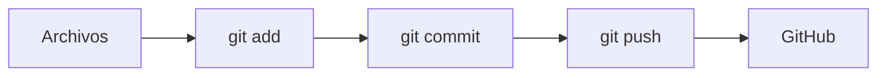

# Ejercicios prácticos: Git, GitHub y Markdown

## 1.º DAW — Serie de 5 prácticas progresivas

Cada práctica se entrega en un **repositorio GitHub** siguiendo la convención de nombres:

```text
1DAW-SIGLA-PXX
```

> Ejemplo: `1DAW-ED-P01`, `1DAW-ED-P02`, `1DAW-ED-P03`...

---

## En qué nos vamos a centrar

Estas prácticas NO evalúan si sabes mucho sobre el tema del que escribes.

**Evalúan cómo escribes en Markdown:**

- ¿Usas la jerarquía de títulos correctamente?
- ¿El código va en bloques de código y no pegado como texto?
- ¿Las imágenes tienen ruta y texto alternativo correctos?

> El **contenido es solo el vehículo**. La **estructura Markdown es lo que practicamos**.

---

## Convención de entrega (válida para las 5 prácticas)

1. Crea el repositorio en GitHub con el nombre indicado
2. Clónalo en tu ordenado (`git clone`)
3. Escribe la práctica en un archivo **`README.md`**
4. Flujo Git: trabajar → `git add .` → `git commit -m "..."` → `git push`
5. **Mínimo 3 commits** por práctica (no todo en un solo commit)
6. Comprueba en GitHub que se ve todo correctamente

---

# P01 — Mi ficha de presentación

---

## Contexto

Bienvenida a 1.º DAW. Tu tutor/a quiere publicar un **directorio del alumnado** en GitHub para que toda la clase os conozcáis, pero no quiere un chat de "presentaos", quiere algo duradero que se pueda consultar todo el curso.

Tu tarea: crear tu ficha del directorio. Nadie conoce tu contenido mejor que tú, así que el qué ya lo tienes. El reto es **maquetarla bien**.

---

## Ideas concretas de contenido (elige, no inventes)

- **Sobre mí:** 3-4 frases. ¿Por qué DAW? ¿Qué esperas del ciclo?
- **Mis datos:** ciclo, grupo, email del instituto, usuario de GitHub
- **Aficiones:** 3-4 aficiones ordenadas de mayor a menor
- **Antes de DAW:** ¿bachillerato? ¿otro FP? ¿trabajabas?
- **Meta del curso:** una frase en *cursiva* con tu objetivo

> Si te falta inspiración, escribe sobre tu serie favorita. Da igual: **lo importante es el Markdown**.

---

## Requisitos mínimos (P01) — CÓMO se evalúa

| Elemento Markdown | Cómo debe usarse |
|---|---|
| `#` y `##` | Un único título principal, secciones con `##` |
| Párrafos | Separados por línea en blanco, no todo seguido |
| `**negrita**` | Al menos 2 usos con intención (destacar datos clave) |
| `*cursiva*` | Al menos 1 uso (una matización o tu meta) |
| Lista `-` | Mínimo 3 elementos |
| Lista `1.` | Mínimo 3 elementos, en orden real |

**Repositorio:** `1DAW-SIGLA-P01`

---

## Ejemplo de esqueleto (solo referencia de estructura)

```markdown
# Ficha de [tu nombre]

## Sobre mí

## Mis datos

## Aficiones

## Meta del curso
```

> No copies el contenido de un compañero: en GitHub se ve quién copia. 😏

---

# P02 — Guía de supervivencia de la terminal

---

## Contexto

Tu primo/a acaba de empezar DAW en otro instituto y te escribe en pánico:

> *"La terminal me da miedo. ¿Qué hago si me pierdo en las carpetas? ¿Y lo de Git que no entiendo cuándo hace falta cada comando?"*

Le prometiste una **guía escrita** que pueda consultar siempre. La vas a publicar en tu GitHub: bien maquetada, con cada comando en su bloque de código y los consejos bien destacados.

---

## Ideas concretas de contenido (el qué ya está decidido)

Cubre estas 4 secciones, una por una:

1. **Moverse por las carpetas:** `pwd`, `ls`, `cd`
2. **Comprobar el estado:** `git status`
3. **Guardar el trabajo:** `git add .`, `git commit -m "..."`
4. **Subir y bajar:** `git push`, `git pull`

¿No sabes qué explicar de cada comando? Copia su definición de la chuleta de clase y añade **cuándo lo usarías** en una práctica real.

---

## Requisitos mínimos (P02) — CÓMO se evalúa

| Elemento Markdown | Cómo debe usarse |
|---|---|
| Bloques ` ```bash ` | Uno por comando o grupo de comandos, SIEMPRE con el lenguaje |
| Código en línea `` ` ` `` | Al mencionar un comando en una frase: *"el comando `git status`..."* |
| Citas `>` | Mínimo 2: un consejo y una advertencia (ej. *"Nunca subas la contraseña"*) |
| Secciones `##` | Las 4 secciones del contenido sugerido |

**Repositorio:** `1DAW-SIGLA-P02`

---

## Ejemplo de tono que se espera

````markdown
## Comprobar el estado

Antes de hacer nada, pregunta siempre a Git qué ha cambiado:

```bash
git status
```

> Consejo: si no sabes qué está pasando, `git status` es tu mejor amigo.
````

> Fíjate: el comando va en bloque, el consejo en cita, la explicación en párrafo. **Tres elementos distintos, tres usos distintos.**

---

# P03 — Bitácora del proyecto con enlaces e imágenes

---

## Contexto

Estás desarrollando tu mini-proyecto de clase durante dos semanas. Tu profesor/a te pide una **bitácora**: un documento que muestre el progreso con capturas y apunte a los recursos que consultaste.

Una bitácora sin imágenes que cargan o con enlaces rotos no sirve de nada. Aquí se evalúa que **todo lo que enlazas o insertas funcione y esté bien referenciado**.

---

## Ideas concretas de contenido (no pienses, elige)

Estructura sugerida de la bitácora:

1. **Día 1 — Arranque:** captura del esqueleto inicial del proyecto
2. **Recursos que consulté:** 2-3 enlaces (MDN, documentación de Git, un tutorial de tu elección)
3. **Día 2 — Avance:** captura con el progreso visible
4. **Problema encontrado y solución:** un párrafo describiéndolo (puede ser inventado)

> ¿No tienes proyecto real aún? Documenta el avance de cualquier práctica anterior. La bitácora es el ejercicio.

---

## Requisitos mínimos (P03) — CÓMO se evalúa

| Elemento Markdown | Cómo debe usarse |
|---|---|
| Imagen `` | 2 imágenes en carpeta `img/`, con **texto alternativo que describa lo que se ve** |
| Ruta relativa | `img/captura.png`, nunca `C:\Users\...\captura.png` |
| Enlace externo `[texto](URL)` | 2-3 enlaces con texto descriptivo (no "click aquí") |
| Lista numerada | Para la cronología de la bitácora |
| Explicación propia | Un apartado explicando con tus palabras enlace vs. imagen |

**Repositorio:** `1DAW-SIGLA-P03`

---

## Estructura obligatoria del repositorio

```text
1DAW-SIGLA-P03/
├── README.md
└── img/
    ├── captura-inicio.png
    └── captura-avance.png
```

> Prueba de fuego: abre tu `README.md` en GitHub y comprueba que **ambas imágenes cargan**. Si no cargan, la ruta es incorrecta.

---

# P04 — Tabla comparativa de herramientas

---

## Contexto

Tu clase va a decidir qué editor usar de forma coordinada este curso. Tu profesor/a te encarga el informe comparativo que se usará para debatir en clase.

Un informe con datos sueltos en párrafos es ilegible. Los datos comparativos **piden tabla**. Aquí se evalúa que domines la sintaxis de tablas completa: cabecera, separador, filas y alineación.

---

## Ideas concretas de contenido (ya elegidas por ti)

Compara estos 3 editores, sin excusas:

- **VS Code**
- **Vim** (sí, aunque no lo uses: investiga 5 minutos)
- **Notepad++**

Columnas sugeridas (puedes añadir una más):

| Columna | Qué anotar |
|---|---|
| Gratuito | Sí / No |
| Multiplataforma | ¿Funciona en Windows, Linux y Mac? |
| Extensiones | Breve descripción |
| Curva de aprendizaje | Fácil / Media / Difícil |

---

## Requisitos mínimos (P04) — CÓMO se evalúa

| Elemento Markdown | Cómo debe usarse |
|---|---|
| Tabla | 4 columnas × 3 filas de datos (cabecera aparte) |
| Separador `\|---\|` | Sintaxis correcta en todas las columnas |
| Alineación | `:--` en una columna, `--:` en otra, `:-:` en otra (las tres) |
| Separadores `---` | Entre las secciones: introducción / tabla / conclusión |
| Conclusión | Un párrafo en el que **defiendas** tu elección con negrita en lo esencial |

**Repositorio:** `1DAW-SIGLA-P04`

---

## La conclusión importa (y se evalúa)

La tabla presenta datos; la conclusión **argumenta**. Ejemplo de lo que se espera:

```markdown
## Conclusión

Elegiría **VS Code** por su equilibrio: es gratuito, multiplataforma
y su gestor de extensiones lo hace apto para todo el ciclo.
Vim tiene potencial, pero su curva de aprendizaje es excesiva
para el primer trimestre.
```

> Fíjate: negrita donde hay decisión, cursiva donde hay matización.

---

# P05 — Práctica integral: memoria de mini-proyecto

---

## Contexto

Última práctica de la serie. Simulamos una **entrega real del módulo**: la memoria de una práctica, tal como la entregaréis en evaluaciones.

Hasta ahora habéis practicado cada elemento por separado. Aquí demostraréis que **los combináis con criterio**: cada elemento en el lugar que le corresponde, con una estructura de documento profesional.

---

## Ideas concretas de contenido (elige un proyecto YA HECHO)

No programes nada nuevo. Documenta algo que ya tengas:

- La página HTML de cualquier práctica anterior
- La ficha P01 reformateada como memoria
- Cualquier ejercicio de otro módulo con archivos que puedas subir

> Si tienes que elegir entre "hacer un proyecto bonito" y "documentar bien", **documenta bien**. Eso es lo que se evalúa aquí.

---

## Requisitos mínimos (P05) — CÓMO se evalúa

| Elemento Markdown | Cómo debe usarse |
|---|---|
| Jerarquía completa | `#` → `##` → `###` sin saltarse niveles |
| 2 bloques de código | Con lenguaje: `html` y `bash` |
| 1 imagen | En `img/`, con texto alternativo útil |
| 1 tabla | Ej: requisitos y estado ✅/❌, o tecnologías y versión |
| 1 cita `>` | Una dificultad o aprendizaje destacado |
| 1 diagrama Mermaid | El flujo Git que has usado durante la práctica |
| Separadores `---` | Entre secciones principales |

**Repositorio:** `1DAW-SIGLA-P05`

---

## Diagrama Mermaid de partida



> No lo copies tal cual: adáptalo a tu práctica (añade `git status`, `git pull`, etapas del proyecto...). Se evalúa que **entiendes** el flujo, no que copias.

---

## Estructura obligatoria de la memoria

```markdown
# [Título del proyecto]

## 1. Introducción
## 2. Objetivos
## 3. Tecnologías utilizadas
## 4. Desarrollo
### 4.1. [Apartado 1]
### 4.2. [Apartado 2]
## 5. Resultados
## 6. Conclusiones
```

---

# Criterios de evaluación comunes

---

## Rúbrica general (todas las prácticas)

| Criterio | Puntos |
|---|---|
| Repositorio con el nombre correcto (`1DAW-SIGLA-PXX`) | 1 |
| Flujo Git correcto (clone, add, commit, push) | 2 |
| Mínimo 3 commits con mensajes descriptivos | 1 |
| Elementos Markdown pedidos, usados correctamente | 4 |
| Documento claro, ordenado y legible | 2 |

**Total: 10 puntos**

> Los 6 puntos de "Markdown + claridad" no dependen de qué escribes, sino de cómo lo escribes.

---

## Errores frecuentes que debes evitar

- Subir el `README.md` con un solo commit gigante
- Imágenes con rutas absolutas de tu ordenador (no se ven en GitHub)
- Bloques de código sin indicar el lenguaje
- Usar `#` para todo tipo de apartados
- Poner código como captura de pantalla en lugar de texto
- Enlaces con el texto "pincha aquí" en lugar de algo descriptivo

---

## Chuleta de entrega

```bash
git status                        # ¿Qué ha cambiado?
git add .                         # Preparar cambios
git commit -m "Añade sección de resultados"
git push                          # Subir a GitHub
git pull                          # Traer cambios si trabajas desde otro PC
```

> **Recuerda:** `commit` guarda en tu ordenador, `push` sube a GitHub.

<REF>file✦sandbox:///mnt/agents/output/ejercicios-markdown-daw.md</REF>
