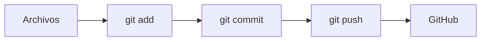

# Git, GitHub y Markdown

## Introducción práctica para 1.º DAW

**Objetivo:** entender qué son Git y GitHub, hacer tus primeras entregas y aprender a redactar prácticas en Markdown.

---

## ¿Qué vamos a aprender hoy?

- Qué es Git y qué es GitHub (y en qué se diferencian)
- Repositorio local vs. repositorio remoto
- Flujo básico: `clone` → trabajar → `add` → `commit` → `push` / `pull`
- Conectar un repositorio local con GitHub
- Markdown: sintaxis básica para todas las prácticas
- Estructura recomendada y buenas prácticas

---

# BLOQUE 1 — Git y GitHub: ¿qué problema resuelven?

---

## El problema: versionar nuestro trabajo

Imagina que estás haciendo una práctica y...

- Quieres guardar versiones del proyecto a lo largo del tiempo
- Te equivocas y quieres volver atrás
- Trabajas desde el ordenador de clase y desde casa
- El profesor necesita revisar tu código
- Quieres compartir tu trabajo con un compañero

**¿Guardar copias como `practica_final_v1.zip`, `practica_final_v2.zip`, `practica_FINALISIMA.zip`?** No escala. 😅

---

## Solución: un sistema de control de versiones

Un **sistema de control de versiones** registra los cambios de tus archivos a lo largo del tiempo, de modo que puedas:

- Recordar versiones anteriores
- Ver qué cambió, cuándo y por qué
- Recuperar estados anteriores del proyecto

**Git** es el sistema de control de versiones más utilizado del mundo.

---

## ¿Qué es Git?

- Git es un **programa** que instalamos en nuestro ordenador
- Vigila una carpeta (un **repositorio**) y guarda un **historial** de todos los cambios que le vamos registrando
- Cada registro de cambios se llama **commit**

> **Git trabaja en tu ordenador.** No necesita internet para funcionar.

---

## ¿Qué es un repositorio?

Un **repositorio** es la carpeta del proyecto que Git vigila.

- Contiene tus archivos (código, documentación, imágenes...)
- Y una carpeta oculta `.git/` donde Git guarda todo el historial

**Repositorio local:** el que está en tu ordenador.
**Repositorio remoto:** una copia del repositorio alojada en un servidor (por ejemplo, en GitHub).

---

## ¿Qué es GitHub?

- GitHub es un **servicio web** (una página: github.com)
- Permite **alojar repositorios Git de forma remota**
- Sirve para compartir código, hacer copias de seguridad y colaborar

> GitHub **NO sustituye a Git**. Son dos cosas distintas que se comunican.

---

## Git vs. GitHub: la diferencia clave

| | Git | GitHub |
|---|---|---|
| ¿Qué es? | Programa de control de versiones | Servicio web para alojar repositorios |
| ¿Dónde vive? | En tu ordenador | En la nube (internet) |
| ¿Para qué? | Registrar historial de cambios | Compartir y respaldar repositorios |

**Frase para recordar:**
> Git es el sistema de control de versiones que usamos en nuestro ordenador; GitHub es un servicio que permite almacenar y compartir repositorios Git de forma remota.

---

## ¿Cómo se comunican?

```text
ORDENADOR DEL ALUMNO
        │
        │  Git (trabajas aquí)
        ▼
Repositorio local  ──git push──▶  Repositorio remoto (GitHub)
Repositorio local  ◀──git pull──  Repositorio remoto (GitHub)
```

- `git push` → **subes** tus cambios a GitHub
- `git pull` → **descargas** los cambios de GitHub

---

## Ejemplo de clase

1. Haces la práctica en tu portátil (repositorio **local**)
2. La subes a GitHub con `git push` (repositorio **remoto**)
3. Desde el ordenador de clase haces `git pull` y tienes la práctica al día
4. El profesor entra a GitHub y revisa tu entrega

---

# BLOQUE 2 — Primera entrega con Git y GitHub

---

## El flujo de trabajo mínimo (visión general)

1. Tener (o crear) un repositorio en GitHub
2. Obtenerlo en tu ordenador con `git clone`
3. Trabajar con los archivos
4. Comprobar el estado → `git status`
5. Preparar cambios → `git add .`
6. Confirmar cambios → `git commit -m "..."`
7. Subir al remoto → `git push`
8. Traer cambios del remoto → `git pull`

**¡Vamos paso a paso!**

---

## Paso 1–2: obtener el repositorio

```bash
git clone https://github.com/usuario/repositorio.git
```

- GitHub ya tiene el repositorio creado (por ti o por el profesor)
- `git clone` **copia** el repositorio remoto a tu ordenador
- Crea una carpeta nueva con todo el proyecto y su historial

> Después de clonar, tu carpeta local y GitHub están conectados.

---

## Paso 3–4: trabajar y comprobar el estado

Editas tus archivos con tu editor favorito y luego:

```bash
git status
```

`git status` te dice **qué ha cambiado**:

- ¿Qué archivos están modificados?
- ¿Qué cambios están preparados para el commit?
- ¿Estás al día con el repositorio remoto?

> **`git status` es tu mejor amigo.** Úsalo siempre que no sepas qué está pasando.

---

## Paso 5: preparar los cambios

```bash
git add .
```

- `git add` **prepara** los cambios (los pasa al *área de preparación* o *staging area*)
- El punto `.` significa "todos los archivos modificados"
- **Todavía no se ha guardado nada en el historial**

---

## Paso 6: crear un commit

```bash
git commit -m "Añade la estructura HTML de la práctica 1"
```

- Un **commit** es una **fotografía** del proyecto en un momento concreto
- Se guarda en el **historial local** (en tu ordenador)
- El mensaje entre comillas describe el cambio: **sé descriptivo/a**

> ⚠️ **Un commit NO sube nada a GitHub.** Solo guarda el historial en local.

---

## Paso 7: subir los cambios a GitHub

```bash
git push
```

- `git push` **envía tus commits** al repositorio remoto
- Es el comando que actualiza GitHub
- Tras el `push`, tu repositorio remoto tiene el mismo historial que el local

---

## Paso 8: traer cambios de GitHub

```bash
git pull
```

- `git pull` **descarga** los commits del repositorio remoto y los aplica a tu copia local
- Útil cuando trabajas desde varios ordenadores o cuando el profesor añade correcciones

---

## Los tres conceptos que NO debes confundir

| Comando | ¿Qué hace? | ¿Dónde ocurre? |
|---|---|---|
| `git commit` | Guarda una foto del proyecto en el historial | En tu ordenador (local) |
| `git push` | Envía los commits a GitHub | Local → Remoto |
| `git pull` | Trae los commits de GitHub | Remoto → Local |

---

# BLOQUE 3 — Conectar un repositorio local con GitHub

---

## Cuando empiezas en local y quieres subirlo a GitHub

A veces creas el proyecto primero en tu ordenador y luego lo conectas a GitHub:

```bash
git init
git remote add origin https://github.com/usuario/repositorio.git
git remote -v
git add .
git commit -m "Primera entrega"
git push -u origin main
```

(Primero crea el repositorio **vacío** en GitHub desde la web.)

---

## ¿Qué significa `git remote add origin URL`?

```bash
git remote add origin https://github.com/usuario/repositorio.git
```

- `remote` → un repositorio que está **fuera** de tu ordenador (remoto)
- `add` → añadir uno nuevo a la configuración
- `origin` → el **nombre** que le damos al remoto (es una convención; podría ser otro)
- `URL` → la dirección de tu repositorio en GitHub

> Con este comando le dices a Git: *"este proyecto local está asociado a ese repositorio de GitHub"*.

---

## Comprobar la conexión: `git remote -v`

```bash
git remote -v
```

Salida de ejemplo:

```text
origin  https://github.com/usuario/repositorio.git (fetch)
origin  https://github.com/usuario/repositorio.git (push)
```

- Muestra qué repositorios remotos están configurados
- `fetch` = dirección para **descargar** (`pull`)
- `push` = dirección para **subir** (`push`)

---

## `git init`: empezar un repositorio desde cero

```bash
git init
```

- Convierte una carpeta normal en un **repositorio Git**
- Crea la carpeta oculta `.git/` con el historial
- Es el primer paso si empiezas el proyecto en local

> No lo necesitas si usas `git clone` (el clone ya trae todo configurado).

---

# BLOQUE 4 — El modelo mental de Git

---

## El viaje de tus cambios

```text
ARCHIVOS (modificados)
        ↓      git add
ÁREA DE PREPARACIÓN (staging)
        ↓      git commit
HISTORIAL LOCAL DE GIT
        ↓      git push
GITHUB
```

---

## ¿Qué ocurre en cada etapa?

1. **Modificas archivos** → Git lo detecta, pero aún no prepara nada
2. **`git add`** → seleccionas qué cambios irán en la próxima foto (commit)
3. **`git commit`** → tomas la foto: los cambios quedan registrados en el historial **local**
4. **`git push`** → subes las fotos (commits) a **GitHub**

> Puedes modificar 10 archivos y elegir con `git add` cuáles entran en cada commit.

---

## Recordatorio clave

> **`git commit` NO sube los archivos a GitHub.**

> **`git push` es lo que envía los commits al repositorio remoto.**

- Commit = guardar en tu ordenador
- Push = compartir/subir a GitHub

---

# BLOQUE 5 — Introducción a Markdown

---

## ¿Qué es Markdown?

- Un **lenguaje de marcado ligero** para escribir documentos con formato
- Se escribe como **texto plano** con símbolos sencillos (`#`, `*`, `-`, `>`...)
- El archivo lleva normalmente la extensión **`.md`**

> Markdown permite escribir documentos estructurados utilizando texto sencillo y una sintaxis muy fácil de aprender.

---

## ¿Por qué Markdown en las prácticas?

- **Todas las prácticas y entregas del módulo se redactarán en Markdown**
- Se lee directamente en GitHub, en el editor y en muchas herramientas
- Ventajas frente a un documento sin estructura:
  - Títulos jerárquicos y navegables
  - Código con colores
  - Tablas, listas, imágenes y enlaces
  - Es texto plano: se versiona perfectamente con Git

---

# BLOQUE 6 — Sintaxis básica de Markdown

---

## Títulos

```markdown
# Título
## Subtítulo
### Apartado
#### Subapartado
```

Se visualizan así:

# Título
## Subtítulo
### Apartado
#### Subapartado

**Usa la jerarquía con cabeza:** un `#` para el título del documento, `##` para secciones, `###` para apartados...

---

## Negrita, cursiva y tachado

```markdown
**texto en negrita**
*texto en cursiva*
***negrita y cursiva***
~~texto tachado~~
```

Resultado:

**texto en negrita**
*texto en cursiva*
***negrita y cursiva***
~~texto tachado~~

---

## Listas sin ordenar

```markdown
- Elemento 1
- Elemento 2
- Elemento 3
```

Resultado:

- Elemento 1
- Elemento 2
- Elemento 3

---

## Listas ordenadas

```markdown
1. Primer paso
2. Segundo paso
3. Tercer paso
```

Resultado:

1. Primer paso
2. Segundo paso
3. Tercer paso

---

## Listas anidadas

```markdown
- Requisitos
  - Git instalado
  - Cuenta en GitHub
- Pasos
  1. Clonar el repositorio
  2. Hacer la práctica
```

Resultado:

- Requisitos
  - Git instalado
  - Cuenta en GitHub
- Pasos
  1. Clonar el repositorio
  2. Hacer la práctica

---

## Citas

```markdown
> Esto es una cita.
```

Resultado:

> Esto es una cita.

Útil para destacar definiciones o advertencias importantes.

---

## Código en línea

```markdown
Utilizamos `git status` para consultar el estado.
```

Resultado:

Utilizamos `git status` para consultar el estado.

---

## Bloques de código

````
```bash
git status
git add .
git commit -m "Mi cambio"
```
````

Resultado (con colores):

```bash
git status
git add .
git commit -m "Mi cambio"
```

> Indicar el lenguaje (`bash`, `html`, `css`...) mejora mucho la presentación.

---

# BLOQUE 7 — Enlaces e imágenes

---

## Enlaces

```markdown
[Texto del enlace](https://ejemplo.com)
```

Resultado:

[Texto del enlace](https://ejemplo.com)

El **texto** es lo que se ve; la **URL** va entre paréntesis.

---

## Imágenes

```markdown

```

- Muy parecido al enlace, pero con una `!` delante
- El **texto alternativo** describe la imagen (accesibilidad y si la imagen no carga)
- Ejemplo de práctica:

```markdown

```

---

## Rutas dentro del repositorio

```text
mi-practica/
├── README.md
├── index.html
└── img/
    └── resultado.png
```

- Desde `README.md`, la imagen es: `img/resultado.png`
- **Rutas correctas = imágenes que se ven** en GitHub y en cualquier sitio

---

# BLOQUE 8 — Tablas

---

## Sintaxis de una tabla

```markdown
| Comando | Función |
|---|---|
| `git status` | Consulta el estado |
| `git add` | Prepara cambios |
| `git commit` | Crea un commit |
| `git push` | Envía commits al remoto |
```

- Primera fila → **cabecera**
- `|---|---|` → **separador** (define las columnas)
- Resto de filas → contenido

---

## Resultado de la tabla

| Comando | Función |
|---|---|
| `git status` | Consulta el estado |
| `git add` | Prepara cambios |
| `git commit` | Crea un commit |
| `git push` | Envía commits al remoto |

---

## Alineación de columnas

```markdown
| Comando | Función |
|:--|--:|
| `git status` | Consulta el estado |
```

- `:--` alinea a la izquierda
- `--:` alinea a la derecha
- `:-:` centra (según visor)

---

## Ejemplo para una práctica

```markdown
| Requisito | Cumplido |
|---|---|
| Repositorio en GitHub | ✅ |
| Al menos 3 commits | ✅ |
| README.md completo | ❌ |
```

| Requisito | Cumplido |
|---|---|
| Repositorio en GitHub | ✅ |
| Al menos 3 commits | ✅ |
| README.md completo | ❌ |

---

# BLOQUE 9 — Párrafos, separadores y organización

---

## Párrafos y saltos de línea

```markdown
Este es un párrafo. Las líneas seguidas forman el mismo párrafo.

Este es otro párrafo (separado por una línea en blanco).
```

> Separa los párrafos con una línea en blanco. Un solo salto de línea no crea un párrafo nuevo en todos los visores.

---

## Separador horizontal

```markdown
Texto de una sección.

---

Texto de otra sección.
```

Resultado:

Texto de una sección.

---

Texto de otra sección.

---

## Organiza con títulos y subtítulos

Una práctica debe tener una **estructura clara y fácil de leer**:

```markdown
# Título de la práctica

## 1. Introducción

## 2. Desarrollo

---

## 3. Resultados
```

---

# BLOQUE 10 — Diagramas con Mermaid

---

## Diagramas en tu documentación

Si el entorno lo permite (Marp, GitHub...), puedes crear diagramas con **Mermaid**:



Los diagramas sirven para representar procesos, arquitecturas, relaciones, flujos y algoritmos sencillos.

> No es un curso de Mermaid: con lo básico es suficiente para empezar.

---

# BLOQUE 11 — Estructura recomendada de una práctica

---

## Plantilla orientativa

```markdown
# Nombre de la práctica

## 1. Introducción

## 2. Objetivos

## 3. Desarrollo

### 3.1. Primer apartado

### 3.2. Segundo apartado

## 4. Resultados

## 5. Conclusiones
```

> Es una **orientación general**: cada práctica podrá establecer su propia estructura.

---

## Ejemplo completo (mini-práctica)

````markdown
# Práctica 1: Mi primera página web

## 1. Introducción
Creación de una página HTML básica.

## 2. Objetivos
- Usar etiquetas HTML semánticas
- Hacer el primer commit y push

## 3. Desarrollo
```html
<h1>Hola, DAW</h1>
```

## 4. Resultados


## 5. Conclusiones
He aprendido a versionar mi trabajo con Git.
````

---

# BLOQUE 12 — Buenas prácticas

---

## Buenas prácticas con Markdown

- Utiliza títulos **jerárquicos** (no saltes de `#` a `###` sin `##`)
- No uses `#` para cualquier apartado
- Usa nombres descriptivos para archivos y carpetas
- Usa tablas **cuando realmente aporten** información
- Inserta imágenes **con texto alternativo**
- Escribe el código en **bloques de código**, nunca como captura de pantalla
- Organiza imágenes y recursos en carpetas (`img/`, `docs/`...)
- **Comprueba que los enlaces funcionan** y revisa la visualización final

---

# BLOQUE 13 — Chuleta final

---

## 🧠 Chuleta Git

```bash
git status                  # Ver el estado del repositorio
git add .                   # Preparar todos los cambios
git commit -m "mensaje"     # Guardar commit en el historial local
git push                    # Subir commits a GitHub
git pull                    # Descargar cambios de GitHub
git clone URL               # Copiar un repositorio remoto
git remote add origin URL   # Conectar local con GitHub
git remote -v               # Ver repositorios remotos configurados
```

---

## 📝 Chuleta Markdown

```markdown
# Título
## Subtítulo
**negrita**   *cursiva*   ~~tachado~~
- lista sin ordenar
1. lista numerada
[enlace](https://ejemplo.com)

`código en línea`
> cita

| Col 1 | Col 2 |
|---|---|
| a     | b     |

---
separador horizontal
```

---

## Resumen de la sesión

- **Git** versiona tu proyecto en tu ordenador; **GitHub** lo aloja y comparte en la nube
- Flujo básico: trabajar → `git add` → `git commit` → `git push`
- `commit` guarda en local; `push` sube a GitHub; `pull` descarga
- Las prácticas se entregan en **Markdown** (`.md`), con estructura clara

**¡Ahora a practicar! 💪**

<REF>file✦sandbox:///mnt/agents/output/git-github-markdown-daw.md</REF>
