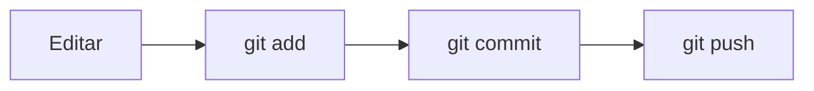
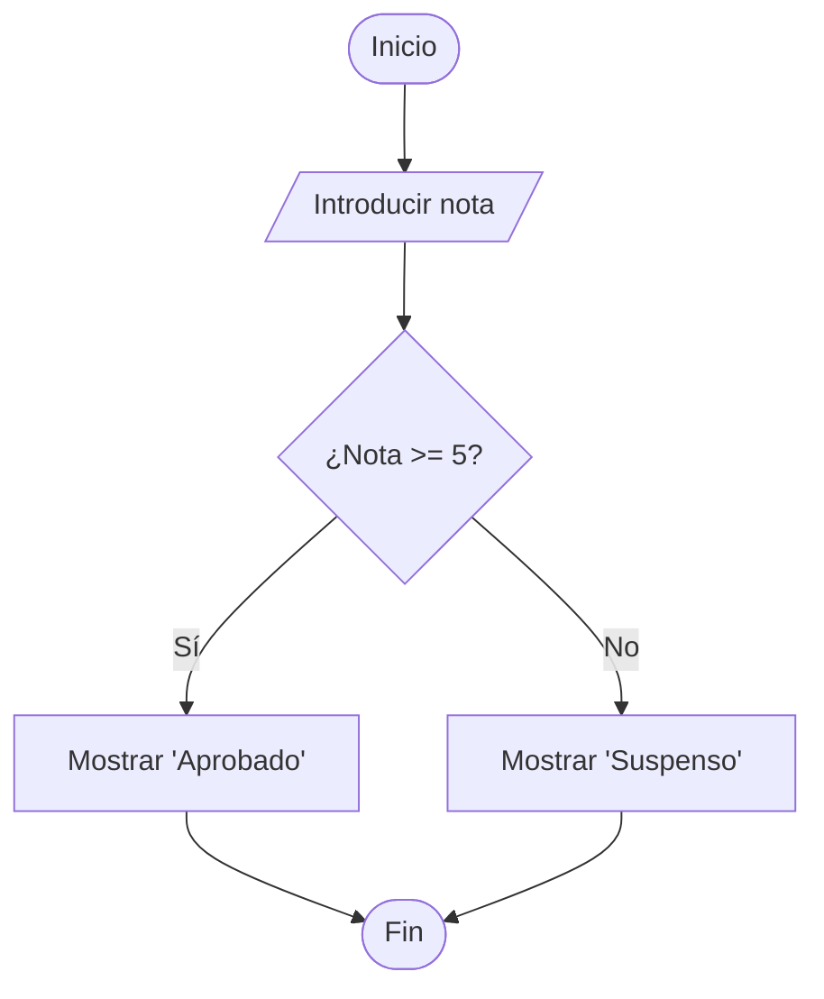
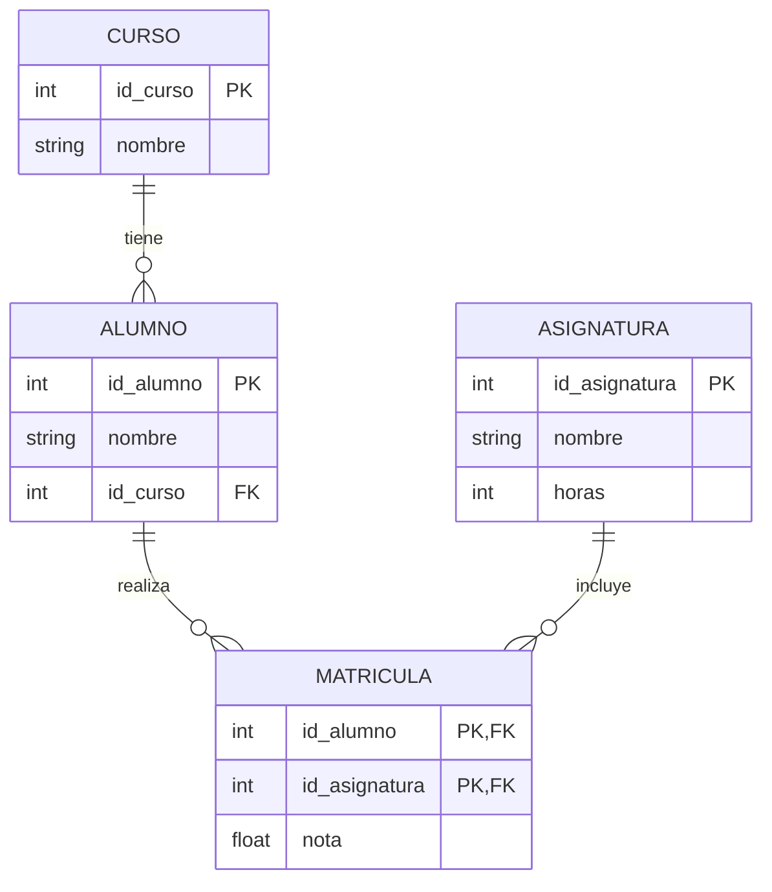
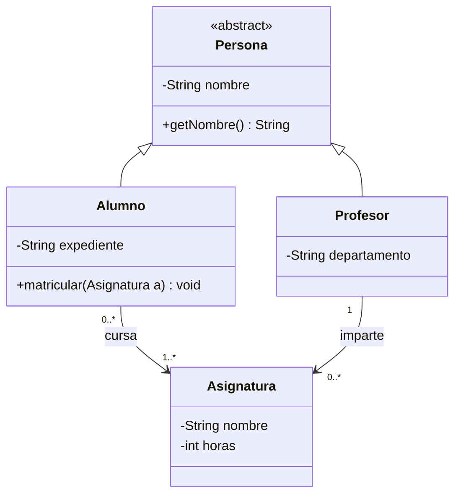

<!-- _class: lead -->
<!-- _paginate: false -->

# Git, GitHub y Markdown

### Guía introductoria para entregar tus prácticas correctamente

Control de versiones · Repositorios remotos · Documentación

---

# Objetivos

Al terminar esta sesión sabrás:

1. Qué es **Git** y qué es **GitHub** (y por qué no son lo mismo)
2. Guardar cambios con `add` y `commit`
3. Subir y bajar trabajo con `push`, `pull` y `clone`
4. Conectar tu repositorio local con GitHub
5. Redactar documentación en **Markdown**
6. Entregar una práctica con un `README.md` profesional

> 💡 Durante la clase hay **ejercicios** y **3 prácticas** para hacer en tu equipo.

---

<!-- _class: part -->
<!-- _paginate: false -->

# PARTE 1
## Git y GitHub

---

# ¿Qué es el control de versiones?

Imagina que entregas un trabajo así:

```
practica.docx
practica_v2.docx
practica_final.docx
practica_final_DEFINITIVO.docx
practica_final_DEFINITIVO_ahora_si.docx
```

Un **sistema de control de versiones** resuelve esto:

- Guarda el **historial completo** de cambios
- Permite **volver atrás** si algo se rompe
- Permite **trabajar en equipo** sin pisarse
- Registra **quién cambió qué y cuándo**

---

# ¿Qué es Git?

**Git** es un sistema de control de versiones **distribuido** y **local**.

- Se instala en tu ordenador
- Funciona **sin internet**
- Guarda el historial en una carpeta oculta `.git`
- Se maneja con comandos en la terminal: `git ...`

Una carpeta de proyecto controlada por Git se llama **repositorio** (o *repo*).

```bash
git --version     # comprueba que está instalado
```

---

# ¿Qué es GitHub?

**GitHub** es una **plataforma web** que aloja repositorios Git en la nube.

| | **Git** | **GitHub** |
|---|---|---|
| Tipo | Herramienta (programa) | Servicio web |
| Dónde vive | Tu ordenador | Internet |
| Necesita internet | No | Sí |
| Función | Versionar el código | Compartir, colaborar, entregar |

<br>

> 🧠 **Analogía:** Git es como el *editor de fotos*; GitHub es como *Instagram* donde las compartes. (Existen alternativas: GitLab, Bitbucket.)


---

# Las 3 áreas de Git

```
 Directorio de trabajo      Área de preparación       Repositorio local
   (Working Directory)         (Staging Area)            (.git)
 ┌───────────────────┐      ┌─────────────────┐     ┌──────────────────┐
 │  Tus archivos,    │ add  │ Cambios listos  │commit│ Historial de     │
 │  los editas aquí  │ ───► │ para guardar    │ ───► │ commits guardados│
 └───────────────────┘      └─────────────────┘     └──────────────────┘
```

- **Working directory:** donde editas.
- **Staging area:** "la cesta" con lo que quieres guardar.
- **Repositorio local:** el historial permanente.


---

# Configuración inicial (solo una vez)

Git necesita saber quién eres para firmar tus commits:

```bash
git config --global user.name  "Tu Nombre"
git config --global user.email "tu_correo@ejemplo.com"
git config --global init.defaultBranch main
```

Comprobar la configuración:

```bash
git config --list
```

⚠️ Usa el **mismo email** que en tu cuenta de GitHub.

---

# Crear un repositorio local

```bash
mkdir mi-practica        # crea la carpeta
cd mi-practica           # entra en ella
git init                 # la convierte en repositorio
```

Resultado: aparece la carpeta oculta `.git/` (¡no la borres ni toques!).

Comando más usado de todos:

```bash
git status
```

Te dice **en qué estado está cada archivo**. Úsalo constantemente.

---

# `.gitignore`: lo que NO se sube

Archivo en la raíz que lista lo que Git debe ignorar:

```gitignore
# Archivos temporales
*.log
*.tmp

# Dependencias
node_modules/

# Configuración local o secretos
.env
.vscode/

# Compilados
*.class
build/
```

❌ Nunca subas contraseñas, tokens ni archivos pesados innecesarios.

---

# `git add`: preparar cambios

Mueve cambios del directorio de trabajo al **staging area**.

```bash
git add README.md        # un archivo concreto
git add src/ docs/       # carpetas
git add .                # TODO lo modificado y nuevo
```

- No guarda nada todavía: solo **selecciona** qué irá en el próximo commit.
- Permite hacer commits **pequeños y ordenados**.

Deshacer un `add`:

```bash
git restore --staged README.md
```

---

# `git commit`: guardar una versión

Un **commit** es una **foto** del proyecto en un momento dado, con un mensaje y un identificador único (hash).

```bash
git commit -m "Añade introducción al README"
```

Cada commit guarda: autor, fecha, mensaje y los cambios.

### Buenos mensajes de commit

- ✅ `Añade tabla de requisitos al README`
- ✅ `Corrige error en el cálculo del total`
- ❌ `cambios`
- ❌ `asdf`
- ❌ `arreglado por fin!!!`

Regla: **verbo en infinitivo/presente + qué has hecho**.

---

# Estados de un archivo

| Estado | Significado | Cómo se llega |
|---|---|---|
| **Untracked** | Git no lo conoce | Archivo nuevo |
| **Modified** | Cambiado, sin preparar | Editas un archivo |
| **Staged** | Preparado para el commit | `git add` |
| **Committed** | Guardado en el historial | `git commit` |

`git status` te muestra en cuál está cada archivo (en rojo = sin preparar, en verde = preparado).

---

# Ver el historial y los cambios

```bash
git log                  # historial completo
git log --oneline        # una línea por commit
git log --oneline --graph --all   # con ramas
git diff                 # cambios aún sin preparar
git diff --staged        # cambios ya preparados
git show <hash>          # detalle de un commit
```

Ejemplo de `git log --oneline`:

```
a3f9c21 Añade sección de instalación
7be4d10 Crea estructura inicial
e12a8ff Primer commit
```

---

# Concepto de rama (branch)

Una **rama** es una **línea independiente de desarrollo**. Permite probar cosas sin romper la versión estable.

```
main     ●────●────●────────────●────●
                   \          /
nueva-funcion       ●────●────●
```

```bash
git branch                    # lista ramas
git switch -c mi-rama         # crea y cambia a ella
git switch main               # vuelve a main
git merge mi-rama             # fusiona mi-rama en la actual
```

> Para las prácticas básicas trabajarás en **`main`**.

---

# Repositorio remoto: conectar local con GitHub

**Remoto** = copia del repo en otro sitio (GitHub). Su nombre habitual es **`origin`**.

### Paso a paso

1. En GitHub: **New repository** → ponle nombre → *Create* (sin README si ya tienes repo local).
2. Copia la URL (HTTPS o SSH).
3. En tu terminal:

```bash
git remote add origin https://github.com/usuario/mi-practica.git
git remote -v            # verifica la conexión
git branch -M main       # asegura que la rama se llama main
git push -u origin main  # primera subida
```

`-u` enlaza tu `main` local con `origin/main` (después basta con `git push`).

---

# `git push`: subir cambios

Envía tus **commits locales** al repositorio remoto.

```bash
git push
```

```
 Local (tu PC)                      Remoto (GitHub)
 ┌────────────┐      git push       ┌────────────┐
 │ commits    │ ──────────────────► │ commits    │
 └────────────┘                     └────────────┘
```

⚠️ `push` sube **commits**, no archivos sueltos. Si no has hecho `commit`, no se sube nada.

---

# `git pull` y `git clone`: traer cambios

**`git pull`** descarga y fusiona los cambios del remoto en tu repo local:

```bash
git pull
```

**`git clone`** copia un repositorio remoto completo por primera vez:

```bash
git clone https://github.com/usuario/mi-practica.git
```

| Comando | Cuándo |
|---|---|
| `clone` | Primera vez, no tienes el repo |
| `pull` | Ya lo tienes y quieres actualizarlo |
| `push` | Quieres subir tus commits |

---

# Fases completas: del cambio a GitHub

```
 1. EDITAR        2. ADD           3. COMMIT         4. PUSH
 ┌─────────┐    ┌─────────┐     ┌────────────┐    ┌──────────┐
 │ Working │ ─► │ Staging │ ──► │ Repositorio│ ─► │  Remoto  │
 │Directory│    │  Area   │     │   local    │    │ (GitHub) │
 └─────────┘    └─────────┘     └────────────┘    └──────────┘
   modificas     git add .      git commit -m "…"    git push
```

**Ciclo de trabajo diario:**

```bash
git status                       # ¿qué ha cambiado?
git add .                        # preparo los cambios
git commit -m "Describe cambio"  # guardo versión
git push                         # subo a GitHub
```

---

# Autenticación con GitHub

GitHub **ya no acepta contraseña** por HTTPS. Opciones:

1. **Personal Access Token (PAT)**: Settings → Developer settings → Tokens. Se usa como contraseña al hacer `push`.
2. **SSH**: genera una clave y súbela a GitHub.
3. **GitHub Desktop / VS Code**: gestionan el login por ti.

```bash
ssh-keygen -t ed25519 -C "tu_correo@ejemplo.com"
cat ~/.ssh/id_ed25519.pub     # copia esto en GitHub → Settings → SSH keys
git remote set-url origin git@github.com:usuario/mi-practica.git
```
---

# Errores comunes y soluciones

| Problema | Causa / solución |
|---|---|
| `fatal: not a git repository` | Estás fuera del repo → `cd` a la carpeta correcta |
| `nothing to commit` | No hiciste `add` o no hay cambios |
| `rejected ... non-fast-forward` | El remoto tiene cambios que no tienes → `git pull` y luego `git push` |
| `Author identity unknown` | Falta `user.name` / `user.email` |
| `Authentication failed` | Usa token o SSH, no contraseña |
| Conflicto al hacer `pull` | Edita el archivo, elige qué conservar, `add` + `commit` |

---

# Chuleta de comandos Git

```bash
git init                      # crear repo
git clone <url>               # clonar
git status                    # estado
git add <archivo> | .         # preparar
git commit -m "mensaje"       # guardar versión
git log --oneline             # historial
git remote add origin <url>   # conectar remoto
git push -u origin main       # primera subida
git push                      # subir
git pull                      # bajar
git switch -c <rama>          # nueva rama
```

---

# 🧪 Ejercicio 1: Tu primer repositorio

Hazlo paso a paso en tu terminal:

1. Crea la carpeta `ejercicio-git` y entra en ella.
2. Ejecuta `git init`.
3. Crea un archivo `hola.txt` con el texto "Hola Git".
4. Ejecuta `git status`. ¿En qué estado está `hola.txt`?
5. Haz `git add hola.txt` y vuelve a ejecutar `git status`. ¿Qué cambió?
6. Haz el commit: `"Añade hola.txt"`.
7. Modifica `hola.txt` (añade una línea) y haz un segundo commit.
8. Ejecuta `git log --oneline`. ¿Cuántos commits ves?
9. Ejecuta `git diff HEAD~1` para ver qué cambió entre ambos.

**Reto:** crea un `.gitignore` que ignore `*.log`, crea `prueba.log` y comprueba que `git status` no lo muestra.

---

<!-- _class: part -->
<!-- _paginate: false -->

# PARTE 2
## Markdown

---

# ¿Qué es Markdown?

**Markdown** es un lenguaje de marcado **ligero** para dar formato al texto usando símbolos sencillos.

- Se escribe en **texto plano** (archivos `.md`)
- Se convierte a HTML, PDF, diapositivas…
- GitHub lo **renderiza automáticamente**
- Estándar para documentar: `README.md`, wikis, issues, apuntes

```markdown
# Esto es un título
Esto es **negrita** y esto *cursiva*.
```

> 📌 El archivo `README.md` es la **portada** de tu repositorio: lo primero que lee quien te corrige.

---

# Títulos y subtítulos

```markdown
# Título nivel 1 (solo uno por documento)
## Subtítulo nivel 2
### Nivel 3
#### Nivel 4
```

Reglas:

- Deja un **espacio** tras las `#`
- Un solo `#` (H1) como título principal
- Respeta la jerarquía: no saltes de `#` a `###`
- Deja una **línea en blanco** antes y después

---

# Párrafos y énfasis

| Resultado | Sintaxis |
|---|---|
| **Negrita** | `**texto**` |
| *Cursiva* | `*texto*` |
| ***Negrita y cursiva*** | `***texto***` |
| ~~Tachado~~ | `~~texto~~` |
| `Código en línea` | `` `texto` `` |

- Un **salto de párrafo** = una línea en blanco.
- Un **salto de línea** = dos espacios al final o `\` .

---
# Listas

```markdown
- Elemento (también vale * o +)
- Otro elemento
  - Sublista (2 espacios de sangría)

1. Primer paso
2. Segundo paso
3. Tercer paso

- [x] Tarea hecha
- [ ] Tarea pendiente
```

Resultado:

- Elemento
  - Sublista

1. Primer paso
2. Segundo paso

- [x] Tarea hecha
- [ ] Tarea pendiente

---

# Enlaces e imágenes

```markdown
[Texto del enlace](https://github.com)
[Enlace con título](https://github.com "Ir a GitHub")
<https://github.com>


```

- La imagen es un enlace con `!` delante.
- Usa **rutas relativas** (`imagenes/captura.png`) para que funcionen al subir el repo.
- El **texto alternativo** describe la imagen (accesibilidad).

---

# Código

Código **en línea**: `` `git status` ``

Bloque de código con **resaltado** (indica el lenguaje):

````markdown
```python
def saludar(nombre):
    return f"Hola, {nombre}"
```

```bash
git commit -m "Mensaje"
```
````

Lenguajes habituales: `python`, `java`, `bash`, `sql`, `json`, `html`, `javascript`.

---

# Citas y separadores

```markdown
> Esto es una cita o una nota importante.
> Puede ocupar varias líneas.

> **Nota:** ideal para avisos al lector.
```

> **Nota:** ideal para avisos al lector.

**Separador horizontal** (línea divisoria): tres guiones, asteriscos o guiones bajos en una línea sola:

```markdown
---
```

⚠️ En **Marp** (estas diapositivas) `---` separa diapositivas.

---

# Tablas

```markdown
| Comando    | Función          | Ejemplo            |
|------------|:----------------:|-------------------:|
| `git add`  | Prepara cambios  | `git add .`        |
| `git push` | Sube commits     | `git push`         |
```

- `|` separa columnas; la fila de guiones separa la cabecera.
- Alineación: `:---` izquierda · `:---:` centro · `---:` derecha.

| Comando    | Función         | Ejemplo     |
|------------|:---------------:|------------:|
| `git add`  | Prepara cambios | `git add .` |
| `git push` | Sube commits    | `git push`  |

---

# Diagramas con Mermaid

GitHub renderiza diagramas **Mermaid** dentro de un bloque de código:

````markdown

````

Otros tipos: `sequenceDiagram`, `classDiagram`, `gantt`, `pie`, `erDiagram`.

> 💡 Se ve renderizado en **GitHub**. En Marp hace falta activar Mermaid; por eso aquí lo mostramos como código.

---

<style scoped>section { font-size: 22px; }</style>

# Mermaid: cómo funciona

Todo diagrama Mermaid sigue la misma estructura:

````markdown
```mermaid
tipoDeDiagrama          ← 1.ª línea: qué diagrama es
    elemento1 --> elemento2   ← relaciones, una por línea
```
````

| Diagrama | Palabra clave | Para qué sirve |
|---|---|---|
| Diagrama de flujo | `flowchart` | Algoritmos, procesos, decisiones |
| Modelo E/R | `erDiagram` | Diseño de bases de datos |
| Diagrama de clases | `classDiagram` | Programación orientada a objetos (UML) |

- La **sangría** no es obligatoria, pero mejora la lectura.
- Comentarios con `%%` al inicio de la línea.
- Prueba tus diagramas en vivo: https://mermaid.live

---

<style scoped>section { font-size: 22px; }</style>

# Diagrama de flujo (1): dirección y nodos

Se empieza con `flowchart` + **dirección**:

| `TD` / `TB` | `BT` | `LR` | `RL` |
|:---:|:---:|:---:|:---:|
| Arriba → abajo | Abajo → arriba | Izquierda → derecha | Derecha → izquierda |

Cada nodo tiene un **identificador** y un **texto**; los corchetes indican la **forma**:

| Sintaxis | Forma | Uso habitual |
|---|---|---|
| `A[Texto]` | Rectángulo | Proceso / acción |
| `A(Texto)` | Bordes redondeados | Paso genérico |
| `A([Texto])` | Píldora (estadio) | Inicio / Fin |
| `A{Texto}` | Rombo | Decisión (sí/no) |
| `A[/Texto/]` | Paralelogramo | Entrada / salida de datos |
| `A[(Texto)]` | Cilindro | Base de datos |
| `A((Texto))` | Círculo | Conector |

---

<style scoped>section { font-size: 22px; }</style>

# Diagrama de flujo (2): flechas y etiquetas

```
A --> B          %% flecha
A --- B          %% línea sin flecha
A -.-> B         %% flecha discontinua
A ==> B          %% flecha gruesa
A -->|sí| B      %% flecha con texto
A -- sí --> B    %% flecha con texto (otra forma)
A --> B & C      %% una flecha a varios nodos
```

- El identificador (`A`, `B`…) se define **una vez** con su texto; después basta con el identificador.
- **Subgrupos** de nodos:

```
subgraph Validación
    B --> C
end
```

---

# Diagrama de flujo (3): ejemplo completo

````markdown

````

Lectura: se pide una nota (**entrada**), se **decide** si es ≥ 5 y cada rama muestra un mensaje distinto antes de llegar al **fin**.

> 💡 Si el texto lleva símbolos raros (`( ) { } "`), ponlo entre comillas: `A["Total (con IVA)"]`.

---

<style scoped>section { font-size: 21px; }</style>

# Modelo E/R (1): entidades y atributos

Se empieza con `erDiagram`. Cada **entidad** se escribe con sus **atributos** entre llaves:

```
erDiagram
    ALUMNO {
        int    id_alumno  PK
        string nombre
        string email      UK
        int    id_curso   FK
    }
```

Formato de cada atributo: **`tipo nombre [clave] ["comentario"]`**

| Clave | Significado |
|---|---|
| `PK` | Clave primaria (*Primary Key*) |
| `FK` | Clave foránea (*Foreign Key*) |
| `UK` | Valor único (*Unique Key*) |

- El tipo es libre (`int`, `string`, `date`, `varchar`…): Mermaid no lo valida.
- Nombres de entidad **sin espacios** (usa `_` o comillas).

---

<style scoped>section { font-size: 22px; }</style>

# Modelo E/R (2): relaciones y cardinalidad

Sintaxis: **`ENTIDAD1 izq--der ENTIDAD2 : "verbo"`**

Cada extremo de la línea indica la **cardinalidad** (notación *pata de gallo*):

```
Izq.  Der.   Significado
 |o    o|    Cero o uno         (0..1)
 ||    ||    Exactamente uno    (1)
 }o    o{    Cero o muchos      (0..N)
 }|    |{    Uno o muchos       (1..N)
```

- `--` línea **continua**: relación identificadora.
- `..` línea **discontinua**: relación no identificadora.

Ejemplo: `CURSO ||--o{ ALUMNO : "tiene"` → *un curso tiene cero o muchos alumnos; cada alumno pertenece a exactamente un curso.*

---

<style scoped>section { font-size: 16px; }</style>

# Modelo E/R (3): ejemplo completo

````markdown

````

> 💡 La relación N:M entre `ALUMNO` y `ASIGNATURA` se resuelve con la entidad intermedia `MATRICULA` (clave primaria compuesta).

---

<style scoped>section { font-size: 20px; }</style>

# Diagrama de clases (1): definir una clase

Se empieza con `classDiagram`. Atributos y métodos van entre llaves:

```
classDiagram
    class Persona {
        -String nombre
        -int edad
        +Persona(nombre, edad)
        +getNombre() String
        +cumplirAnios() void
    }
```

- Si lleva `()` es un **método**; si no, un **atributo**.
- El tipo de retorno va **después** del método: `getNombre() String`.

| Símbolo | Visibilidad |
|:---:|---|
| `+` | Pública |
| `-` | Privada |
| `#` | Protegida |
| `~` | De paquete |

Extras: `$` al final = estático · `*` al final = abstracto · `<<interface>>` / `<<abstract>>` para estereotipos.

---

<style scoped>section { font-size: 22px; }</style>

# Diagrama de clases (2): relaciones

Sintaxis: **`ClaseA flecha ClaseB : etiqueta`**

```
A <|-- B    %% Herencia:     B es un A
A <|.. B    %% Realización:  B implementa la interfaz A
A *-- B     %% Composición:  B no existe sin A
A o-- B     %% Agregación:   A contiene B, pero B vive por sí solo
A --> B     %% Asociación:   A usa / conoce a B
A ..> B     %% Dependencia:  A depende puntualmente de B
```

**Multiplicidad**: entre comillas junto a cada clase:

```
Curso "1" --> "1..*" Alumno : tiene
```

Valores habituales: `1`, `0..1`, `*`, `1..*`, `0..*`.

---

<style scoped>section { font-size: 17px; }</style>

# Diagrama de clases (3): ejemplo completo

````markdown

````

Lectura: `Alumno` y `Profesor` **heredan** de la clase abstracta `Persona`; un alumno cursa una o varias asignaturas y cada asignatura la imparte un profesor.

---

# 🧪 Mini-ejercicio: Mermaid

Añade a un `README.md` estos tres diagramas y comprueba que GitHub los renderiza:

1. **Flujo:** algoritmo que pide un número y dice si es par o impar (inicio, entrada, decisión, dos salidas y fin).
2. **E/R:** una biblioteca con `SOCIO`, `LIBRO` y `PRESTAMO` (con PK, FK y cardinalidades).
3. **Clases:** `Vehiculo` (abstracta) con dos subclases `Coche` y `Moto`, y una clase `Garaje` que **agrega** vehículos.

Haz commit: `"Añade diagramas Mermaid al README"`.

> 💡 Si un diagrama no aparece, copia el código en https://mermaid.live: te marcará la línea del error.

---

# Otros elementos útiles

**Escapar símbolos:** `\*no es cursiva\*` → \*no es cursiva\*

**Notas de pie / HTML permitido:**

```markdown
<details>
<summary>Pulsa para ver la solución</summary>

Contenido oculto aquí.

</details>
```

**Emojis:** `:rocket:` 🚀 `:warning:` ⚠️ (o pégalos directamente)

**Comentarios (no se muestran):**

```markdown
<!-- Esto es un comentario -->
```

**Insignias (badges)** y **tabla de contenidos** son habituales en READMEs.

---

# Estructura recomendada de un `README.md`

````markdown
# Nombre del proyecto

Breve descripción de qué hace (1-2 frases).

## Autores
- Nombre Apellido

## Requisitos
- Python 3.10+

## Instalación
```bash
git clone https://github.com/usuario/proyecto.git
```

## Uso
Explica cómo ejecutarlo, con ejemplos.

## Estructura del proyecto
## Capturas
## Conclusiones
````

---

# Buenas prácticas de documentación

- ✅ Un solo `#` por documento y jerarquía lógica
- ✅ Frases cortas, claras, sin faltas
- ✅ Ejemplos de código en bloques con lenguaje
- ✅ Imágenes con texto alternativo y rutas relativas
- ✅ Revisar la **vista previa** (VS Code: `Ctrl+Shift+V`)
- ❌ No copiar capturas enormes ni subir archivos innecesarios
- ❌ No dejar el README vacío o con el texto por defecto

---

# 🧪 Ejercicio 2: Tu primer README

Crea `README.md` con **exactamente** esto:

1. Un título H1 con tu nombre.
2. Un subtítulo H2 "Sobre mí" con un párrafo que incluya una palabra en **negrita** y otra en *cursiva*.
3. Un subtítulo "Mis asignaturas" con una **lista numerada** de 3 elementos.
4. Un subtítulo "Aficiones" con una lista con viñetas y una **sublista**.
5. Un enlace a tu perfil de GitHub.
6. Un separador horizontal y una cita con tu frase favorita.
7. Una tabla de 3 columnas (Asignatura, Profesor, Horas).

Comprueba la vista previa y haz commit: `"Añade README de presentación"`.

---

<!-- _class: part -->
<!-- _paginate: false -->

# PRÁCTICAS
## Para hacer en clase

---

# 📝 Práctica 1: Primer repositorio y entrega

**Objetivo:** crear un repositorio, versionarlo y subirlo a GitHub.

**Enunciado:**

1. Crea en GitHub un repositorio **público** llamado `practica1-apellido`.
2. Clónalo en tu equipo con `git clone`.
3. Crea los archivos: `README.md`, `notas.txt` y `.gitignore`.
4. Haz **al menos 4 commits** separados con mensajes claros:
   - Commit 1: estructura inicial (README con título).
   - Commit 2: contenido de `notas.txt` (mínimo 5 líneas).
   - Commit 3: `.gitignore` que excluya `*.log` y `.env`.
   - Commit 4: completa el README.
5. Sube todo con `git push`.

---

# Práctica 1: criterios de evaluación

**Entrega:** URL del repositorio.

| Criterio | Puntos |
|---|:---:|
| Repositorio creado y accesible | 2 |
| Mínimo 4 commits con mensajes descriptivos | 3 |
| `.gitignore` correcto | 1 |
| README con título y descripción | 2 |
| `git log` coherente y sin archivos basura | 2 |
| **Total** | **10** |

**Pista de verificación:** `git log --oneline` debe mostrar tus 4 commits, y en GitHub deben verse los mismos.

---

# 📝 Práctica 2: Documentación completa en Markdown

**Objetivo:** redactar un `README.md` completo y vistoso.

**Enunciado:** crea un repositorio `practica2-apellido` con un `README.md` sobre un tema a elegir (una receta, un videojuego, una ciudad, un proyecto de clase…) que **contenga obligatoriamente**:

- Título H1 y **al menos 3 subtítulos** H2
- Texto con **negrita**, *cursiva* y `código en línea`
- Una lista numerada y una lista con viñetas con sublista
- Una **tabla** de mínimo 4 filas y 3 columnas
- Una **imagen** (carpeta `img/`, ruta relativa)
- Un **enlace** externo y una **cita**
- Un bloque de código con lenguaje indicado
- Un **diagrama Mermaid**
- Separadores horizontales y lista de tareas `- [ ]`

Realiza **mínimo 5 commits** conforme avanzas. Se valora el orden y la claridad.

---

# 📝 Práctica 3: Trabajo en equipo con pull y push

**Objetivo:** colaborar en un repositorio compartido sin romperlo.

**Enunciado (parejas A y B):**

1. **A** crea el repositorio `practica3-equipo` y añade a **B** como colaborador (*Settings → Collaborators*).
2. **B** acepta la invitación y hace `git clone`.
3. **A** crea `integrantes.md` con su nombre → commit y `push`.
4. **B** hace `git pull`, añade su nombre al mismo archivo → commit y `push`.
5. **A** crea un archivo `tareas.md` con una lista de tareas → commit y `push`.
6. **B** hace `pull`, marca una tarea como hecha `- [x]` → commit y `push`.
7. **Reto de conflicto:** ambos editan la **misma línea** de `integrantes.md` sin hacer `pull` antes. El segundo en hacer `push` recibirá un rechazo: debe hacer `pull`, **resolver el conflicto** (borrar las marcas `<<<<<<<`, `=======`, `>>>>>>>`), `add`, `commit` y `push`.

**Entrega:** URL del repo + captura de `git log --oneline --graph` en el README.

---

# Cómo entregar las prácticas: checklist ✅

Antes de enviar la URL, comprueba:

- [ ] El repositorio es accesible (público o con permisos al profesor)
- [ ] Existe un `README.md` con título, descripción y autor
- [ ] Hay **varios commits** con mensajes claros (no uno solo gigante)
- [ ] `git status` dice *"nothing to commit, working tree clean"*
- [ ] `git push` hecho: lo ves en la web de GitHub
- [ ] No hay archivos basura ni contraseñas (`.gitignore`)
- [ ] El README se ve bien en GitHub (títulos, tablas, imágenes)
- [ ] Las imágenes usan **rutas relativas** y se visualizan

---


<!-- _paginate: false -->

# ¡Resumen!

**Git** guarda versiones en local · **GitHub** las comparte en la nube

`edit → add → commit → push`

**Markdown** documenta tu trabajo con texto sencillo

> Haz commits pequeños, escribe buenos mensajes y cuida tu README.

### ¿Dudas? 🙋

---

# Recursos para seguir aprendiendo

- 📘 Pro Git (libro gratuito): https://git-scm.com/book/es/v2
- 🌐 Documentación de GitHub: https://docs.github.com/es
- 🎮 Aprende ramas jugando: https://learngitbranching.js.org/?locale=es_ES
- ✍️ Guía de Markdown: https://www.markdownguide.org
- 🧜 Mermaid: https://mermaid.js.org
- 🖥️ Marp (diapositivas en Markdown): https://marp.app

**Extensión de VS Code recomendada:** *Marp for VS Code*.
