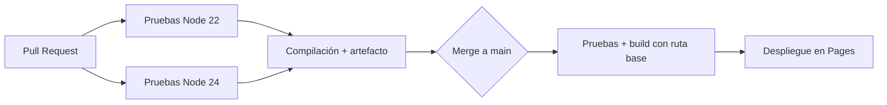

# Práctica: Integración y despliegue continuos con GitHub Actions y GitHub Pages

**Curso de especialización · Pipeline de CI/CD sobre una aplicación web con pruebas automatizadas**

| | |
|---|---|
| **Duración** | 120 minutos (90 guiados + 30 de reto) |
| **Modalidad** | Individual |
| **Nivel** | Posterior a DAW/DAM: se presupone dominio de Git, GitHub (ramas y Pull Requests), npm y JavaScript |
| **Resultado** | Una aplicación publicada en GitHub Pages mediante un pipeline que ejecuta pruebas, compila y despliega solo si todo es correcto |

---

## Índice

1. [Objetivos](#1-objetivos)
2. [Requisitos previos](#2-requisitos-previos)
3. [Planificación](#3-planificación)
4. [Bloque 0. Fundamentos](#4-bloque-0-fundamentos-15-min)
5. [Bloque 1. Proyecto base](#5-bloque-1-proyecto-base-15-min)
6. [Bloque 2. Integración continua](#6-bloque-2-integración-continua-25-min)
7. [Bloque 3. Despliegue continuo en Pages](#7-bloque-3-despliegue-continuo-en-pages-20-min)
8. [Bloque 4. Protección de rama y flujo de Pull Request](#8-bloque-4-protección-de-rama-y-flujo-de-pull-request-10-min)
9. [Bloque 5. Diagnóstico y buenas prácticas](#9-bloque-5-diagnóstico-y-buenas-prácticas-5-min)
10. [Preguntas de comprobación](#10-preguntas-de-comprobación)
11. [Reto final](#11-reto-final-30-min)
12. [Evaluación y entrega](#12-evaluación-y-entrega)
13. [Resolución de incidencias](#13-resolución-de-incidencias)
14. [Referencias](#14-referencias)

---

## 1. Objetivos

Al finalizar la práctica serás capaz de:

- Explicar el modelo de ejecución de GitHub Actions: eventos, workflows, jobs, steps, runners y contextos.
- Diseñar un pipeline de **integración continua** con matriz de versiones, caché de dependencias y artefactos.
- Publicar una aplicación en **GitHub Pages** mediante despliegue basado en artefactos, gestionando correctamente la ruta base.
- Aplicar el principio de **mínimo privilegio** a los permisos del `GITHUB_TOKEN`.
- Proteger la rama principal para que ningún cambio llegue a producción sin superar las comprobaciones.
- Diagnosticar fallos de un pipeline a partir de sus registros.
- Reducir duplicidad con **workflows reutilizables** y automatizar el mantenimiento de dependencias.

---

## 2. Requisitos previos

| Requisito | Comprobación |
|---|---|
| Cuenta de GitHub autenticada desde tu equipo (Práctica 0) | `git push` funciona sin pedir contraseña |
| Node.js 22 o 24 (LTS) y npm | `node -v` y `npm -v` |
| Git y VS Code | `git --version` |
| Extensión **GitHub Actions** de VS Code (recomendada) | Valida la sintaxis de los workflows mientras escribes |

> **Nota:** GitHub Pages en cuentas gratuitas requiere que el repositorio sea **público**. Los minutos de ejecución en repositorios públicos no tienen coste.

---

## 3. Planificación

| Bloque | Contenido | Tiempo |
|:---:|---|:---:|
| 0 | Fundamentos de CI/CD, Actions y Pages | 15 min |
| 1 | Proyecto base con pruebas | 15 min |
| 2 | Integración continua (matriz, caché, artefactos) | 25 min |
| 3 | Despliegue continuo en Pages | 20 min |
| 4 | Protección de rama y flujo de PR | 10 min |
| 5 | Diagnóstico y buenas prácticas | 5 min |
| 6 | **Reto final** | 30 min |

---

## 4. Bloque 0. Fundamentos (15 min)

### 4.1 CI, entrega continua y despliegue continuo

| Término | Qué automatiza | Ejemplo en esta práctica |
|---|---|---|
| **Integración continua (CI)** | Verificar cada cambio: instalar, probar y compilar | Pruebas y build en cada Pull Request |
| **Entrega continua (CD)** | Dejar siempre un artefacto desplegable | Artefacto `dist` generado y validado |
| **Despliegue continuo** | Publicar automáticamente en producción | Publicación en Pages tras cada merge a `main` |

### 4.2 Arquitectura de GitHub Actions

| Concepto | Descripción |
|---|---|
| **Workflow** | Archivo YAML en `.github/workflows/` que define un proceso automatizado |
| **Evento** | Lo que lo dispara: `push`, `pull_request`, `workflow_dispatch`, `schedule`, `workflow_call`… |
| **Job** | Conjunto de steps que se ejecutan en un mismo runner |
| **Step** | Unidad mínima: un comando (`run`) o una action (`uses`) |
| **Runner** | Máquina virtual efímera donde corre un job (`ubuntu-latest`) |
| **Action** | Componente reutilizable (`actions/checkout`) |
| **Artefacto** | Archivos que un job guarda para otro job o para descarga |

### 4.3 Modelo de ejecución: lo que conviene tener claro

- Cada **job se ejecuta en un runner nuevo y limpio**. Dos jobs **no comparten sistema de archivos**. Para pasar ficheros entre ellos se usan **artefactos**; para pasar valores pequeños, **outputs**.
- Los jobs corren **en paralelo** salvo que declares dependencias con `needs`.
- Los steps de un mismo job son **secuenciales** y comparten sistema de archivos y variables de entorno.
- La **caché** acelera instalaciones repetidas (clave basada en el hash del lockfile); **no** sirve para transferir resultados entre jobs.

### 4.4 Contextos y expresiones

Las expresiones `${{ ... }}` se evalúan **antes** de ejecutar el step y dan acceso a contextos:

| Contexto | Ejemplo | Uso típico |
|---|---|---|
| `github` | `${{ github.sha }}`, `${{ github.ref_name }}` | Datos del evento y del repositorio |
| `env` | `${{ env.NODE_ENV }}` | Variables de entorno definidas en el workflow |
| `vars` / `secrets` | `${{ vars.NOMBRE }}`, `${{ secrets.TOKEN }}` | Configuración y credenciales del repositorio |
| `matrix` | `${{ matrix.node }}` | Valor de la combinación actual |
| `needs` / `steps` | `${{ steps.deployment.outputs.page_url }}` | Resultados de otros jobs o steps |

### 4.5 El `GITHUB_TOKEN` y el mínimo privilegio

Cada ejecución recibe un token temporal. Sus permisos se declaran con `permissions`; todo lo no declarado se deniega al declarar al menos uno. **Regla:** empieza con `contents: read` y añade permisos solo en el job que los necesita.

### 4.6 Modelo de despliegue de GitHub Pages

Pages sirve **contenido estático**. Con el origen **GitHub Actions**:

1. Un job construye el sitio y lo sube como **artefacto de Pages**.
2. Otro job ejecuta `actions/deploy-pages`, que publica el artefacto autenticándose mediante **OIDC** (`id-token: write`).
3. El despliegue queda registrado en el **environment** `github-pages`, con su URL e histórico.

Sustituye al método antiguo de la rama `gh-pages`, que ensuciaba el historial con código generado.

> Consulta siempre los límites vigentes del servicio (tamaño del sitio, ancho de banda) en la documentación oficial.

### 4.7 Pipeline objetivo



---

## 5. Bloque 1. Proyecto base (15 min)

Trabajarás con una pequeña aplicación de **estadísticas de notas** (media, mediana y porcentaje de aprobados) con lógica separada de la interfaz para poder probarla. Se compila con **Vite**.

### 5.1 Crear el repositorio

1. En GitHub: **New repository** → nombre `pipeline-lab` → **Public** → marca *Add a README file* → **Create repository**.
2. Clónalo y ábrelo:

```bash
git clone https://github.com/USUARIO/pipeline-lab.git
cd pipeline-lab
code .
```

### 5.2 Estructura

```
pipeline-lab/
├── .github/
│   └── workflows/          (se rellenará en los bloques 2 y 3)
├── src/
│   ├── estadisticas.js
│   ├── main.js
│   └── style.css
├── test/
│   └── estadisticas.test.js
├── .gitignore
├── index.html
├── package.json
└── vite.config.js
```

### 5.3 Archivos del proyecto

**`package.json`**

```json
{
  "name": "pipeline-lab",
  "private": true,
  "version": "1.0.0",
  "type": "module",
  "scripts": {
    "dev": "vite",
    "build": "vite build",
    "preview": "vite preview",
    "test": "node --test"
  }
}
```

**`vite.config.js`**: la ruta base se parametriza para poder publicar en un subdirectorio.

```js
import { defineConfig } from 'vite';

export default defineConfig({
  base: process.env.BASE_PATH ?? '/',
});
```

**`.gitignore`**

```gitignore
node_modules/
dist/
.env
```

**`src/estadisticas.js`**

```js
function exigirDatos(valores) {
  if (valores.length === 0) {
    throw new RangeError('La lista no puede estar vacía');
  }
}

export function media(valores) {
  exigirDatos(valores);
  return valores.reduce((acc, v) => acc + v, 0) / valores.length;
}

export function mediana(valores) {
  exigirDatos(valores);
  const orden = [...valores].sort((a, b) => a - b);
  const mitad = Math.floor(orden.length / 2);
  return orden.length % 2 === 0
    ? (orden[mitad - 1] + orden[mitad]) / 2
    : orden[mitad];
}

export function porcentajeAprobados(valores, aprobado = 5) {
  exigirDatos(valores);
  return (valores.filter((v) => v >= aprobado).length / valores.length) * 100;
}

export function parsear(texto) {
  return texto
    .split(/[,;\s]+/)
    .filter(Boolean)
    .map(Number)
    .filter(Number.isFinite);
}
```

**`test/estadisticas.test.js`**: usa el ejecutor de pruebas integrado de Node, sin dependencias adicionales.

```js
import { test } from 'node:test';
import assert from 'node:assert/strict';
import {
  media,
  mediana,
  porcentajeAprobados,
  parsear,
} from '../src/estadisticas.js';

test('media de una lista', () => {
  assert.equal(media([4, 6, 8]), 6);
});

test('mediana con cantidad impar de datos', () => {
  assert.equal(mediana([9, 1, 5]), 5);
});

test('mediana con cantidad par de datos', () => {
  assert.equal(mediana([1, 2, 3, 4]), 2.5);
});

test('porcentaje de aprobados', () => {
  assert.equal(porcentajeAprobados([3, 5, 7, 9]), 75);
});

test('una lista vacía lanza RangeError', () => {
  assert.throws(() => media([]), RangeError);
});

test('parsear descarta valores no numéricos', () => {
  assert.deepEqual(parsear('5, 7;abc 9'), [5, 7, 9]);
});
```

**`index.html`**

```html
<!doctype html>
<html lang="es">
  <head>
    <meta charset="UTF-8" />
    <meta name="viewport" content="width=device-width, initial-scale=1.0" />
    <title>Pipeline Lab · Estadísticas de notas</title>
  </head>
  <body>
    <main>
      <h1>Estadísticas de notas</h1>
      <p>Introduce las notas separadas por comas.</p>
      <form id="formulario">
        <input id="notas" value="4, 6.5, 7, 9, 3" aria-label="Notas" />
        <button type="submit">Calcular</button>
      </form>
      <dl id="resultado"></dl>
      <footer>
        Versión <code id="version"></code> · compilada
        <code id="compilacion"></code>
      </footer>
    </main>
    <script type="module" src="/src/main.js"></script>
  </body>
</html>
```

**`src/main.js`**

```js
import './style.css';
import {
  media,
  mediana,
  porcentajeAprobados,
  parsear,
} from './estadisticas.js';

const entrada = document.getElementById('notas');
const salida = document.getElementById('resultado');

function fila(etiqueta, valor) {
  const dt = document.createElement('dt');
  dt.textContent = etiqueta;
  const dd = document.createElement('dd');
  dd.textContent = valor;
  salida.append(dt, dd);
}

function calcular() {
  const notas = parsear(entrada.value);
  salida.replaceChildren();
  if (notas.length === 0) {
    fila('Error', 'Introduce al menos una nota válida.');
    return;
  }
  fila('Notas válidas', notas.length);
  fila('Media', media(notas).toFixed(2));
  fila('Mediana', mediana(notas).toFixed(2));
  fila('Aprobados', `${porcentajeAprobados(notas).toFixed(0)} %`);
}

document.getElementById('formulario').addEventListener('submit', (e) => {
  e.preventDefault();
  calcular();
});

// Metadatos inyectados en tiempo de compilación por el pipeline
document.getElementById('version').textContent =
  import.meta.env.VITE_COMMIT_SHA?.slice(0, 7) ?? 'local';
document.getElementById('compilacion').textContent =
  import.meta.env.VITE_BUILD_DATE ?? 'desarrollo';

calcular();
```

**`src/style.css`**

```css
:root { color-scheme: light dark; --acento: #2563eb; }
* { box-sizing: border-box; }
body {
  margin: 0;
  font-family: system-ui, sans-serif;
  line-height: 1.5;
  background: Canvas;
  color: CanvasText;
}
main { max-width: 560px; margin: 4rem auto; padding: 0 1.25rem; }
form { display: flex; gap: .5rem; margin: 1rem 0; }
input {
  flex: 1; padding: .5rem .75rem; font: inherit;
  border: 1px solid #8886; border-radius: 6px;
  background: Field; color: FieldText;
}
button {
  padding: .5rem 1rem; border: 0; border-radius: 6px;
  background: var(--acento); color: #fff; font: inherit; cursor: pointer;
}
dl { display: grid; grid-template-columns: max-content 1fr; gap: .25rem 1rem; }
dt { font-weight: 600; }
dd { margin: 0; }
footer { margin-top: 2.5rem; font-size: .85rem; opacity: .7; }
```

### 5.4 Instalar, verificar en local y subir

```bash
npm install --save-dev vite
npm test
npm run build
npm run dev
```

Comprueba:

- `npm test` muestra **6 pruebas superadas**.
- `npm run build` genera la carpeta `dist/`.
- `npm run dev` sirve la aplicación en el puerto que indique la terminal y calcula correctamente.

> **Importante:** `npm install` ha creado `package-lock.json`. **Debe versionarse**: el pipeline usará `npm ci`, que instala exactamente lo que dice el lockfile.

Sube el proyecto a `main` (aún no hay reglas de protección):

```bash
git add .
git commit -m "feat: proyecto base con estadísticas de notas y pruebas"
git push origin main
```

---

## 6. Bloque 2. Integración continua (25 min)

A partir de ahora **todo cambio se hará mediante rama y Pull Request**.

### 6.1 Crear la rama

```bash
git switch -c ci/pipeline-pruebas
```

### 6.2 Crear `.github/workflows/ci.yml`

```yaml
name: CI

on:
  pull_request:
    branches: [main]
  workflow_dispatch:

permissions:
  contents: read

concurrency:
  group: ci-${{ github.ref }}
  cancel-in-progress: true

jobs:
  test:
    name: Pruebas (Node ${{ matrix.node }})
    runs-on: ubuntu-latest
    timeout-minutes: 10
    strategy:
      fail-fast: false
      matrix:
        node: [22, 24]
    steps:
      - name: Descargar el código
        uses: actions/checkout@v7

      - name: Preparar Node.js ${{ matrix.node }}
        uses: actions/setup-node@v7
        with:
          node-version: ${{ matrix.node }}
          cache: npm

      - name: Instalar dependencias
        run: npm ci

      - name: Ejecutar pruebas
        run: npm test

  build:
    name: Compilación
    needs: test
    runs-on: ubuntu-latest
    timeout-minutes: 10
    steps:
      - name: Descargar el código
        uses: actions/checkout@v7

      - name: Preparar Node.js
        uses: actions/setup-node@v7
        with:
          node-version: 24
          cache: npm

      - name: Instalar dependencias
        run: npm ci

      - name: Compilar
        run: npm run build

      - name: Guardar el resultado como artefacto
        uses: actions/upload-artifact@v7
        with:
          name: dist
          path: dist
          retention-days: 7
```

### 6.3 Decisiones de diseño

| Elemento | Justificación |
|---|---|
| `on: pull_request` | Valida los cambios **antes** de integrarlos. No se usa `push` para evitar ejecuciones duplicadas cuando la rama ya tiene PR |
| `workflow_dispatch` | Permite lanzarlo manualmente para depurar |
| `permissions: contents: read` | Mínimo privilegio: este pipeline solo lee el repositorio |
| `concurrency` + `cancel-in-progress` | Cancela ejecuciones obsoletas de la misma rama cuando llega un commit nuevo |
| `timeout-minutes` | Evita que un job colgado consuma minutos hasta el límite por defecto (6 horas) |
| `matrix` | Prueba el código en varias versiones de Node en paralelo |
| `fail-fast: false` | Si falla una combinación, las demás terminan y ves el panorama completo |
| `npm ci` | Instalación **reproducible** desde el lockfile; falla si `package.json` y el lockfile no coinciden. `npm install` puede modificar el lockfile |
| `cache: npm` | Cachea `~/.npm` con clave basada en el hash de `package-lock.json` |
| `needs: test` | La compilación solo se ejecuta si **todas** las combinaciones de pruebas pasan |
| `upload-artifact` | Conserva el `dist` generado para inspección o reutilización |
| `name:` del job con `${{ matrix.node }}` | Genera nombres de check predecibles (`Pruebas (Node 22)`), que usaremos en la protección de rama |

### 6.4 Publicar la rama y abrir el Pull Request

```bash
git add .
git commit -m "ci: añade pipeline de pruebas y compilación"
git push -u origin ci/pipeline-pruebas
```

En GitHub: **Compare & pull request** → crea el PR hacia `main`.

### 6.5 Observar la ejecución

1. En el PR, sección **Checks**, o en la pestaña **Actions**.
2. Abre la ejecución y observa el **grafo**: `Pruebas (Node 22)` y `Pruebas (Node 24)` en paralelo → `Compilación`.
3. Abre un job y lee el registro de cada step.
4. Cuando termine, en el resumen de la ejecución verás el artefacto **dist**.

### 6.6 Ejercicios

**Ejercicio 2.1. Verificar la caché.**
Añade un cambio trivial al `README.md`, haz commit y push a la misma rama. En el job `Pruebas`, abre el step *Preparar Node.js* y localiza el mensaje de caché restaurada (*Cache restored from key…*). Anota la clave: ¿de qué depende?

**Ejercicio 2.2. Inspeccionar el artefacto.**
Descarga `dist` desde el resumen de la ejecución, descomprímelo y abre `index.html`. ¿Con qué prefijo aparecen las rutas de los recursos (`/assets/...`)? Guarda la respuesta: la necesitarás en el bloque 3.

### 6.7 Integrar

Cuando el PR esté en verde, **Merge pull request** y actualiza tu copia local:

```bash
git switch main
git pull
```

---

## 7. Bloque 3. Despliegue continuo en Pages (20 min)

### 7.1 Activar Pages con origen Actions

**Settings → Pages → Build and deployment → Source → GitHub Actions.**

### 7.2 Crear la rama y el workflow

```bash
git switch -c cd/despliegue-pages
```

Crea `.github/workflows/pages.yml`:

```yaml
name: Desplegar en Pages

on:
  push:
    branches: [main]
  workflow_dispatch:

permissions:
  contents: read

concurrency:
  group: pages
  cancel-in-progress: false

jobs:
  build:
    name: Pruebas y compilación
    runs-on: ubuntu-latest
    timeout-minutes: 10
    steps:
      - name: Descargar el código
        uses: actions/checkout@v7

      - name: Preparar Node.js
        uses: actions/setup-node@v7
        with:
          node-version: 24
          cache: npm

      - name: Instalar dependencias
        run: npm ci

      - name: Ejecutar pruebas
        run: npm test

      - name: Calcular metadatos de compilación
        run: echo "VITE_BUILD_DATE=$(date -u +%Y-%m-%dT%H:%MZ)" >> "$GITHUB_ENV"

      - name: Compilar con la ruta base del repositorio
        run: npm run build
        env:
          BASE_PATH: /${{ github.event.repository.name }}/
          VITE_COMMIT_SHA: ${{ github.sha }}

      - name: Subir el sitio como artefacto de Pages
        uses: actions/upload-pages-artifact@v5
        with:
          path: dist

  deploy:
    name: Despliegue
    needs: build
    runs-on: ubuntu-latest
    permissions:
      contents: read
      pages: write
      id-token: write
    environment:
      name: github-pages
      url: ${{ steps.deployment.outputs.page_url }}
    steps:
      - name: Publicar en GitHub Pages
        id: deployment
        uses: actions/deploy-pages@v5
```

### 7.3 Puntos clave

| Elemento | Explicación |
|---|---|
| `on: push` a `main` | Cada integración en `main` provoca un despliegue. `workflow_dispatch` permite redesplegar manualmente |
| **Pruebas dentro de `build`** | Actúan como **puerta de calidad**: si fallan, no hay artefacto y el job `deploy` no se ejecuta |
| `BASE_PATH` | Un repositorio de proyecto se sirve en `https://usuario.github.io/<repo>/`, no en la raíz. Sin ruta base, los recursos se buscarían en `/assets/...` y darían 404 (ejercicio 2.2) |
| `$GITHUB_ENV` | Archivo especial para exportar variables a los steps siguientes del **mismo job** |
| `VITE_*` | Vite incorpora al código cliente las variables con este prefijo. **Nunca** pongas secretos en ellas: acaban en el bundle público |
| `permissions` por job | `build` solo lee; `deploy` recibe además `pages: write` e `id-token: write` (publicación y OIDC) |
| `environment: github-pages` | Registra el despliegue y expone la URL como salida del job |
| `concurrency` con `cancel-in-progress: false` | Los despliegues se encolan en lugar de cancelarse a medias |
| Sin `configure-pages` | En este caso la ruta base se calcula a mano. Esa action es opcional y se usa cuando se necesita obtener la configuración de Pages |

> **Caso particular:** si el repositorio se llama `USUARIO.github.io`, o si usas un dominio propio, el sitio se sirve en la raíz y `BASE_PATH` debe ser `/`.

### 7.4 Publicar mediante Pull Request

```bash
git add .
git commit -m "ci: añade despliegue en GitHub Pages"
git push -u origin cd/despliegue-pages
```

1. Abre el PR hacia `main`. Verás que **se ejecuta CI** pero **no** el despliegue (solo se dispara con `push` a `main`).
2. Con el PR en verde, haz **merge**.
3. El merge genera un `push` a `main`: ve a **Actions** y observa `Desplegar en Pages`.

### 7.5 Verificación

1. Abre el job `Despliegue`: aparece la **URL** del sitio. También está en **Settings → Pages**.
2. Accede a `https://USUARIO.github.io/pipeline-lab/` y comprueba que la aplicación funciona.
3. Verifica la trazabilidad: el commit mostrado en el pie debe coincidir con el último commit de `main`:

```bash
git switch main
git pull
git rev-parse --short=7 HEAD
```

4. Revisa **Settings → Environments → github-pages**: encontrarás el histórico de despliegues y la política de ramas permitidas.

### 7.6 Ejercicio

**Ejercicio 3.1. Despliegue controlado.**
Crea una rama `feat/notas-minimas`, modifica la interfaz (por ejemplo, el título), abre un PR y fusiónalo. Comprueba que el pie de página de la web muestra el **nuevo commit** y una **nueva fecha de compilación**.

---

## 8. Bloque 4. Protección de rama y flujo de Pull Request (10 min)

Un pipeline que se puede saltar no garantiza nada. Configura una regla para que `main` solo reciba cambios verificados.

### 8.1 Crear el ruleset

**Settings → Rules → Rulesets → New ruleset → New branch ruleset**

| Campo | Valor |
|---|---|
| Ruleset name | `proteger-main` |
| Enforcement status | **Active** |
| Target branches | **Add target → Include default branch** |
| Rules | ✔ **Require a pull request before merging** (0 aprobaciones, si trabajas solo) |
| | ✔ **Require status checks to pass** → añade `Pruebas (Node 22)` y `Pruebas (Node 24)` |
| | ✔ **Block force pushes** (viene activa por defecto) |

> Los checks aparecen en el buscador **una vez han sido ejecutados** al menos una vez, y el nombre debe coincidir exactamente con el del job.

> **Matiz importante:** un job omitido por una condición (`if`) se notifica como superado. Por eso se exigen los jobs que **ejecutan** las pruebas y no solo el último de la cadena.

### 8.2 Comprobar que la protección funciona

Intenta `git push origin main` directamente: debe ser **rechazado**.

### 8.3 Ejercicio 4.1. Romper el build a propósito

```bash
git switch -c fix/prueba-rota
```

En `test/estadisticas.test.js` cambia el valor esperado de la media de `6` a `7`.

```bash
git add .
git commit -m "test: provoca un fallo para verificar la protección"
git push -u origin fix/prueba-rota
```

Abre el PR y observa:

1. Los dos jobs de pruebas fallan (✗) y `Compilación` aparece **omitido**.
2. El botón de merge está **bloqueado**.
3. En el registro del job ves el assert fallido con el valor esperado y el recibido.

Corrige la prueba, haz push y espera al verde. Después **cierra el PR sin fusionar** (era un experimento) o fusiona el arreglo. **Guarda una captura del PR bloqueado**: forma parte de la entrega.

---

## 9. Bloque 5. Diagnóstico y buenas prácticas (5 min)

### 9.1 Herramientas de diagnóstico

- **Registros por step**: los pasos que fallan se expanden automáticamente.
- **Re-run jobs → Enable debug logging**: vuelve a ejecutar con trazas detalladas.
- **Resumen del job**: escribe Markdown en `$GITHUB_STEP_SUMMARY` para que aparezca en la ejecución.
- **Artefactos**: sube informes o salidas para analizarlos después.

Ejemplo de step de resumen (puedes añadirlo al job `build` de `pages.yml`):

```yaml
      - name: Resumen de compilación
        run: |
          {
            echo "### Compilación"
            echo "- Commit: \`${GITHUB_SHA::7}\`"
            echo "- Ruta base: \`/${{ github.event.repository.name }}/\`"
          } >> "$GITHUB_STEP_SUMMARY"
```

### 9.2 Buenas prácticas

| Práctica | Motivo |
|---|---|
| `permissions` explícitos y mínimos | Un workflow comprometido solo podrá hacer lo declarado |
| Actions de terceros **fijadas por SHA de commit** | Una etiqueta como `@v1` puede moverse; el SHA no |
| Mantener las actions al día con **Dependabot** | Recibes PR automáticos con las nuevas versiones |
| `timeout-minutes` y `concurrency` | Controlan el consumo y evitan carreras |
| No volcar secretos en los registros | Los secretos se enmascaran, pero valores derivados pueden filtrarse |
| Fijar el runner (`ubuntu-24.04`) si necesitas reproducibilidad | `ubuntu-latest` cambia de versión con el tiempo |
| Validar el YAML antes de subirlo | Extensión de VS Code, o herramientas como `actionlint` |

### 9.3 Inyección de comandos mediante expresiones

Las expresiones se **sustituyen antes de ejecutar** el script, de modo que un dato controlado por un atacante puede convertirse en código.

```yaml
# ✗ Vulnerable: el título del PR se inserta tal cual en el script
- run: echo "Título: ${{ github.event.pull_request.title }}"

# ✓ Seguro: el valor pasa como variable de entorno, no como código
- run: echo "Título: $TITULO"
  env:
    TITULO: ${{ github.event.pull_request.title }}
```

---

## 10. Preguntas de comprobación

Responde por escrito antes de abrir las soluciones.

1. ¿Por qué se usa `npm ci` en lugar de `npm install` en un pipeline?
2. El job `deploy` necesita los archivos que generó `build`. ¿Por qué no los encuentra directamente y qué mecanismo se emplea?
3. ¿Qué diferencia hay entre **caché** y **artefacto**?
4. ¿Para qué necesita el job `deploy` los permisos `pages: write` e `id-token: write`?
5. ¿Por qué sin `BASE_PATH` la aplicación se vería sin estilos ni scripts en Pages?
6. ¿Qué riesgo introduce usar `${{ github.event.pull_request.title }}` directamente dentro de un `run`?

<details>
<summary>Ver soluciones</summary>

1. `npm ci` instala **exactamente** lo que indica `package-lock.json`, parte de una instalación limpia y falla si el lockfile y `package.json` no coinciden. Garantiza compilaciones reproducibles; `npm install` puede alterar el lockfile.
2. Cada job se ejecuta en un runner distinto y limpio. Se usa un **artefacto** (`upload-pages-artifact` en `build`, consumido por `deploy-pages` en `deploy`).
3. La **caché** reutiliza dependencias entre ejecuciones para ganar velocidad (clave según el lockfile). El **artefacto** conserva el resultado de una ejecución concreta y permite pasarlo a otros jobs o descargarlo.
4. `pages: write` permite publicar el sitio y `id-token: write` permite obtener el token OIDC con el que se acredita el despliegue ante Pages.
5. Un proyecto se sirve en `/<repo>/`. Sin ruta base, el HTML referencia `/assets/...`, que apunta a la raíz del dominio, donde esos archivos no existen (404).
6. La expresión se sustituye antes de ejecutar el script: un título con comillas y comandos se ejecutaría como código (inyección). Debe pasarse mediante `env`.

</details>

---

## 11. Reto final (30 min)

**Objetivo:** endurecer y profesionalizar el pipeline que has construido. Cada requisito debe estar resuelto **mediante Pull Request** y con la protección de rama activa.

> Prioriza: los requisitos **R1 a R3** son el núcleo. **R4** y **R5** completan la entrega y puntúan igualmente; si no llegas en clase, termínalos después.

### R1. Análisis estático en paralelo

Añade un job `lint` en `ci.yml` que ejecute **ESLint** (u otra herramienta equivalente justificada) **en paralelo** con las pruebas.

- Crea el script `npm run lint` y la configuración necesaria.
- **Evidencia:** en el grafo de la ejecución, `lint` y `Pruebas` aparecen en paralelo. Provoca un error de lint deliberado y comprueba que el PR falla.

<details>
<summary>Pista: configuración mínima de ESLint (formato flat)</summary>

```bash
npm install --save-dev eslint @eslint/js globals
```

```js
// eslint.config.js
import js from '@eslint/js';
import globals from 'globals';

export default [
  js.configs.recommended,
  { files: ['src/**/*.js'], languageOptions: { globals: globals.browser } },
  { files: ['test/**/*.js'], languageOptions: { globals: globals.node } },
  { ignores: ['dist/'] },
];
```

Y en `package.json`: `"lint": "eslint ."`.

</details>

### R2. Workflow reutilizable

Actualmente `ci.yml` y `pages.yml` repiten los mismos steps de pruebas. Elimina la duplicidad:

- Crea `.github/workflows/tests.yml` con el trigger `workflow_call` que contenga la matriz de pruebas.
- Llámalo desde `ci.yml` y desde `pages.yml` con `uses: ./.github/workflows/tests.yml`.
- En `pages.yml`, el job de compilación debe depender del job reutilizable con `needs`.
- **Evidencia:** ningún otro workflow contiene los steps de pruebas.

<details>
<summary>Pista: esqueleto</summary>

```yaml
# tests.yml
on:
  workflow_call:

# ci.yml / pages.yml
jobs:
  tests:
    uses: ./.github/workflows/tests.yml
```

</details>

> **Atención:** al llamar a un workflow reutilizable, el **nombre del check cambia** (aparece como `tests / Pruebas (Node 22)`). Actualiza los checks requeridos en el ruleset o el merge quedará esperando un estado que ya no se reporta.

### R3. Mínimo privilegio y mantenimiento automático

- Revisa **todos** los workflows: cada job debe declarar solo los permisos que necesita.
- Añade `.github/dependabot.yml` para actualizar **npm** y **github-actions** con periodicidad semanal.
- **Evidencia:** el archivo existe y, en **Insights → Dependency graph → Dependabot**, aparecen ambos ecosistemas.

<details>
<summary>Pista: estructura de dependabot.yml</summary>

```yaml
version: 2
updates:
  - package-ecosystem: npm
    directory: /
    schedule:
      interval: weekly
  - package-ecosystem: github-actions
    directory: /
    schedule:
      interval: weekly
```

</details>

### R4. Publicación de versiones por etiqueta

Crea `release.yml`, que al subir una etiqueta con formato `vX.Y.Z`:

1. Ejecute las pruebas y compile.
2. Comprima `dist` en un `.zip`.
3. Cree una **Release** de GitHub con el `.zip` adjunto y notas generadas automáticamente.

Requisitos: el job de publicación solo debe tener `contents: write` y se debe usar `GITHUB_TOKEN` (no un token personal).

- **Evidencia:** una release `v1.0.0` visible en el repositorio con el archivo adjunto.

<details>
<summary>Pista: piezas necesarias</summary>

```yaml
on:
  push:
    tags: ['v*.*.*']

# ... en el job de publicación:
permissions:
  contents: write
steps:
  # checkout, setup-node, npm ci, npm test, npm run build
  - run: zip -r dist.zip dist
  - run: gh release create "$GITHUB_REF_NAME" dist.zip --generate-notes
    env:
      GH_TOKEN: ${{ secrets.GITHUB_TOKEN }}
```

Para crear la etiqueta: `git tag v1.0.0 && git push origin v1.0.0`.

</details>

### R5. Documentación del pipeline

Crea `docs/PIPELINE.md` con:

- Un **diagrama Mermaid** del pipeline final (puedes partir del apartado 4.7).
- Una **tabla de workflows**: nombre, evento que lo dispara, jobs y propósito.
- Un apartado **«Incidencias provocadas»** con al menos un fallo real que hayas generado (qué cambiaste, qué job falló, cómo lo diagnosticaste y cómo lo corregiste).

Enlaza el documento y el **badge de estado** del workflow `CI` desde el `README.md`:

```markdown

```

### Bonus

- Usa `vars` para parametrizar el título de la aplicación desde **Settings → Secrets and variables → Actions → Variables**.
- Configura un **environment** con revisores requeridos para aprobar manualmente el despliegue.
- Añade un `CODEOWNERS` que exija tu revisión sobre `.github/workflows/`.
- Fija las actions de terceros por SHA y documenta cómo lo has verificado.
- Reduce el tiempo total del pipeline y justifica con datos (duración antes y después) qué optimización aplicaste.

---

## 12. Evaluación y entrega

### 12.1 Autoevaluación

Marca cada punto solo si puedes **demostrarlo** con una ejecución, un PR o un archivo concreto.

- [ ] La aplicación está publicada y su pie muestra el SHA y la fecha del último despliegue.
- [ ] `main` está protegida: no se puede hacer push directo y los checks de pruebas son obligatorios.
- [ ] Existe al menos un PR **bloqueado por tests en rojo** y otro posterior en verde.
- [ ] `lint` y las pruebas se ejecutan en paralelo (R1).
- [ ] Las pruebas están en un único workflow reutilizable (R2).
- [ ] Todos los jobs declaran permisos mínimos y existe `dependabot.yml` (R3).
- [ ] Existe una Release con el `.zip` generado por el pipeline (R4).
- [ ] `docs/PIPELINE.md` incluye diagrama, tabla e incidencia documentada (R5).
- [ ] Los commits siguen una convención (`feat:`, `ci:`, `fix:`, `docs:`, `test:`, `chore:`).

### 12.2 Rúbrica

| Criterio | Puntos |
|---|:---:|
| Sitio desplegado con ruta base correcta y trazabilidad (SHA y fecha) | 1 |
| Protección de rama activa y demostrada (captura del PR bloqueado) | 1 |
| R1. Job de lint en paralelo, con fallo comprobado | 1,5 |
| R2. Workflow reutilizable sin duplicidad, con ruleset actualizado | 2 |
| R3. Permisos mínimos por job y Dependabot configurado | 1,5 |
| R4. Release automática por etiqueta con artefacto adjunto | 1 |
| R5. Documentación del pipeline con incidencia analizada | 1 |
| Historial limpio: PR por cada cambio y commits con convención | 1 |
| **Total** | **10** |

### 12.3 Entregables

1. URL del **repositorio**.
2. URL del **sitio publicado**.
3. Enlaces a los **Pull Requests** fusionados (mínimo cuatro) y al PR bloqueado.
4. Captura del PR con los checks en rojo y el merge bloqueado.
5. Archivo `docs/PIPELINE.md` dentro del repositorio.

---

## 13. Resolución de incidencias

| Síntoma | Causa probable | Solución |
|---|---|---|
| El workflow no aparece o no se ejecuta | Ruta o extensión incorrectas, o filtro de eventos que no coincide | Debe estar en `.github/workflows/*.yml`. Comprueba `on:` y la rama |
| `Invalid workflow file` | Error de sintaxis YAML | Usa solo espacios, revisa la línea indicada y valida con la extensión de VS Code |
| `npm ci` falla por lockfile ausente o desincronizado | `package-lock.json` no versionado o no actualizado | Ejecuta `npm install` en local y haz commit del lockfile |
| `Dependencies lock file is not found` en `setup-node` | `cache: npm` sin lockfile en el repositorio | Versiona `package-lock.json` |
| `node --test` no encuentra pruebas | Nombre o ubicación de los archivos | Usa `*.test.js` o la carpeta `test/` |
| La web carga sin estilos o con errores 404 | `BASE_PATH` ausente o incorrecto | Debe ser `/<nombre-del-repo>/` (con barras inicial y final) |
| `deploy-pages` indica que Pages no está habilitado | Origen mal configurado | **Settings → Pages → Source → GitHub Actions** |
| `Resource not accessible by integration` | Falta un permiso en el job | Añade el permiso necesario en el bloque `permissions` de **ese job** |
| El despliegue queda bloqueado por el environment | La rama no está permitida en el environment | Revisa **Settings → Environments → github-pages → Deployment branches** |
| Check requerido en estado «Expected — Waiting for status» | Nombre del check distinto o workflow que no llegó a ejecutarse | Compara el nombre exacto del job; tras usar workflows reutilizables, actualízalo |
| `403` al crear la Release | El job no tiene `contents: write` | Declara el permiso en el job de publicación |
| Pages no está disponible | Repositorio privado en plan gratuito | Hazlo público |
| La caché no se restaura | Primera ejecución o lockfile modificado | Es el comportamiento esperado: se genera una caché nueva |

---

## 14. Referencias

- Documentación de GitHub Actions: https://docs.github.com/es/actions
- Sintaxis de workflows: https://docs.github.com/es/actions/reference/workflows-and-actions/workflow-syntax
- Despliegue en GitHub Pages con Actions: https://docs.github.com/es/pages
- Seguridad en Actions: https://docs.github.com/es/actions/security-for-github-actions
- Rulesets: https://docs.github.com/es/repositories/configuring-branches-and-merges-in-your-repository/managing-rulesets
- Vite, despliegue estático: https://vite.dev/guide/static-deploy
- Ejecutor de pruebas de Node.js: https://nodejs.org/api/test.html
- Conventional Commits: https://www.conventionalcommits.org/es
